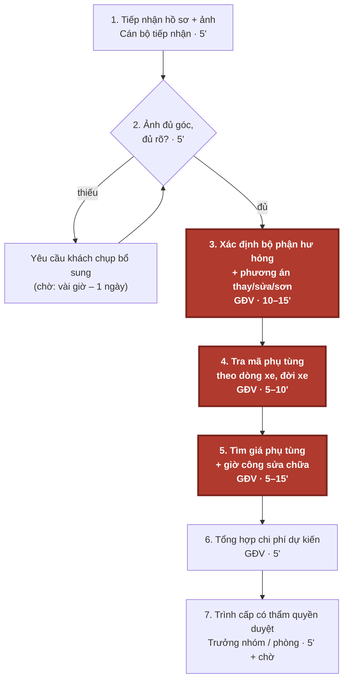
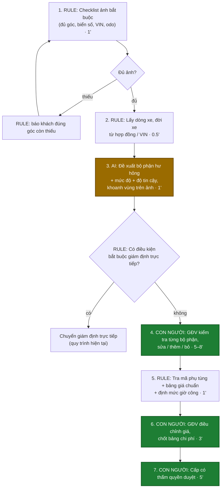

# Báo cáo nhóm — Day 02 Discovery & Problem Framing

> Bản chung của nhóm NhomCold, viết trên repo do nhóm trưởng fork.
>
> ⚠️ **Trước khi nộp:** thay mọi `[ĐO THẬT]` / `___` bằng số thật lấy từ phỏng vấn giám định viên hoặc từ hồ sơ đã xử lý (CP4). Số phút trong mục 4 hiện là ước tính ban đầu của nhóm. Xóa khối ghi chú này khi xong.

## 1. Thông tin nhóm

- Tên nhóm: NhomCold
- Thành viên: xem `TEAM.md`
- Candidate problem được chọn (1 câu): Khi tiếp nhận hồ sơ bồi thường bảo hiểm ô tô kèm ảnh xe tai nạn, giám định viên mất 20–40 phút/vụ để xác định bộ phận hư hỏng, tra phụ tùng và giá sửa chữa, và kết quả ước lượng chưa nhất quán giữa các nhân viên.
- Quyết định cuối: Go / Not Yet / No-Go

---

## 2. Hội tụ nhóm (CP3)

### 2.1. Pitch

| # | Người đưa ra | Candidate (Job Story ngắn) | Actor | Bottleneck | Câu hỏi phản biện nhận được (ai hỏi) |
|---:|---|---|---|---|---|
| 1 | | | | | |
| 2 | | | | | |
| 3 | | | | | |
| 4 | | | | | |
| 5 | | | | | |
| 6 | | | | | |
| 7 | | | | | |
| 8 | | | | | |
| 9 | | | | | |
| 10 | | | | | |
| 11 | | | | | |
| 12 | | | | | |

### 2.2. Cluster

| Cluster | Các candidate | Pattern chung |
|---|---|---|
| A | | |
| B | | |
| C | | |

### 2.3. Opportunity Solution Tree rút gọn

Gốc là **1 outcome**. Nhánh là **opportunity** (nhu cầu, pain), không phải tính năng hay công cụ.

```text
OUTCOME: 
├── Opportunity A: 
├── Opportunity B: 
└── Opportunity C: 
```

Những ý đã gạch bỏ vì là solution đội lốt opportunity:

-

### 2.4. Chấm điểm shortlist (1–5)

| Candidate | Actor rõ | Quy trình rõ | Pain có bằng chứng | Impact đo được | Vừa sức lab | So sánh được No AI/Rule/Workflow/Agent | Nhóm hiểu domain | Tổng |
|---|---:|---:|---:|---:|---:|---:|---:|---:|
| | | | | | | | | |
| | | | | | | | | |
| | | | | | | | | |

**Candidate được chọn:** Xác định hư hỏng và ước lượng chi phí sửa chữa xe (bảo hiểm ô tô).

**Vì sao chọn:**

**Vì sao loại các candidate còn lại:**

**Xử lý bất đồng (nếu có):**

---

## 3. Kiểm chứng + research giải pháp đã có (CP4)

### 3.1. Assumption Map

| # | Giả định | Loại (Value / Usability / Feasibility / Viability) | Quan trọng (1–5) | Đã có bằng chứng (1–5) | Kiểm chứng trước? |
|---:|---|---|---:|---:|---|
| 1 | | | | | |
| 2 | | | | | |
| 3 | | | | | |
| 4 | | | | | |

Giả định nhóm kiểm chứng trong buổi này:

### 3.2. Kiểm chứng

Cách đã dùng: Phỏng vấn / Survey / Log, ticket, review

Interview snapshot:

| Trường | Nội dung |
|---|---|
| Người được hỏi (vai trò, không ghi tên thật) | |
| Câu nói đáng nhớ nhất (nguyên văn) | |
| Lần gần nhất gặp vấn đề này: chuyện gì đã xảy ra? | |
| Hiện đang xử lý bằng cách nào (workaround)? | |
| Mất bao lâu, bao lần? | |
| Insight / opportunity rút ra | |

Tổng hợp:

| Nguồn | Số người / số mẫu | Tín hiệu xác nhận | Tín hiệu phản bác |
|---|---:|---|---|
| | | | |

**Nhóm đã sửa problem thế nào sau kiểm chứng:**

### 3.3. Research giải pháp đã có

| Công cụ / case / pattern | Link | Giải bước nào trong quy trình? | Điểm mạnh | Khoảng trống / rủi ro | Bài học cho nhóm |
|---|---|---|---|---|---|
| | | | | | |
| | | | | | |

---

## 4. Quy trình trước/sau (CP5)

Phạm vi: **đánh giá sơ bộ từ ảnh** cho một hồ sơ bồi thường vật chất xe ô tô, tính từ lúc nhận ảnh đến lúc trình duyệt phương án sửa chữa và chi phí dự kiến. Không gồm bước xác minh phạm vi bảo hiểm, giám định trực tiếp tại garage khi tháo dỡ, và thanh toán.

### 4.1. Quy trình hiện tại



*Ô đỏ đậm, viền dày = bottleneck (bước 3–5).*

| Bước | Actor | Input | Output | Thời gian / tần suất | Ghi chú |
|---:|---|---|---|---|---|
| 1 | Cán bộ tiếp nhận | Thông báo tổn thất, ảnh khách gửi, số hợp đồng | Hồ sơ vụ mới | 5'/vụ | 5 vụ/ngày/GĐV |
| 2 | Giám định viên (GĐV) | Bộ ảnh hiện trường/xe | Ảnh đạt yêu cầu, hoặc yêu cầu chụp bổ sung | 5'/vụ; 20% vụ phải chụp lại `[ĐO THẬT]` | Thiếu ảnh làm cả hồ sơ phải chờ |
| 3 | GĐV | Ảnh đạt yêu cầu, thông tin xe | Danh sách bộ phận hư hỏng + phương án thay/sửa/sơn | 10–15'/vụ | **Bottleneck**: phụ thuộc kinh nghiệm, mỗi GĐV đánh giá một kiểu |
| 4 | GĐV | Danh sách bộ phận, dòng xe/đời xe | Mã phụ tùng | 5–10'/vụ | Tra catalogue theo từng hãng |
| 5 | GĐV | Mã phụ tùng, phương án sửa | Đơn giá phụ tùng + giờ công | 5–15'/vụ | Hỏi báo giá garage, đối chiếu bảng giá hãng |
| 6 | GĐV | Kết quả bước 3–5 | Bảng chi phí dự kiến (Excel/biểu mẫu) | 5'/vụ | |
| 7 | Trưởng nhóm / phòng | Bảng chi phí + ảnh | Duyệt / yêu cầu chỉnh sửa | 5'/vụ + thời gian chờ | Ngưỡng phân cấp duyệt theo số tiền |

**Tổng thời gian thao tác:** khoảng 40–60 phút/vụ, trong đó bước 3–5 chiếm 20–40 phút. Chưa tính thời gian chờ khách chụp bổ sung và chờ duyệt.

**Bottleneck chính:** Bước 3–5. GĐV phải tự nhìn ảnh để xác định bộ phận hư hỏng và chọn thay hay sửa, rồi tra mã và giá thủ công qua nhiều nguồn. Ba bước này vừa tốn 20–40 phút vừa cho kết quả khác nhau giữa các GĐV với cùng một bộ ảnh.

### 4.2. Quy trình tương lai



*Vàng đậm = bước AI · Xanh lá đậm = bước con người kiểm tra / quyết định · còn lại là Rule.*

| Bước | Ai làm | Việc | Thời gian |
|---:|---|---|---|
| 1 | **Rule** | Biểu mẫu nhận ảnh bắt buộc đủ góc (4 góc chéo, cận cảnh vùng hư hỏng, biển số, VIN, đồng hồ odo); thiếu góc nào báo đúng góc đó | 1' |
| 2 | **Rule** | Lấy hãng, dòng xe, đời xe từ hợp đồng bảo hiểm / VIN | 0.5' |
| 3 | **AI** | Đề xuất danh sách bộ phận hư hỏng, mức độ (trầy / móp / vỡ), gợi ý thay hay sửa, kèm độ tin cậy và vùng khoanh trên ảnh | ~1' |
| 3b | **Rule** | Kiểm điều kiện bắt buộc giám định trực tiếp (xem Boundary) | tức thì |
| 4 | **Con người** | GĐV kiểm tra từng bộ phận AI đề xuất: xác nhận, sửa, thêm bộ phận bị sót, bỏ bộ phận sai | 5–8' |
| 5 | **Rule** | Tra mã phụ tùng và đơn giá từ bảng giá chuẩn của công ty + định mức giờ công | 1' |
| 6 | **Con người** | GĐV điều chỉnh theo báo giá garage thực tế, chốt bảng chi phí sơ bộ | 3' |
| 7 | **Con người** | Cấp có thẩm quyền duyệt theo phân cấp số tiền | 5' |

**Boundary — AI không được:**

- Quyết định mức bồi thường, chấp nhận hay từ chối bồi thường.
- Kết luận về phạm vi bảo hiểm, nguyên nhân tai nạn hay nghi vấn gian lận.
- Tự gửi kết quả hoặc báo giá cho khách hàng hay garage.
- Tự đặt giá. Giá chỉ lấy từ bảng giá chuẩn (Rule), GĐV điều chỉnh.

**Khi nào bắt buộc con người (HITL):**

- **Mọi hồ sơ:** GĐV phải xác nhận từng bộ phận ở bước 4 trước khi tính giá. Không có đường nào đi thẳng từ AI sang bảng chi phí.
- **Bắt buộc chuyển giám định trực tiếp, không dùng đề xuất AI:**
  - Có dấu hiệu hư hỏng kết cấu: khung, sườn, túi khí bung.
  - Xe bị ngập nước hoặc cháy.
  - AI báo độ tin cậy thấp (dưới ngưỡng ___, nhóm chốt ở CP6).
  - Chi phí sơ bộ vượt ___ triệu đồng.
  - Ảnh không đạt chuẩn sau 2 lần chụp lại.
- **Mọi kết quả từ ảnh chỉ là ước lượng sơ bộ.** Hư hỏng bên trong chỉ thấy được khi tháo dỡ tại garage, lúc đó GĐV giám định bổ sung như hiện nay.

**Phương án quay về khi AI sai:**

- **AI sai ở một vụ:** GĐV bỏ toàn bộ đề xuất của AI và làm bước 3 thủ công như hiện tại. Bảng giá chuẩn (bước 5) vẫn dùng được vì không phụ thuộc AI.
- **AI sai lặp lại, hoặc hệ thống lỗi:** tắt bước 3, quy trình quay về hiện tại nhưng vẫn giữ checklist ảnh (bước 1) và bảng giá chuẩn (bước 5). Hai bước Rule này đã có giá trị riêng.
- **Mỗi lần GĐV sửa đề xuất AI đều được ghi lại.** Dữ liệu này dùng để đo tỉ lệ sai và quyết định có tiếp tục dùng AI không.

### 4.3. Before / after

| Chỉ số | Trước | Sau (kỳ vọng) | Ghi chú |
|---|---:|---:|---|
| Số bước | 7 | 7 (3 Rule, 1 AI, 3 con người) | Không bớt bước kiểm tra nào; thay đổi nằm ở ai làm |
| Tổng thời gian thao tác / vụ | 40–60' | ~17–20' | Bước 3–5 từ 20–40' còn ~8–11' (AI 1' + GĐV kiểm 5–8' + Rule tra giá 1') |
| Số bước thủ công | 7/7 | 3/7 | Bước 4, 6, 7 vẫn là con người |
| Số vụ phải chụp ảnh lại | 20% | Giảm (kỳ vọng) | Nhờ checklist ảnh ở bước 1 (Rule, không cần AI) |
| Độ nhất quán giữa các GĐV | Thấp (chưa đo) | Cao hơn | Cùng xuất phát từ một đề xuất + một bảng giá chuẩn |
| Bottleneck chính | Bước 3–5: tự xác định và tra giá | Bước 4: GĐV kiểm tra đề xuất AI | Từ "tự làm" sang "kiểm tra" |
| Rủi ro mới phát sinh | — | AI bỏ sót bộ phận hư hỏng; GĐV tin AI quá mức nên kiểm qua loa; ảnh bị chỉnh sửa; bảng giá chuẩn lỗi thời | Xử lý bằng HITL bắt buộc, điều kiện chuyển giám định trực tiếp, cập nhật bảng giá định kỳ |

---

## 5. Problem Statement v0 (CP5)

| Trường | Nội dung |
|---|---|
| **Actor** | Giám định viên tổn thất xe ô tô tại công ty bảo hiểm phi nhân thọ, xử lý 20 hồ sơ/ngày . Người duyệt: trưởng nhóm / trưởng phòng bồi thường. |
| **Quy trình** | Tiếp nhận ảnh xe tai nạn → kiểm tra đủ ảnh → xác định bộ phận hư hỏng và phương án thay/sửa/sơn → tra mã phụ tùng → tìm giá phụ tùng và giờ công → tổng hợp chi phí dự kiến → trình duyệt |
| **Bottleneck** | Bước 3–5: GĐV tự nhìn ảnh để xác định hư hỏng, rồi tra mã và giá thủ công qua nhiều nguồn. Mất 20–40 phút/vụ, kết quả phụ thuộc kinh nghiệm từng người. |
| **Impact** | 20–40 phút/vụ × 15 vụ/ngày/GĐV = 6 giờ/ngày . Khách chờ lâu mới có phương án sửa chữa. Cùng một bộ ảnh nhưng các GĐV cho ra danh sách hư hỏng và chi phí khác nhau, dẫn tới khiếu nại và phải duyệt lại. |
| **Success Metric** (baseline → target, cách đo) | **(1) Thời gian bước 3–5:** 20–40' → ≤ 12'/vụ. *Cách đo:* bấm giờ trên ≥ 30 hồ sơ trước và trong pilot.<br>**(2) Độ khớp danh sách bộ phận hư hỏng** so với biên bản giám định cuối cùng (sau tháo dỡ): baseline ___% → không thấp hơn baseline. *Cách đo:* đối chiếu trên tập hồ sơ đã đóng.<br>**(3) Sai lệch chi phí sơ bộ** so với chi phí được duyệt cuối: baseline ±25% → ≤ ±15%. *Cách đo:* cùng tập hồ sơ đã đóng. |
| **Boundary** (AI không được làm gì; khi nào cần con người kiểm tra — HITL) | **AI không được:** quyết định mức bồi thường; chấp nhận hay từ chối bồi thường; kết luận về phạm vi bảo hiểm hay gian lận; tự gửi kết quả cho khách hoặc garage; tự đặt giá.<br>**HITL:** GĐV xác nhận từng bộ phận trước khi tính giá, ở mọi hồ sơ.<br>**Bắt buộc giám định trực tiếp khi:** hư hỏng kết cấu hoặc túi khí bung; xe ngập nước hoặc cháy; AI có độ tin cậy thấp; chi phí sơ bộ vượt ngưỡng; ảnh không đạt chuẩn. |

**Phản biện Problem Statement v0 từ AI** (prompt: "chỉ ra lỗ hổng trong Problem Statement này, đừng viết lại"). Nhóm tự ghi quyết định ở cột cuối:

| # | Lỗ hổng AI chỉ ra | Nhóm có đồng ý không? Sửa gì ở v1? |
|---:|---|---|
| 1 | Baseline 20–40 phút chỉ là ước tính, chưa có số đo thật. Khoảng rộng gấp đôi cho thấy có thể đang gộp nhiều loại vụ khác nhau (va quẹt nhẹ và tai nạn nặng). Nên tách metric theo mức độ vụ. | |
| 2 | Metric (2) và (3) cần **tập hồ sơ đã đóng** kèm ảnh ban đầu và kết quả giám định cuối. Nhóm chưa chứng minh có tiếp cận được dữ liệu này. Nếu không có, cả hai metric không đo được. | |
| 3 | Metric chưa tách hai kiểu lỗi: **bỏ sót** bộ phận hư hỏng (làm khách thiệt, dễ khiếu nại) và **báo thừa** (làm công ty trả thừa). Hai kiểu lỗi có hậu quả khác nhau, nên đo riêng. | |
| 4 | Ảnh chỉ thấy hư hỏng bên ngoài. Nếu phần lớn chi phí nằm ở hư hỏng ẩn (phát hiện khi tháo dỡ), thì cải thiện bước đánh giá từ ảnh có thể không giảm được tổng thời gian xử lý hồ sơ. | |
| 5 | Phương án No AI (checklist ảnh + bảng giá chuẩn) có thể đã giải quyết bước 4–5 và một phần bước 2. Cần đo riêng phần thời gian mà chỉ AI mới giảm được (bước 3) trước khi kết luận cần AI. | |
| 6 | Problem Card ghi cảm nhận là "Agent", nhưng quy trình tương lai là Workflow: các bước cố định, AI chỉ làm bước 3. Cần thống nhất ở CP6. | |

---

## 6. Mức can thiệp AI (CP6)

### 6.1. Ma trận độ mơ hồ × độ phức tạp

Bài của nhóm nằm ở ô:

Vì sao:

### 6.2. So sánh 4 mức

| Mức | Phương án cho bài của nhóm | Đủ khi nào | Rủi ro | Chọn? |
|---|---|---|---|---|
| **No AI** (sửa quy trình) | | | | |
| **Rule** | | | | |
| **Workflow** | | | | |
| **Agent** | | | | |

**Mức chọn:**

**Vì sao không chọn mức đơn giản hơn:**

### 6.3. AI Canvas rút gọn

| Thành phần | Nội dung |
|---|---|
| **Prediction** — AI dự đoán / tạo ra gì? | |
| **Judgment** — con người cân nhắc, quyết định gì? | |
| **Action** — hành động cuối cùng là gì, ai làm? | |
| **Outcome** — đo kết quả bằng gì? | |
| **Input** — AI cần dữ liệu đầu vào gì mỗi lần chạy? Có sẵn không? | |
| **Feedback** — lấy phản hồi ở đâu để cải thiện? | |

### 6.4. Hai câu hỏi của Google PAIR

- Người dùng muốn **được hỗ trợ (augment)** hay **giao hẳn việc (automate)**? Bằng chứng:
- AI sai kiểu nào tệ hơn, **báo nhầm** hay **bỏ sót**? Vì sao, và thiết kế đã xử lý thế nào:

---

## 7. Problem Statement v1 + tiêu chí đánh giá (CP6)

| Trường | Nội dung |
|---|---|
| **Actor** | |
| **Quy trình** | |
| **Bottleneck** | |
| **Impact** | |
| **Success Metric** (baseline → target, cách đo) | |
| **Boundary** | |
| **AI intervention point** | |
| **Mức chọn** | No AI / Rule / Workflow / Agent |
| **Rủi ro & người kiểm tra** | |

**Thay đổi so với v0 và lý do:**

| Trường | v0 | v1 | Vì sao đổi |
|---|---|---|---|
| | | | |

**Tiêu chí đánh giá đầu ra của AI (3–5 tiêu chí):**

| # | Tiêu chí | Đạt khi | Không đạt khi |
|---:|---|---|---|
| 1 | | | |
| 2 | | | |
| 3 | | | |

---

## 8. Quyết định (CP6)

### 8.1. Bốn rủi ro

| Rủi ro | Câu hỏi | Mức độ rủi ro (Thấp = an toàn / TB / Cao = nguy hiểm) | Lý do / bằng chứng |
|---|---|---|---|
| **Value** | Người dùng có thật sự cần và sẽ dùng không? | | |
| **Usability** | Người dùng có dùng được, có hiểu và sửa được đầu ra của AI không? | | |
| **Feasibility** | Có đủ dữ liệu, công cụ, kỹ năng để làm không? | | |
| **Viability** | Có hợp chi phí, pháp lý, quy định tổ chức không? Ai vận hành? | | |

### 8.2. Kết luận

**Quyết định:** Go / Not Yet / No-Go

**Lý do:**

**Nếu Go — pilot nhỏ nhất:**

**Nếu Not Yet — cần kiểm chứng gì trước:**

**Nếu No-Go — nên làm gì thay AI:**

**Ngưỡng dừng** (nếu sau … mà … thì quay về …):

---

## 9. Hạn chế và hướng tiếp theo

-

## 10. Tài liệu tham khảo

-
