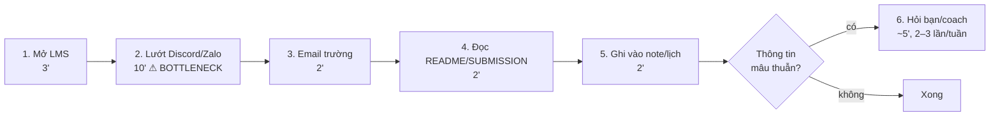
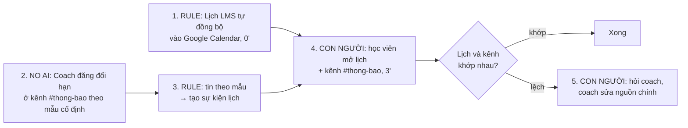

# Báo cáo nhóm — Day 02 Discovery & Problem Framing

> Bản chung của nhóm NhomCold.
>
> **Phạm vi cập nhật 09/11/2026:** CP4 đã chuyển sang Problem Card #1 của Nguyễn Thảo Quyên về giám định xe. CP3 và CP5–CP6 bên dưới còn là bản đề tài deadline cũ, chưa phải kết quả của bài toán xe. Research CP4 đã thực hiện; phỏng vấn người thật chưa thực hiện.
>
> ⚠️ **Trước khi nộp:** (1) các dòng pitch của thành viên khác do chính họ điền; (2) mục 3.2 chỉ điền dữ liệu từ người thật đã hỏi — bịa phỏng vấn/survey thì C7 = 0 cả nhóm; (3) thay mọi `[ĐO THẬT]` / `___` bằng số thật. Xóa khối ghi chú này khi xong.

## 1. Thông tin nhóm

- Tên nhóm: NhomCold
- Thành viên: xem `TEAM.md`
- Candidate problem triển khai CP4: Nhân viên giám định/bồi thường bảo hiểm ô tô cần xác định hư hỏng nhìn thấy, đối chiếu phụ tùng và nguồn giá để lập dự toán ban đầu có thể kiểm tra. Mức 20–40 phút/vụ là ước tính chưa đo; nguyên nhân và bottleneck cần kiểm chứng (Problem Card #1 — [2A202603895_NguyenThaoQuyen.md](../individual/2A202603895_NguyenThaoQuyen.md)).
- Quyết định cuối cho bài toán xe: **Chưa chốt CP6**. CP4 đề xuất **Not Yet cho thử AI trên hồ sơ thật**, chờ kiểm chứng dữ liệu, thời gian và quyền sử dụng.

---

## 2. Hội tụ nhóm (CP3)

### 2.1. Pitch

| # | Người đưa ra | Candidate (Job Story ngắn) | Actor | Bottleneck | Câu hỏi phản biện nhận được (ai hỏi) |
|---:|---|---|---|---|---|
| 1 | Vũ Lương Duy | Khi tuần có nhiều lab và thông báo ở nhiều kênh, tôi muốn biết chắc còn bài gì phải nộp và hạn lúc nào, để không trễ/sót | Học viên | Lướt lại chat tìm thông báo đổi hạn (~10'/ngày) | "LMS có lịch rồi, bao nhiêu deadline thật sự chỉ nằm trong chat?" (`[tên người hỏi]`) |
| 2 | Vũ Lương Duy | Khi sắp tới deadline, tôi muốn đối chiếu bài với RUBRIC/SUBMISSION, để không mất điểm hình thức | Học viên | Đọc lại từng mục so với rubric (~15') | `[điền]` |
| 3 | Vũ Lương Duy | Khi nhiều học viên hỏi trùng về deadline, coach muốn trả lời một lần | Coach | Trả lời lặp lại | `[điền]` |
| 4 | `[Thành viên 2]` | `[tự điền]` | | | |
| 5 | `[Thành viên 2]` | | | | |
| 6 | `[Thành viên 2]` | | | | |
| 7 | `[Thành viên 3]` | | | | |
| 8 | `[Thành viên 3]` | | | | |
| 9 | `[Thành viên 3]` | | | | |
| 10 | `[Thành viên 4]` | | | | |
| 11 | `[Thành viên 4]` | | | | |
| 12 | `[Thành viên 4]` | | | | |

### 2.2. Cluster

| Cluster | Các candidate | Pattern chung |
|---|---|---|
| A — Thông tin khóa học rải rác | #1 Theo dõi deadline, #3 Câu hỏi trùng cho coach, `[thêm candidate của bạn khác nếu cùng pattern]` | Một thông tin (hạn, cách nộp) có nhiều nguồn, không có nguồn chính thức duy nhất |
| B — Tự kiểm chất lượng bài nộp | #2 Đối chiếu rubric, `[...]` | So khớp sản phẩm với tiêu chí cố định |
| C — Phối hợp nhóm trên repo | `[ví dụ: mời collaborator, conflict khi cùng sửa file]` | Thao tác Git/GitHub làm chậm đầu buổi |

### 2.3. Opportunity Solution Tree rút gọn

```text
OUTCOME: Học viên nộp đủ, đúng hạn mọi bài lab mà tốn ít thời gian theo dõi thông tin khóa học
├── Opportunity A: Không biết thông báo nào là bản mới nhất khi hạn bị đổi (thông tin mâu thuẫn giữa các kênh)
├── Opportunity B: Thông báo quan trọng bị trôi giữa các tin nhắn trao đổi thường ngày
└── Opportunity C: Quy tắc giờ hạn khác nhau theo ca (sáng: 23h59 cùng ngày; chiều/tối: 11h59 hôm sau) dễ nhớ nhầm
     ✗ "Chatbot hỏi đáp deadline"          ← solution đội lốt
     ✗ "App lịch học riêng cho lớp"        ← solution đội lốt
     ✗ "Bot Discord tự nhắc deadline"      ← solution đội lốt
```

Những ý đã gạch bỏ vì là solution đội lốt opportunity:

- "Thiếu chatbot trả lời deadline" — mô tả cách giải, không mô tả pain.
- "Cần app lịch riêng" — đã có lịch LMS + Google Calendar, chưa chứng minh thiếu công cụ.
- "Cần bot nhắc deadline" — nhắc là cách giải; pain là không biết hạn nào đúng.

### 2.4. Chấm điểm shortlist (1–5)

| Candidate | Actor rõ | Quy trình rõ | Pain có bằng chứng | Impact đo được | Vừa sức lab | So sánh được No AI/Rule/Workflow/Agent | Nhóm hiểu domain | Tổng |
|---|---:|---:|---:|---:|---:|---:|---:|---:|
| Theo dõi deadline rải rác | 5 | 4 | 4 | 4 | 5 | 5 | 5 | 32 |
| Đối chiếu bài với rubric | 5 | 5 | 3 | 3 | 5 | 3 | 5 | 29 |
| Câu hỏi trùng cho coach | 3 | 4 | 2 | 3 | 4 | 4 | 3 | 23 |

*(Điểm là đề xuất ban đầu — cả nhóm chấm lại và sửa sau khi thảo luận.)*

**Candidate được chọn:** Theo dõi deadline rải rác nhiều kênh.

**Vì sao chọn:** Cả 4 thành viên đều đang gặp trong chính khóa học (domain hiểu rõ, phỏng vấn được bạn học nhóm khác ngay trong buổi); lặp lại hằng ngày; impact đo được bằng phút và số bài trễ; có đủ cả phương án No AI, Rule và AI để so sánh.

**Vì sao loại các candidate còn lại:**

- *Đối chiếu bài với rubric:* tiêu chí đúng/sai rõ nên một checklist hoặc script kiểm tên file là đủ — không có gì để so sánh giữa các mức can thiệp; pain chỉ xuất hiện 1 lần/lab.
- *Câu hỏi trùng cho coach:* nhóm không phải actor, chưa có số liệu từ coach, và thực chất là hệ quả của candidate #1 — giải #1 sẽ giảm luôn #3.

**Xử lý bất đồng (nếu có):** `[ghi nếu có]`

---

## 3. Kiểm chứng + research giải pháp đã có (CP4)

**Bài toán:** Problem Card #1 — Xác định hư hỏng và ước lượng chi phí sửa chữa của [Nguyễn Thảo Quyên](../individual/2A202603895_NguyenThaoQuyen.md). **Người tổng hợp:** Mai Danh Hiếu — 2A202603948. **Ngày research:** 09/11/2026.

**Trạng thái bằng chứng:** đã đọc card và research 3 nhà cung cấp qua 4 trang chính thức; chưa có biên bản phỏng vấn, survey hoặc hồ sơ thực tế được cung cấp. Mức 20–40 phút/vụ là ước tính trong card, chưa phải baseline đã đo. Card dùng con số này cho cả bước 3–5 và sơ đồ toàn quy trình nên cần làm rõ phạm vi. Khoảng 5–7 ngày ở CP1 là thời gian toàn hồ sơ, không được dùng thay thời gian thao tác giám định ban đầu.

### 3.1. Assumption Map

Thang điểm: quan trọng 5 = nếu sai phải đổi hướng; bằng chứng 1 = chưa có dữ liệu trực tiếp, 2 = có nguồn gián tiếp, 3 = có dữ liệu trực tiếp nhỏ, 4–5 = đã kiểm tra lặp lại. Điểm là đánh giá sơ bộ phục vụ ưu tiên, không phải kết quả đo.

| # | Giả định cần kiểm chứng | Loại | Quan trọng (1–5) | Đã có bằng chứng (1–5) | Kiểm chứng trước? |
|---:|---|---|---:|---:|---|
| A1 | Bước xác định hư hỏng, đối chiếu phụ tùng và tra giá thực sự chiếm phần lớn thời gian thao tác ban đầu; 20–40 phút là mức thường gặp. | Value | 5 | 1 | Ưu tiên 1: hỏi 2 giám định viên và ghi giờ từng bước trên 5 hồ sơ được phép dùng. |
| A2 | Chuẩn hóa danh mục, nguồn giá và biểu mẫu vẫn chưa đủ giảm công sức hoặc sai khác giữa người lập dự toán. | Value | 5 | 1 | Ưu tiên 1: xem cách làm hiện tại và thử checklist + bảng tính trên cùng 5 hồ sơ trước khi chọn AI. |
| A3 | Có quyền dùng bộ ảnh, thông tin xe, kết quả giám định và giá phụ tùng/công còn hiệu lực để đối chiếu dự toán. | Feasibility | 5 | 1 | Ưu tiên 1: xin xác nhận quyền sử dụng và kiểm tra trường dữ liệu trên hồ sơ đã ẩn danh. |
| A4 | Ảnh đầu vào đủ để hỗ trợ nhận diện hư hỏng nhìn thấy; trường hợp thiếu góc chụp hoặc nghi hư hỏng ẩn có thể chuyển giám định trực tiếp. | Feasibility | 5 | 2 | Ưu tiên 2: chuyên viên phân loại ảnh đủ/thiếu thông tin; research chỉ chứng minh có sản phẩm, chưa chứng minh độ chính xác trên dữ liệu nhóm. |
| A5 | Giám định viên có thể kiểm tra nguồn, sửa hoặc từ chối từng dòng dự toán mà không mất thời gian hơn cách hiện tại. | Usability | 4 | 1 | Ưu tiên 2: quan sát 2 người xử lý bản nháp, đo cả thời gian sửa và lỗi còn sót. |
| A6 | Đơn vị cho phép xử lý dữ liệu theo cách đề xuất, chấp nhận chi phí và chỉ dùng kết quả như dự toán có người duyệt. | Viability | 5 | 1 | Ưu tiên 1: hỏi người phụ trách dữ liệu/quản lý; chưa gửi ảnh hồ sơ cho dịch vụ ngoài khi chưa được phép. |

**Trọng tâm kiểm chứng:** A1–A3 và A6. Nếu phần chờ bổ sung hồ sơ/phê duyệt mới gây chậm, cần đổi bottleneck; nếu checklist và bảng giá đã đủ thì không có căn cứ tăng mức can thiệp lên AI. A4–A5 chỉ thử tiếp khi có dữ liệu và quyền dùng.

### 3.2. Kiểm chứng

**Cách đã thực hiện:** rà soát tài liệu nội bộ và nghiên cứu tài liệu sản phẩm công khai. **Phỏng vấn thực tế: chưa thực hiện trong phạm vi dữ liệu hiện có; số người đã hỏi được ghi nhận: 0.** Không coi tài liệu nhà cung cấp là phỏng vấn người dùng.

**Đối tượng và cách kiểm chứng tiếp theo:** 2 giám định viên/nhân viên bồi thường đã xử lý hồ sơ ô tô và 1 người lập báo giá tại garage, ngoài nhóm; phỏng vấn 10–15 phút/người về vụ gần nhất. Xem 5 hồ sơ đã ẩn danh nếu được cho phép. Hướng dẫn và biểu mẫu ghi nhận: [cp4-interview-guide.md](../assets/cp4-interview-guide.md).

**Snapshot — trạng thái thu thập hiện tại:**

| Trường | Nội dung |
|---|---|
| Người được hỏi (vai trò, không ghi tên thật) | Chưa có người được phỏng vấn; đối tượng dự kiến là giám định viên, nhân viên bồi thường và người lập báo giá garage. |
| Khi nào, hỏi bằng cách nào | Chưa có buổi phỏng vấn được ghi nhận; nghiên cứu tài liệu được thực hiện ngày 09/11/2026. |
| Câu nói đáng nhớ nhất (nguyên văn) | Chưa có lời nói nguyên văn từ người thật. |
| Lần gần nhất gặp vấn đề này: chuyện gì đã xảy ra? | Chưa có hồ sơ cụ thể; card chỉ mô tả tình huống tiếp nhận ảnh xe tai nạn và lập dự toán. |
| Hiện đang xử lý bằng cách nào (workaround)? | Card đề xuất checklist, danh mục và bảng giá chuẩn hóa; chưa xác nhận đây là cách đang được người dùng thực hiện. |
| Mất bao lâu, bao lần? | 20–40 phút/vụ là ước tính của card; chưa có tần suất hoặc log tách từng bước và thời gian chờ. |
| Insight / opportunity rút ra | Cần xác định bước nghẽn thực tế trước khi chọn mô hình; dữ liệu giá và quyền sử dụng hồ sơ là các điều kiện phải kiểm tra, chưa phải nguyên nhân đã chứng minh. |

**Tổng hợp bằng chứng:**

| Nguồn | Số người / số mẫu | Tín hiệu xác nhận | Tín hiệu phản bác / giới hạn |
|---|---|---|---|
| Problem Card #1 của Quyên | 1 card; không tính là mẫu phỏng vấn | Có actor, chuỗi 7 bước và ước tính 20–40 phút để đặt giả định kiểm chứng. | Chưa có nguồn đo; phạm vi số phút chưa nhất quán; cảm nhận “Agent” chưa được so sánh với cách đơn giản hơn. |
| Research chính thức tại mục 3.3 | 3 nhà cung cấp / 4 trang | Có sản phẩm hỗ trợ đánh giá hư hỏng và lập dự toán từ ảnh. | Phản bác giả định phải tự xây toàn bộ; chưa chứng minh hiệu quả, độ phủ giá hoặc quyền truy cập tại đơn vị ở Việt Nam. |
| Phỏng vấn / survey / hồ sơ đã ẩn danh | 0 người / 0 hồ sơ đã thu thập | Chưa có tín hiệu trực tiếp xác nhận nhu cầu hoặc baseline. | Chưa có phản bác từ người dùng; không thay bằng một câu trả lời giả định. |

**Tiêu chí kiểm chứng được đặt trước, chưa phải kết quả:**

- Xác nhận sơ bộ A1 nếu ít nhất 2/3 người kể được vụ cụ thể có khó khăn tại bước 3–5 và log cho thấy đây là cụm bước chiếm nhiều thời gian thao tác nhất. Với mẫu nhỏ chỉ dùng để định hướng, không suy rộng toàn ngành.
- Bác bỏ hoặc thu hẹp A1 nếu phần lớn chậm trễ nằm ở chờ hồ sơ, chờ garage hoặc phê duyệt. Tách thời gian thao tác khỏi thời gian từ tiếp nhận đến phản hồi.
- Thử checklist + bảng giá + công thức trước: nếu giảm ít nhất 30% trung vị thời gian thao tác trên 5 hồ sơ, không tăng lỗi sau người duyệt, ưu tiên tiếp tục No AI/Rule. Đây là ngưỡng thử nghiệm đề xuất.
- Nếu chưa được phép dùng hồ sơ hoặc không đối chiếu được mã phụ tùng/nguồn giá/ngày hiệu lực, dừng thử AI trên hồ sơ thật và bổ sung điều kiện dữ liệu.
- Không kết luận độ chính xác hoặc mức giảm chi phí khi chưa có tập đối chiếu và kết quả thực nghiệm.

**Điều chỉnh problem sau research — chưa phải sau phỏng vấn:**

> Khi tiếp nhận ảnh xe tai nạn và thông tin xe để đánh giá ban đầu, nhân viên giám định/bồi thường cần xác định các bộ phận hư hỏng nhìn thấy, đối chiếu phụ tùng và nguồn giá còn hiệu lực để lập dự toán có thể kiểm tra trước khi chuyển người có thẩm quyền xác nhận. Nhóm cần đo riêng bước nhận diện, tra mã, tra giá và tổng hợp để xác định bottleneck, thay vì mặc định toàn bộ bước 3–5 đều nghẽn hoặc mặc định cần Agent.

Phạm vi ban đầu giới hạn ở dự toán hỗ trợ đối với hư hỏng nhìn thấy. Không suy luận “không hư hỏng” từ ảnh không đủ, không tự quyết sửa/thay khi thiếu cơ sở và không đồng nhất chi phí sửa chữa dự kiến với số tiền được duyệt bồi thường. Thiếu dữ liệu thì yêu cầu bổ sung hoặc chuyển chuyên viên.

### 3.3. Research giải pháp đã có

Các trang dưới đây được AI hỗ trợ mở và kiểm nội dung ngày **09/11/2026**. Đây là mô tả của nhà cung cấp, không phải benchmark độc lập hoặc kết quả thử của nhóm. Cột khoảng trống và bài học là đánh giá của nhóm từ phạm vi thông tin đọc được.

| Công cụ / case / pattern | Link chính thức | Giải bước nào trong quy trình? | Điểm mạnh được nguồn mô tả | Khoảng trống / rủi ro cần kiểm chứng | Bài học cho nhóm |
|---|---|---|---|---|---|
| Tractable — đánh giá hư hỏng bằng ảnh | [Tractable](https://tractable.ai/) | Bước 2–3: phân tích ảnh và đánh giá hư hỏng. | Có đánh giá kèm mức độ chắc chắn, xét chất lượng ảnh và khả năng quan sát; cung cấp API tích hợp. | Trang đã đọc chưa đủ xác nhận độ chính xác trên ảnh của nhóm, giá dịch vụ hoặc dữ liệu phụ tùng/công tại Việt Nam. | Bản nháp cần thể hiện trường hợp không chắc chắn; không tự xây mô hình chỉ vì đã có ý tưởng nhận diện ảnh. |
| Solera — Qapter Intelligent Estimating | [Sản phẩm](https://www.claims.solera.com/products/intelligent-estimating/), [Công nghệ](https://www.qapter.com/technology/) | Bước 2–6: đánh giá ảnh, nhận diện hư hỏng và tạo dự toán theo từng dòng. | Có đề xuất phương pháp sửa chữa và phản hồi chất lượng ảnh để yêu cầu chụp lại. | Chưa xác nhận quyền truy cập, điều kiện tích hợp và độ phủ giá tại garage mục tiêu; không lấy tốc độ quảng bá làm target đã kiểm chứng. | Kiểm chất lượng ảnh phải đứng trước lập dự toán; nguồn giá và người duyệt cần kiểm tra riêng. |
| CCC — Data + AI cho bảo hiểm và sửa chữa | [CCC Data + AI](https://www.cccis.com/our-technology/ai) | Bước 3 và 6: computer vision hỗ trợ đánh giá, điền trước dòng dự toán từ ảnh hư hỏng. | Hỗ trợ khởi tạo dự toán trong quy trình làm việc thay vì yêu cầu người dùng nhập lại toàn bộ. | Trang tổng quan chưa chứng minh phù hợp với dòng xe, nguồn giá, hệ thống hoặc chi phí của đơn vị mục tiêu. | Có thể thử bản nháp cho chuyên viên sửa; việc một hãng có Agent không chứng minh bài toán của nhóm cần Agent. |

**Kết luận research:** đã có các sản phẩm hỗ trợ nhiều bước của chuỗi ảnh → đánh giá hư hỏng → dự toán. Chưa đủ căn cứ kết luận “không có sản phẩm phủ Việt Nam” hoặc “dữ liệu giá chắc chắn là bottleneck”. Trước khi xây mới, cần kiểm tra công cụ đơn vị đang dùng, dữ liệu được phép tiếp cận và hiệu quả của checklist + bảng giá + công thức. Nếu các bước cố định nhưng còn cần hiểu ảnh, Workflow có người duyệt là một giả thuyết để thử; chưa có căn cứ chọn Agent.

**Kết luận CP4:** research hoàn thành; kiểm chứng trực tiếp chưa hoàn thành. Đề xuất **Not Yet cho thử nghiệm AI trên hồ sơ thật** cho đến khi A1, A3 và A6 được kiểm tra. Đây là kết luận tại CP4, chưa thay cho quyết định CP6 của nhóm.

---


## 4. Quy trình trước/sau (CP5)

### 4.1. Quy trình hiện tại



| Bước | Actor | Input | Output | Thời gian / tần suất | Ghi chú |
|---:|---|---|---|---|---|
| 1 | Học viên | Trang khóa học trên LMS | Danh sách bài + hạn chính thức | 3'/ngày `[ĐO THẬT]` | |
| 2 | Học viên | Kênh Discord/Zalo lớp và nhóm | Thông báo đổi hạn/yêu cầu (nếu thấy) | 10'/ngày `[ĐO THẬT]` | **Bottleneck**: thông báo bị trôi giữa tin trao đổi |
| 3 | Học viên | Hộp thư trường | Thông báo chính thức (nếu có) | 2'/ngày | |
| 4 | Học viên | README/SUBMISSION repo lab | Giờ hạn cụ thể theo ca | 2'/lab | Ca sáng/chiều khác giờ hạn |
| 5 | Học viên | Kết quả bước 1–4 | Ghi chú/lịch cá nhân | 2'/ngày | |
| 6 | Học viên, coach | Thông tin mâu thuẫn | Câu trả lời xác nhận | ~5'/lần, 2–3 lần/tuần | Tốn cả thời gian coach |

**Bottleneck chính:** Bước 2 — tìm lại thông báo đổi hạn/đổi yêu cầu trong luồng chat, vì không có kênh chính thức duy nhất và thông báo không theo mẫu.

### 4.2. Quy trình tương lai



- **No AI:** quy ước 1 kênh thông báo một chiều (chỉ coach đăng), mẫu tin cố định: `[DEADLINE] <tên lab> | <ca> | <hạn mới dd/mm hh:mm> | <link>`.
- **Rule:** đăng ký lịch LMS bằng URL; script/bot đơn giản chuyển tin đúng mẫu thành sự kiện lịch (không cần hiểu ngôn ngữ).
- **AI (chưa làm — Not Yet):** chỉ cân nhắc nếu kiểm chứng cho thấy nhiều thông báo vẫn đăng tự do ngoài mẫu.
- **Bước con người kiểm tra:** học viên đối chiếu lịch với kênh #thong-bao; coach là người duy nhất được sửa nguồn chính.
- **Boundary:** không công cụ nào tự suy luận hạn từ tin trao đổi của học viên; hạn chính thức chỉ đến từ LMS hoặc tin của coach đúng mẫu; khi lịch và thông báo lệch nhau, tin của coach/LMS thắng.
- **Phương án quay về:** nếu đồng bộ lịch lỗi hoặc chậm (docs Moodle nói Google Calendar có thể trễ vài giờ), học viên quay về kiểm tra trực tiếp LMS + kênh #thong-bao (~5'/ngày) — vẫn nhanh hơn hiện tại vì chỉ còn 1 kênh chat cần đọc.

### 4.3. Before / after

| Chỉ số | Trước | Sau (kỳ vọng) | Ghi chú |
|---|---:|---:|---|
| Số bước | 6 | 3 bước học viên làm (1 bước tùy chọn) | Bước 1, 3 tự động |
| Tổng thời gian | ~20'/ngày `[ĐO THẬT]` | ≤ 5'/ngày | Đo bằng tự bấm giờ 5 ngày |
| Số bước thủ công | 6/6 | 1–2/5 | |
| Bottleneck chính | Lướt chat tìm thông báo | Đối chiếu lịch với kênh #thong-bao | Từ "tìm" sang "kiểm" |
| Rủi ro mới phát sinh | — | Lịch trễ đồng bộ; coach quên đăng theo mẫu; học viên tin lịch tuyệt đối | Xử lý bằng boundary + phương án quay về |

---

## 5. Problem Statement v0 (CP5)

| Trường | Nội dung |
|---|---|
| **Actor** | Học viên K5 học song song nhiều lab mỗi tuần |
| **Quy trình** | Mỗi tối: xem LMS → lướt Discord/Zalo → email → README/SUBMISSION → ghi lịch cá nhân → hỏi lại khi mâu thuẫn |
| **Bottleneck** | Tìm lại thông báo đổi hạn/đổi yêu cầu trong chat (~10'/ngày) vì không có nguồn chính thức duy nhất |
| **Impact** | ~20 phút/ngày/học viên `[ĐO THẬT]`; ___ câu hỏi trùng về hạn/tuần trên kênh lớp; rủi ro nộp trễ = không được chấm |
| **Success Metric** (baseline → target, cách đo) | Thời gian kiểm tra deadline: ~20 → ≤ 5 phút/ngày (tự bấm giờ, 4 học viên × 5 ngày) |
| **Boundary** (AI không được làm gì; khi nào cần con người kiểm tra — HITL) | Không công cụ nào tự đặt/sửa hạn chính thức; chỉ coach và LMS là nguồn đúng; khi lịch cá nhân lệch với thông báo của coach → học viên phải hỏi coach |

Phản biện nhận được (từ AI hoặc nhóm khác) và nhóm có đồng ý không:

- AI (prompt: "chỉ ra lỗ hổng, không viết lại"): metric chỉ đo thời gian; nếu học viên kiểm nhanh hơn nhưng vẫn sót hạn thì vô nghĩa → **Đồng ý**, thêm metric "số bài trễ/sót" ở v1.
- AI: chưa rõ ai vận hành kênh #thong-bao → **Đồng ý**, thêm vào Viability và người kiểm tra ở v1.
- `[thêm phản biện từ nhóm khác nếu có]`

---

## 6. Mức can thiệp AI (CP6)

### 6.1. Ma trận độ mơ hồ × độ phức tạp

Bài của nhóm nằm ở ô: **độ mơ hồ thấp × độ phức tạp thấp** (sau khi chuẩn hóa nguồn).

Vì sao: mỗi deadline có đáp án đúng/sai rõ (một ngày giờ cụ thể) → độ mơ hồ thấp. Chỉ có 2 nguồn chính thức sau khi sửa quy trình (LMS + kênh coach), các bước không phụ thuộc phức tạp → độ phức tạp thấp. Ô này theo worksheet: "Rule hoặc Workflow đơn giản thường đủ". Độ mơ hồ chỉ cao nếu phải đọc tin nhắn tự do — chính là phần nhóm loại bỏ bằng mẫu thông báo cố định.

### 6.2. So sánh 4 mức

| Mức | Phương án cho bài của nhóm | Đủ khi nào | Rủi ro | Chọn? |
|---|---|---|---|---|
| **No AI** (sửa quy trình) | Kênh #thong-bao một chiều, mẫu tin cố định, ghim "nguồn chính thức = LMS + kênh này" | Coach tuân thủ mẫu | Phụ thuộc kỷ luật của coach | **Chọn** (nền) |
| **Rule** | Đăng ký lịch LMS bằng URL + script chuyển tin đúng mẫu thành sự kiện lịch | Thông báo có định dạng cố định | Đồng bộ chậm vài giờ; tin sai mẫu bị bỏ qua | **Chọn** |
| **Workflow** | AI đọc tin chat tự do → trích (lab, hạn) → học viên/coach duyệt → thêm vào lịch | Nhiều thông báo vẫn đăng tự do, không chuẩn hóa được | Hiểu nhầm tin bàn luận ("chắc sẽ gia hạn?") thành deadline thật; tốn chi phí | Không (Not Yet) |
| **Agent** | AI tự theo dõi mọi kênh, tự quyết thêm/sửa lịch, tự nhắc | Gần như không bao giờ cần cho bài này | Tự sửa hạn sai mà không ai biết; quyền đọc mọi kênh | Không |

**Mức chọn:** No AI + Rule.

**Vì sao không chọn mức cao hơn (Workflow/Agent):** Deadline là dữ liệu có đáp án đúng duy nhất; research cho thấy LMS đã xuất lịch được (Rule có sẵn), và phần còn lại (thông báo trong chat) giải được bằng quy ước mẫu tin thay vì để AI đoán. Thêm AI chỉ thêm một kiểu lỗi mới — báo nhầm hạn — trong khi Rule đã phủ phần lớn trường hợp `[kiểm bằng tỉ lệ ở 3.2: % thông báo chỉ có trong chat]`.

**Vì sao không chỉ No AI:** nếu không có Rule đồng bộ lịch, học viên vẫn phải mở LMS thủ công mỗi ngày; Rule làm bước đó tự động mà không thêm rủi ro.

### 6.3. AI Canvas rút gọn / vì sao không cần AI

Nhóm chọn No AI + Rule nên không cần AI Canvas (worksheet CP6). Lý do bài toán không cần AI dự đoán hay tạo nội dung:

1. Đầu ra có đúng/sai rõ (một ngày giờ), không cần "tạo" nội dung.
2. Nguồn sự thật đã tồn tại (LMS, coach) — vấn đề là phân tán, không phải thiếu suy luận.
3. Chuẩn hóa mẫu thông báo rẻ hơn và đáng tin hơn việc để AI hiểu tin tự do.

*(Tham khảo, cho bước Workflow nếu sau này cần: Prediction = trích (lab, hạn) từ tin chat; Judgment = coach xác nhận; Action = thêm vào lịch; Outcome = số hạn sai trong lịch; Input = tin nhắn kênh lớp — cần quyền đọc; Feedback = các lần coach sửa/từ chối.)*

### 6.4. Hai câu hỏi của Google PAIR

Không bắt buộc với mức No AI/Rule. Ghi chú để giải thích boundary: nếu sau này có bước AI, **báo nhầm** (thêm hạn sai, nhất là hạn muộn hơn thực tế) tệ hơn **bỏ sót**, vì học viên tin lịch rồi nộp trễ — bài không được chấm. Bỏ sót vẫn còn lưới an toàn là kênh #thong-bao.

---

## 7. Problem Statement v1 + tiêu chí đánh giá (CP6)

| Trường | Nội dung |
|---|---|
| **Actor** | Học viên K5 học song song nhiều lab mỗi tuần; coach là người phát thông báo |
| **Quy trình** | Lịch LMS tự đồng bộ vào lịch cá nhân; coach đăng mọi thay đổi hạn/yêu cầu ở 1 kênh theo mẫu; học viên chỉ kiểm lịch + 1 kênh mỗi ngày |
| **Bottleneck** | Thông báo đổi hạn/yêu cầu nằm rải rác và không theo mẫu trong chat, nên học viên phải lướt lại nhiều kênh (~10'/ngày) |
| **Impact** | ~20 phút/ngày/học viên `[ĐO THẬT]`; ___ câu hỏi trùng/tuần cho coach; rủi ro nộp trễ = không được chấm |
| **Success Metric** (baseline → target, cách đo) | (1) Thời gian kiểm deadline: ~20 → ≤ 5 phút/ngày — tự bấm giờ, 4 học viên × 5 ngày; (2) Số bài trễ/sót do không biết hạn: ___ → 0 trong 2 tuần — đối chiếu lịch sử nộp; (3) Câu hỏi trùng về hạn trên kênh lớp: ___ → giảm ≥ 50% — đếm log Discord |
| **Boundary** | Không công cụ nào tự đặt/sửa hạn chính thức; chỉ LMS và tin đúng mẫu của coach là nguồn; tin sai mẫu bị bỏ qua chứ không đoán; khi lịch lệch thông báo → hỏi coach (HITL) |
| **AI intervention point** | **Không có** — deadline có đáp án đúng duy nhất và nguồn chính thức đã tồn tại; chuẩn hóa mẫu tin rẻ và đáng tin hơn để AI đọc chat tự do |
| **Mức chọn** | No AI + Rule |
| **Rủi ro & người kiểm tra** | Đồng bộ lịch chậm vài giờ; coach quên dùng mẫu → học viên kiểm kênh #thong-bao hằng ngày; coach (người vận hành kênh) kiểm tra mẫu tin; nhóm trưởng mỗi nhóm báo lệch cho coach |

**Thay đổi so với v0 và lý do:**

| Trường | v0 | v1 | Vì sao đổi |
|---|---|---|---|
| Success Metric | Chỉ đo thời gian | Thêm số bài trễ/sót và số câu hỏi trùng | AI phản biện: nhanh hơn mà vẫn sót hạn thì vô nghĩa |
| Actor | Chỉ học viên | Thêm coach là người phát thông báo | Giải pháp No AI phụ thuộc coach dùng mẫu → coach là một phần quy trình |
| Boundary | "Không tự sửa hạn" | Thêm "tin sai mẫu bị bỏ qua, không đoán" | Chặn lối tắt dùng AI đoán hạn từ tin tự do |
| AI intervention point | (chưa có) | Không có, kèm lý do | Kết quả so sánh 4 mức ở CP6 |

**Tiêu chí đánh giá cho giải pháp No AI + Rule (3–5 tiêu chí):**

| # | Tiêu chí | Đạt khi | Không đạt khi |
|---:|---|---|---|
| 1 | Đầy đủ | Mọi bài có hạn trên LMS đều xuất hiện trong lịch cá nhân | Thiếu ≥ 1 bài trong lịch |
| 2 | Chính xác | Ngày giờ trong lịch khớp LMS/thông báo coach, đúng múi giờ GMT+7 và đúng ca (sáng 23h59 / chiều-tối 11h59 hôm sau) | Lệch giờ, sai múi giờ, sai ca |
| 3 | Kịp thời | Thông báo đổi hạn có trong kênh #thong-bao ≥ 24h trước hạn cũ | Đổi hạn chỉ nói miệng hoặc trong tin trao đổi |
| 4 | Đúng mẫu | ≥ 90% tin trên #thong-bao đúng mẫu cố định | Tin tự do, script không đọc được |
| 5 | Nhanh | Học viên kiểm xong trong ≤ 5 phút/ngày | > 5 phút hoặc vẫn phải hỏi lại |

---

## 8. Quyết định (CP6)

### 8.1. Bốn rủi ro

| Rủi ro | Câu hỏi | Mức độ rủi ro | Lý do / bằng chứng |
|---|---|---|---|
| **Value** | Người dùng có thật sự cần và sẽ dùng không? | TB `[cập nhật theo 3.2]` | Nhóm tự gặp; ___/___ người được phỏng vấn kể lần trễ/suýt trễ cụ thể. Chưa rõ tỉ lệ thông báo chỉ có trong chat |
| **Usability** | Người dùng có dùng được không? | Thấp | Đăng ký lịch bằng URL là thao tác 1 lần; đọc 1 kênh dễ hơn đọc nhiều kênh |
| **Feasibility** | Có đủ dữ liệu, công cụ, kỹ năng không? | TB | Moodle hỗ trợ export lịch (đã kiểm docs), nhưng **chưa kiểm LMS của khóa có bật không**; Google Calendar có thể trễ vài giờ |
| **Viability** | Có hợp chi phí, quy định không? Ai vận hành? | TB | Chi phí ≈ 0; nhưng cần coach đồng ý dùng kênh một chiều + mẫu tin — chưa hỏi |

### 8.2. Kết luận

**Quyết định:** **Go — phạm vi No AI + Rule** (riêng bước AI đọc chat: **Not Yet**).

**Lý do:** Không rủi ro nào ở mức Cao; giải pháp gần như không tốn chi phí và có thể đảo ngược ngay. AI không được chọn vì deadline có đáp án đúng duy nhất và Rule đã có sẵn.

**Nếu Go — pilot nhỏ nhất:** 4 thành viên NhomCold trong 2 tuần: (1) đăng ký lịch LMS vào Google Calendar; (2) đề xuất coach dùng mẫu `[DEADLINE] <lab> | <ca> | <hạn> | <link>` trên 1 kênh; (3) mỗi người bấm giờ kiểm deadline mỗi tối và ghi vào bảng chung.

**Nếu Not Yet — cần kiểm chứng gì trước (cho bước AI):** đếm trong 2 tuần pilot bao nhiêu thông báo đổi hạn vẫn đăng tự do ngoài mẫu. Chỉ khi > 30% thông báo không theo mẫu **và** coach không thể chuẩn hóa thì mới xem xét Workflow có người duyệt.

**Ngưỡng dừng:**

- Nếu sau 2 tuần thời gian kiểm deadline trung bình vẫn > 10 phút/ngày → quay về phỏng vấn lại, bottleneck có thể không nằm ở chat.
- Nếu LMS của khóa không export được lịch → bỏ Rule đồng bộ, chỉ giữ No AI (kênh #thong-bao + checklist).
- Nếu coach không đồng ý mẫu tin, hoặc < 70% tin đúng mẫu sau 1 tuần → dừng script, quay về đọc kênh #thong-bao thủ công.
- Nếu có ≥ 1 bài nộp trễ do lịch sai → dừng tin lịch, quay về đối chiếu trực tiếp LMS.

**Bước tiếp theo:** (1) kiểm ngay LMS khóa có nút export lịch không; (2) gửi đề xuất mẫu tin cho coach; (3) bắt đầu bấm giờ baseline thật 3 ngày trước pilot.

---

## 9. Hạn chế và hướng tiếp theo

- Baseline thời gian hiện là ước lượng của nhóm, cần thay bằng số bấm giờ thật.
- Mẫu phỏng vấn nhỏ và đều là học viên cùng khóa — chưa đại diện cho học viên đi làm full-time hay khóa khác.
- Chưa phỏng vấn coach — người quyết định Viability của giải pháp No AI.
- Chưa xác minh LMS của khóa là Moodle hay nền tảng khác; nếu khác, cần tìm tính năng export lịch tương đương.

## 10. Tài liệu tham khảo

Nguồn CP4 giám định xe, AI hỗ trợ mở và kiểm ngày 09/11/2026:

- [Tractable](https://tractable.ai/).
- [Solera Qapter Intelligent Estimating](https://www.claims.solera.com/products/intelligent-estimating/).
- [Qapter Technology](https://www.qapter.com/technology/).
- [CCC Data + AI](https://www.cccis.com/our-technology/ai).
- [Card #1 của Nguyễn Thảo Quyên](../individual/2A202603895_NguyenThaoQuyen.md) và [kế hoạch phỏng vấn CP4](../assets/cp4-interview-guide.md).

Nguồn của đề tài deadline cũ (CP3, CP5–CP6), chưa áp dụng cho CP4 mới:

- Moodle Docs — Calendar export: https://docs.moodle.org/en/Calendar_export
- Todoist Help — Use Task Quick Add: https://www.todoist.com/help/articles/use-task-quick-add-in-todoist-va4Lhpzz
- Google Calendar Help — Events from Gmail: https://support.google.com/calendar/answer/6084018
- Rob Fitzpatrick — *The Mom Test*; Teresa Torres — Opportunity Solution Tree; Anthropic — *Building Effective Agents*; Marty Cagan — 4 rủi ro (xem [docs/03-international-frameworks.md](../../docs/03-international-frameworks.md))
