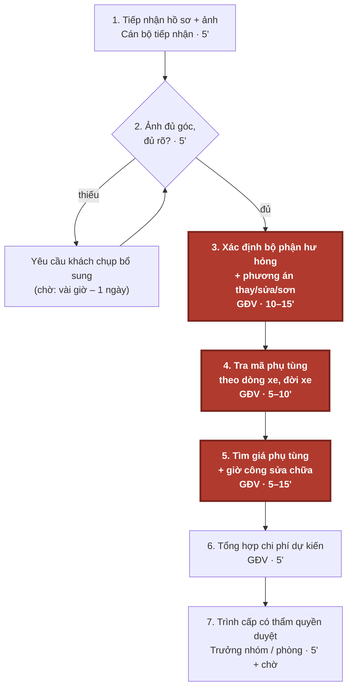
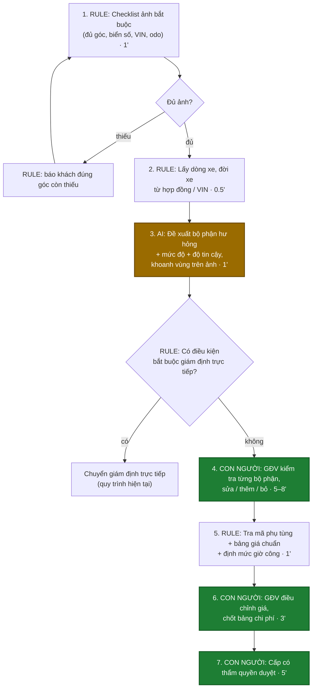

# Báo cáo nhóm — Day 02 Discovery & Problem Framing

> Bản chung của nhóm Cold. Các mốc thời gian và ngưỡng ở CP5–CP6 là ước tính hoặc tiêu chí thử nghiệm, không phải kết quả đo hiệu quả.

## 1. Thông tin nhóm

- Tên nhóm: Cold
- Thành viên: xem `TEAM.md`
- Candidate problem được chọn (1 câu): Khi tiếp nhận yêu cầu bồi thường kèm hình ảnh xe tai nạn, nhân viên giám định muốn xác định bộ phận hư hỏng và lập dự toán có nguồn đối chiếu, để đánh giá và chuyển kết quả cho người có thẩm quyền kiểm tra.
- Quyết định cuối: **Not Yet cho thử AI trên hồ sơ thật** — rủi ro Value, Feasibility và Viability ở mức Cao. Bước tiếp theo là đo thời gian trên 5 hồ sơ được phép dùng, thử checklist + bảng giá + công thức làm phương án đối chiếu, và xác nhận quyền dữ liệu trước khi cân nhắc pilot Workflow có giám định viên kiểm tra (chi tiết tại mục 8).

---

## 2. Hội tụ nhóm (CP3)

Nhóm 4 người, 12 candidate. Hội tụ theo trình tự: pitch top 3 → gom cluster → cây OST → chấm điểm shortlist và chọn một candidate.

### 2.1. Candidate và câu hỏi chuẩn bị pitch

Các câu hỏi dưới đây phục vụ buổi pitch; câu hỏi thực tế và người hỏi được ghi vào nhật ký phản biện của từng thành viên.

| # | Người có card | Candidate | Actor | Bottleneck | Câu hỏi chuẩn bị phản biện |
|---:|---|---|---|---|---|
| 1 | Vũ Lương Duy | Chép đơn từ inbox | Chủ shop | Chép trường thông tin sang bảng quản lý | Khách tự điền mẫu xác nhận đơn có giảm được thao tác chép lại không? |
| 2 | Vũ Lương Duy | Tồn kho lệch giữa các kênh | Chủ shop | Cập nhật kho thủ công | Kho lệch do cập nhật chậm hay do số tồn ban đầu sai? |
| 3 | Vũ Lương Duy | Đăng sản phẩm nhiều kênh | Chủ shop | Viết và điều chỉnh mô tả | Bước mất thời gian nhất là viết mô tả hay nhập thuộc tính từng kênh? |
| 4 | Nguyễn Thảo Quyên | Xác định hư hỏng xe | Giám định viên | Đối chiếu hư hỏng, phụ tùng và giá | Bước nghẽn chính là xác định hư hỏng, tra phụ tùng hay tra giá? Ảnh có đủ căn cứ để lập dự toán không? |
| 5 | Nguyễn Thảo Quyên | Tìm đúng phụ tùng | Nhân viên phụ tùng | Đối chiếu mã và tính tương thích | Đã có mã phụ tùng và thông tin dòng xe thì bộ lọc danh mục có đủ không? |
| 6 | Nguyễn Thảo Quyên | Kiểm tra bài tập | Giảng viên | Đọc bài và đối chiếu rubric | Rubric và đáp án có đủ rõ để hai người chấm nhất quán không? |
| 7 | Hồ Nguyễn Minh Sang | Tổng hợp ghi chú họp | Thành viên nhóm | Gom ghi chú theo chủ đề | Nếu ghi trực tiếp theo mẫu ngay trong họp, bước gom ghi chú còn tốn thời gian không? |
| 8 | Hồ Nguyễn Minh Sang | Chốt sổ thu chi nhà trọ hằng tháng | Chủ nhà trọ, người quản lý | Đối chiếu thanh toán và công nợ theo phòng/kỳ | Công thức bảng tính đã xử lý được bao nhiêu phần việc? Chênh lệch chủ yếu ở chỉ số hay thanh toán? |
| 9 | Hồ Nguyễn Minh Sang | Hiểu khái niệm khó khi research | Người học, dev | Tra thuật ngữ và tìm cách giải thích phù hợp kiến thức nền | Sau khi đọc lời giải thích, làm thế nào kiểm tra người học hiểu đúng và áp dụng được? |
| 10 | Mai Danh Hiếu | Tổng hợp tiến độ nhóm | Người điều phối | Đọc cập nhật và hỏi lại | Nhóm thiếu cập nhật hay có cập nhật nhưng cách diễn đạt khó tổng hợp? |
| 11 | Mai Danh Hiếu | Phân công phù hợp khả năng | Nhóm trưởng | Cân đối tải và chuyển đầu việc | Chênh lệch tải do số việc, độ khó hay thời gian rảnh của từng người? |
| 12 | Mai Danh Hiếu | Bàn giao việc phụ thuộc | Người nhận bàn giao | Đợi và yêu cầu bổ sung đầu vào | Phần việc bị chặn vì giao trễ hay vì đầu ra bàn giao thiếu thông tin? |

### 2.2. Cluster

| Cluster | Candidate | Pattern chung |
|---|---|---|
| A — Tổng hợp và diễn giải thông tin | #1, #7, #9, #10 | Chuyển thông tin rời rạc hoặc khó hiểu thành nội dung có cấu trúc để sử dụng |
| B — Đối chiếu số liệu và giao dịch | #2, #8 | Đối chiếu lượng tồn, khoản thanh toán hoặc công nợ để xác định trạng thái đúng |
| C — Đánh giá và đối chiếu chuyên môn | #4, #5, #6 | Xác định bộ phận, mã tương thích hoặc mức độ đáp ứng tiêu chí dựa trên căn cứ chuyên môn |
| D — Phối hợp và xuất bản | #3, #11, #12 | Phụ thuộc đầu vào, tải công việc hoặc nhiều nơi nhận |

### 2.3. Opportunity Solution Tree rút gọn

Gốc là **1 outcome**. Nhánh là **opportunity** (nhu cầu, pain), không phải tính năng hay công cụ.

```text
OUTCOME: Rút ngắn thời gian lập dự toán sửa chữa ban đầu trên mỗi hồ sơ bồi thường ô tô,
         đồng thời không tăng số hạng mục bỏ sót và sai lệch chi phí so với giám định
├── Opportunity: Khó xác định đầy đủ bộ phận hư hỏng từ ảnh và thông tin xe
├── Opportunity: Tốn công đối chiếu phụ tùng tương thích và phương án sửa/thay
├── Opportunity: Phải tra cứu giá phụ tùng và công sửa chữa từ nhiều nguồn
└── Opportunity: Khó đối chiếu căn cứ của từng hạng mục trong dự toán
     ✗ "Nhận diện hư hỏng bằng Computer Vision"       ← đây là SOLUTION, gạch bỏ khỏi tầng này
     ✗ "Hệ thống tự tra phụ tùng và đề xuất chi phí"  ← đây là SOLUTION, gạch bỏ khỏi tầng này
     ✗ "Agent tự xử lý hồ sơ"                        ← đây là SOLUTION, gạch bỏ khỏi tầng này
```

### 2.4. Chấm điểm shortlist (1–5)

Bảng điểm đề xuất trên thang 1–5, dùng để đối chiếu ba candidate theo cùng tiêu chí. Điểm bằng chứng phản ánh mức độ dữ liệu hiện có; điểm tổng không thay thế việc xem xét phạm vi và khả năng kiểm chứng.

| Candidate | Actor rõ | Quy trình rõ | Pain có bằng chứng | Impact đo được | Vừa sức lab | So sánh được 4 mức | Nhóm hiểu domain | Tổng |
|---|---:|---:|---:|---:|---:|---:|---:|---:|
| Xác định hư hỏng và ước lượng chi phí sửa chữa | 5 | 5 | 2 | 5 | 3 | 5 | 3 | **28** |
| Tra cứu và xác định phụ tùng ô tô | 5 | 5 | 2 | 4 | 4 | 4 | 3 | 27 |
| Chốt sổ thu chi nhà trọ hằng tháng | 5 | 5 | 1 | 5 | 5 | 2 | 3 | 26 |

**Chọn:** Xác định hư hỏng và ước lượng chi phí sửa chữa — Problem Card #1 của Nguyễn Thảo Quyên, tương ứng candidate #4 trong bảng tổng hợp.

**Job Story:** Khi tiếp nhận yêu cầu bồi thường kèm hình ảnh xe bị tai nạn, tôi muốn xác định các bộ phận bị hư hỏng và ước lượng chi phí sửa chữa, để có cơ sở đánh giá mức bồi thường và tư vấn cho khách hàng.

**Vì sao chọn:** Quy trình rõ, đo được thời gian lập dự toán, hạng mục bỏ sót và sai lệch chi phí; có cơ sở so sánh checklist, Rule, Workflow và Agent. Phạm vi lab chỉ gồm dự toán ban đầu để người giám định kiểm tra. Điểm bằng chứng thấp vì số phút trong card là ước lượng; điểm vừa sức lab thấp hơn hai bài còn lại do cần hồ sơ và dữ liệu giá.

**Vì sao loại hai candidate kia:** Tra cứu phụ tùng hẹp hơn và đã là một bước trong bài toán được chọn, nên giữ làm phần phân tích sâu. Sổ nhà trọ có quy trình rõ và vẫn là candidate hợp lệ dù chỉ cần bảng tính hoặc Rule. Vòng này nhóm tập trung vào chuỗi xác định hư hỏng, tra phụ tùng và lập dự toán; bài toán nhà trọ được giữ cho vòng phân tích khác. Cả ba chỉ đạt 3 điểm hiểu domain vì cần người trực tiếp làm nghiệp vụ đối chiếu.

**Nguyên tắc xử lý bất đồng:** Đối chiếu actor, dữ liệu tiếp cận được và cách đo tác động; nếu hai candidate có điểm gần nhau, ưu tiên phạm vi kiểm chứng được trong buổi lab. Giữ các candidate còn lại cho vòng phân tích tiếp theo.


## 3. Kiểm chứng + research giải pháp đã có (CP4)

**Bài toán:** Problem Card #1 — Xác định hư hỏng và ước lượng chi phí sửa chữa của [Nguyễn Thảo Quyên](../individual/2A202603895_NguyenThaoQuyen.md). **Người tổng hợp:** Mai Danh Hiếu — 2A202603948. **Ngày research:** 09/11/2026.

**Trạng thái bằng chứng:** đã có tài liệu ba cuộc phỏng vấn [Tài liệu phỏng vấn gốc — Phụ lục A](#cp4-phong-van-goc) và research giải pháp chính thức. Snapshot và giới hạn nguồn ở mục 3.2. Mức 20–40 phút/vụ vẫn là ước tính chưa đo; thời gian toàn hồ sơ không được dùng thay thời gian thao tác.

### 3.1. Assumption Map ban đầu (trước bổ sung phỏng vấn)

Thang điểm: quan trọng 5 = nếu sai phải đổi hướng; bằng chứng 1 = chưa có dữ liệu trực tiếp, 2 = có nguồn gián tiếp, 3 = có dữ liệu trực tiếp nhỏ, 4–5 = đã kiểm tra lặp lại. Điểm là đánh giá sơ bộ phục vụ ưu tiên, không phải kết quả đo.

| # | Giả định cần kiểm chứng | Loại | Quan trọng (1–5) | Đã có bằng chứng (1–5) | Kiểm chứng trước? |
|---:|---|---|---:|---:|---|
| A1 | Bước xác định hư hỏng, đối chiếu phụ tùng và tra giá thực sự chiếm phần lớn thời gian thao tác ban đầu; 20–40 phút là mức thường gặp. | Value | 5 | 1 | Ưu tiên 1: hỏi 2 giám định viên và ghi giờ từng bước trên 5 hồ sơ được phép dùng. |
| A2 | Chuẩn hóa danh mục, nguồn giá và biểu mẫu vẫn chưa đủ giảm công sức hoặc sai khác giữa người lập dự toán. | Value | 5 | 1 | Ưu tiên 1: xem cách làm hiện tại và thử checklist + bảng tính trên cùng 5 hồ sơ trước khi chọn AI. |
| A3 | Có quyền dùng bộ ảnh, thông tin xe, kết quả giám định và giá phụ tùng/công còn hiệu lực để đối chiếu dự toán. | Feasibility | 5 | 1 | Ưu tiên 1: xin xác nhận quyền sử dụng và kiểm tra trường dữ liệu trên hồ sơ đã ẩn danh. |
| A4 | Ảnh đầu vào đủ để hỗ trợ nhận diện hư hỏng nhìn thấy; trường hợp thiếu góc chụp hoặc nghi hư hỏng ẩn có thể chuyển giám định trực tiếp. | Feasibility | 5 | 2 | Ưu tiên 2: chuyên viên phân loại ảnh đủ/thiếu thông tin; research chỉ chứng minh có sản phẩm, chưa chứng minh độ chính xác trên dữ liệu nhóm. |
| A5 | Giám định viên có thể kiểm tra nguồn, sửa hoặc từ chối từng dòng dự toán mà không mất thời gian hơn cách hiện tại. | Usability | 4 | 1 | Ưu tiên 2: quan sát 2 người xử lý bản nháp, đo cả thời gian sửa và lỗi còn sót. |
| A6 | Đơn vị cho phép xử lý dữ liệu theo cách đề xuất, chấp nhận chi phí và chỉ dùng kết quả như dự toán có người duyệt. | Viability | 5 | 1 | Ưu tiên 1: hỏi người phụ trách dữ liệu/quản lý; chưa gửi ảnh hồ sơ cho dịch vụ ngoài khi chưa được phép. |

**Trọng tâm kiểm chứng:** A1–A3 và A6. Nếu phần chờ bổ sung hồ sơ/phê duyệt mới gây chậm, cần đổi bottleneck; nếu checklist và bảng giá đã đủ thì không có căn cứ tăng mức can thiệp lên AI. A4–A5 chỉ thử tiếp khi có dữ liệu và quyền dùng.

### 3.2. Kết quả nghiên cứu và kiểm chứng

#### Nguồn phỏng vấn bổ sung

CP4 sử dụng [Tài liệu phỏng vấn gốc — Phụ lục A](#cp4-phong-van-goc), bản cập nhật 09/11/2026, gồm ba cuộc phỏng vấn do Mai Danh Hiếu — 2A202603948 trực tiếp thực hiện. AI hỗ trợ tổng hợp các snapshot từ tài liệu phỏng vấn. Ngày, hình thức và địa bàn từng buổi chưa được bổ sung; ngày cập nhật file không được coi là ngày phỏng vấn. Chưa có log thời gian hoặc hồ sơ kèm theo. Mã PV01–PV03 tương ứng mục 2.1–2.3; H1–H6 là số câu hỏi trong mỗi mục.

#### Interview Snapshot PV01 — Giám định viên bảo hiểm

- **Ngữ cảnh:** tiếp nhận ảnh hồ sơ va chạm đầu xe; người phỏng vấn: Mai Danh Hiếu; ngày, hình thức và địa bàn chưa được bổ sung.
- **Hành vi cụ thể (H2):** nhận hai ảnh cận cảnh, thiếu ảnh toàn xe và phiên bản; yêu cầu bổ sung góc ảnh và kiểm tra thông tin xe trước khi đối chiếu phụ tùng.
- **Trích dẫn (H5):** “Rủi ro là chọn đúng tên bộ phận nhưng sai biến thể của phụ tùng.”
- **Pain và workaround (H3–H5):** tra đúng cấu hình, mã và giá tốn công; dùng danh mục, hỏi garage, đánh dấu chưa xác nhận khi dữ liệu không khớp.
- **Insight:** cần dữ liệu xe đầy đủ và nguồn đối chiếu cho từng dòng dự toán, không chỉ khoanh vùng hư hỏng.
- **Phản bác/giới hạn:** ảnh đủ và xe quen thì khoanh vùng khá nhanh; chưa có số phút hay tần suất để xếp hạng bottleneck. Kỳ vọng công cụ ở H6 chưa phải cam kết sử dụng.

#### Interview Snapshot PV02 — Nhân viên bồi thường

- **Ngữ cảnh:** đối chiếu dự toán ca va chạm nhẹ, xe phổ thông; người phỏng vấn: Mai Danh Hiếu; ngày, hình thức và địa bàn chưa được bổ sung.
- **Hành vi cụ thể (H1–H2):** ca có ảnh đủ, xe quen và báo giá đúng mẫu chỉ cần rà hạng mục, giá rồi chuyển duyệt; đã dùng checklist và bảng dữ liệu, không nhập lại toàn bộ.
- **Trích dẫn (H3):** “Vấn đề nằm ở quy trình chuyển duyệt và chờ phản hồi.”
- **Pain và workaround:** chờ duyệt kéo dài dù thao tác thuận lợi; rà biểu mẫu, báo giá và ghi các dòng cần xác nhận.
- **Insight:** phải tách ca đủ dữ liệu với ca thiếu dữ liệu, đồng thời tách thời gian thao tác với chờ người duyệt.
- **Tín hiệu phản bác (H4):** tìm kiếm theo mã xe và biểu mẫu chuẩn có thể đã đủ khi dữ liệu có cấu trúc; không có căn cứ áp dụng AI cho mọi ca.
- **Hàm ý (H5–H6):** đo cả công rà/sửa nháp, số dòng sửa và hồ sơ trả về. Đây là điều kiện cần thử, chưa phải hiệu quả đã đo.

#### Interview Snapshot PV03 — Nhân viên garage / cố vấn dịch vụ

- **Ngữ cảnh:** va chạm cản trước và chi tiết phía sau cản; người phỏng vấn: Mai Danh Hiếu; ngày, hình thức và địa bàn chưa được bổ sung.
- **Hành vi cụ thể (H2):** ảnh ngoài cho thấy cản nứt; kiểm tra sâu phát hiện chi tiết gá lắp bị ảnh hưởng, phải thêm ảnh, hạng mục và báo giá điều chỉnh.
- **Trích dẫn (H4):** “Giá thì ghi nguồn báo và thời điểm nhận báo giá.”
- **Pain và workaround (H1–H4):** kiểm tra/tháo kiểm hư hỏng khuất, chờ tồn kho, báo giá và duyệt bổ sung; ghi dự toán tạm, hạng mục cần kiểm tra và lưu phiên bản trước.
- **Insight:** dự toán có thể cần bổ sung vì thông tin mới; không mặc định mọi bổ sung đều là lỗi nhận diện ban đầu.
- **Phản bác/giới hạn (H5):** ảnh ngoài không xác nhận kết cấu bên trong; nhận diện ảnh không giải quyết toàn bộ chuỗi xử lý.
- **Hàm ý:** tách phần nhìn thấy và phần chưa xác minh, lưu nguồn/thời điểm giá và lịch sử sửa. Mong muốn ở H6 chưa chứng minh hiệu quả tự động hóa.

#### Tổng hợp đối chiếu sau phỏng vấn

| Giả định | Bằng chứng trong tài liệu | Kết luận cập nhật |
|---|---|---|
| A1 — nhận diện/tra mã/giá chiếm phần lớn thời gian, thường 20–40 phút | PV01 H3: tra biến thể tốn công; PV02 H3: chờ duyệt; PV03 H3: chờ báo giá và duyệt bổ sung. | Có lời kể về khó khăn, chưa xác nhận số phút hoặc bottleneck chung. |
| A2 — chuẩn hóa chưa đủ | PV02 H1–H4 mô tả ca thuận lợi với checklist và dữ liệu sẵn có. | Bị phản bác trong nhóm ca đủ dữ liệu; cần thử No AI/Rule trước. |
| A3 — nhóm có dữ liệu và quyền dùng | PV01 H4, PV03 H4 nói về nguồn tra cứu của người được hỏi. | Không chứng minh nhóm có quyền truy cập; vẫn chưa xác nhận. |
| A4 — ảnh hỗ trợ phần nhìn thấy, ca khó chuyển kiểm tra | PV01 H2/H4, PV03 H1/H2/H5. | Được củng cố có điều kiện; không xác nhận độ chính xác của mô hình. |
| A5 — rà nháp nhanh hơn tự lập | PV02 H5/H6 chỉ nêu điều kiện chấp nhận. | Chưa có thử nghiệm; không lấy kỳ vọng làm bằng chứng hiệu quả. |
| A6 — đơn vị chấp thuận chi phí và xử lý dữ liệu | Không có cam kết quản lý trong tài liệu. | Chưa xác nhận. |

**Thay đổi problem:** từ nhận diện hư hỏng và ước lượng chi phí nói chung, thu hẹp vào ca thiếu góc ảnh hoặc cấu hình xe, cần đối chiếu đúng biến thể phụ tùng/nguồn giá và làm rõ hạng mục chưa xác minh. PV02 cho thấy cần phân nhóm hồ sơ thay vì coi mọi ca đều cần AI. Ba lời kể là mẫu định tính nhỏ, chưa chứng minh mức phổ biến tại Việt Nam hoặc mức giảm 30–50%.

**Kế hoạch đo tiếp:** Mai Danh Hiếu bổ sung ngày, hình thức và địa bàn từng buổi; quan sát 5 hồ sơ được phép dùng, gồm ca đủ/thiếu đầu vào. Ghi riêng phút kiểm tra ảnh/xe, nhận diện, tra mã, tra giá, tổng hợp, rà/sửa; ghi thời gian chờ bổ sung/duyệt riêng. So sánh quy trình hiện tại với checklist + danh mục + bảng tính trên hồ sơ tương đương, cùng tiêu chuẩn duyệt. Theo dõi trung vị tổng thời gian thao tác, số dòng sai mã/giá, số dòng sửa và hồ sơ trả về. Ngưỡng giảm 30% dưới đây là đề xuất thử, chưa phải kết quả.

#### Nghiên cứu thứ cấp bổ trợ

**Phương pháp:** đọc quy trình công khai và báo cáo ngành, đối chiếu với Problem Card #1. Tài liệu do Mai Danh Hiếu cung cấp, được AI hỗ trợ kiểm tra nguồn ngày 09/11/2026. Đây là phần nghiên cứu thứ cấp, tách biệt với ba snapshot từ tài liệu cung cấp ở trên; chưa có phép đo hồ sơ tại Việt Nam. Các kịch bản MP01–MP03 trước đây không được dùng làm bằng chứng trong bản này.

#### 3.2.1. Kết quả theo nhóm đối tượng

| Nhóm đối tượng | Kết quả từ nguồn đã kiểm tra | Ý nghĩa đối với bài toán |
|---|---|---|
| Giám định viên | Allstate yêu cầu ảnh hư hỏng, nhiều góc xe, VIN và công-tơ-mét; có thể yêu cầu thêm ảnh. Dự toán dựa trên phần hư hỏng nhìn thấy. [Nguồn Allstate](https://www.allstate.com/claims/auto-motorcycle/photos). | Kiểm tra độ đầy đủ đầu vào trước khi đánh giá; không xem ảnh là bằng chứng đầy đủ về mọi hư hỏng. |
| Nhân viên bồi thường | Báo cáo Vermont mô tả nhu cầu bổ sung dự toán khi phát hiện hư hỏng chưa thấy lúc đầu, gồm trường hợp sau tháo kiểm. [Nguồn DFR, trang 17–18](https://legislature.vermont.gov/Documents/2026/Workgroups/House%20Commerce/Reports%20and%20Resources/W~Department%20of%20Financial%20Regulation~Act%2032%20of%202023%20Section%2012a%20Report~12-30-2025.pdf). | Phân biệt dự toán ban đầu và kết quả cuối; ghi hạng mục cần xác minh cùng trạng thái duyệt. |
| Người lập báo giá garage | Garage phản hồi trong khảo sát Vermont báo cáo mức chậm trễ trung bình do bổ sung dự toán là **7,32 ngày**. Đây là số tự báo cáo của mẫu khảo sát, không phải số đo của nhóm. [Nguồn DFR, trang 19](https://legislature.vermont.gov/Documents/2026/Workgroups/House%20Commerce/Reports%20and%20Resources/W~Department%20of%20Financial%20Regulation~Act%2032%20of%202023%20Section%2012a%20Report~12-30-2025.pdf). | Đo thời gian phối hợp/chờ riêng với thời gian thao tác; không mặc định tự động nhận diện ảnh sẽ giảm toàn bộ thời gian xử lý. |

Allstate nêu **10–15 phút để hoàn tất gửi thông tin/ảnh**, không phải thời gian giám định và lập dự toán. Không dùng con số này thay baseline 20–40 phút trong card. [Nguồn](https://www.allstate.com/claims/auto-motorcycle/photos).

#### 3.2.2. Tổng hợp bằng chứng và tín hiệu phản bác

| Nguồn | Phạm vi | Tín hiệu xác nhận | Tín hiệu phản bác / giới hạn |
|---|---|---|---|
| Allstate | Quy trình gửi ảnh và lập dự toán tại một doanh nghiệp bảo hiểm | Có bước yêu cầu bổ sung ảnh và xử lý hư hỏng phát hiện thêm. | Chưa chứng minh bước tra mã/giá là bottleneck lớn nhất hoặc AI tiết kiệm bao nhiêu phút. |
| Vermont DFR | Báo cáo ngành tại một bang của Hoa Kỳ | Có nhu cầu bổ sung, xác minh và phối hợp sau dự toán ban đầu. | Không đại diện cho Việt Nam; thời gian chờ không phải giờ công; không chứng minh nguyên nhân là thiếu AI. |
| Tractable, Qapter, CCC | Tài liệu sản phẩm tại mục 3.3 | Có công cụ hỗ trợ nhiều bước của quy trình. | Phản bác giả định phải tự xây mới; chưa kiểm chứng độ phù hợp với đơn vị mục tiêu. |
| Card #1 của Quyên | Một mô tả vấn đề, ước tính 20–40 phút | Xác định được actor và các bước cần đo. | Chưa có log hoặc hồ sơ đối chiếu xác nhận mức 20–40 phút; ba phỏng vấn chỉ bổ sung bằng chứng định tính. |

**Phát hiện rút ra:** vấn đề có cơ sở từ nguồn công khai là dữ liệu ban đầu có thể chưa đủ và dự toán có thể cần xác minh, điều chỉnh. Chưa đủ căn cứ kết luận tra cứu mã/giá luôn là bước nghẽn lớn nhất. Kết quả nghiên cứu không xác nhận mức giảm 30–50% hoặc nhu cầu chọn Agent.

#### 3.2.3. Đối chiếu Assumption Map riêng với nguồn thứ cấp

| Giả định | Kết quả sau nghiên cứu | Trạng thái |
|---|---|---|
| A1 — bước 3–5 chiếm phần lớn thao tác và thường mất 20–40 phút | Nguồn chưa có phép đo tương đồng. | Chưa xác nhận; cần đo từng bước. |
| A2 — chuẩn hóa chưa đủ | Nhu cầu bổ sung dự toán không chứng minh checklist/bảng giá không hiệu quả. | Chưa xác nhận; thử No AI/Rule trước. |
| A3 — có dữ liệu và quyền dùng | Sự tồn tại sản phẩm không đồng nghĩa nhóm được truy cập dữ liệu. | Chưa xác nhận với đơn vị mục tiêu. |
| A4 — ảnh hỗ trợ nhận diện với cơ chế chuyển chuyên viên | Nguồn công khai củng cố phạm vi đánh giá hư hỏng nhìn thấy và nhu cầu bổ sung thông tin. | Có cơ sở có điều kiện; chưa đo độ chính xác. |
| A5 — người dùng kiểm tra nháp AI hiệu quả | Chưa thử với người dùng. | Chưa xác nhận. |
| A6 — đơn vị chấp thuận chi phí và cách xử lý dữ liệu | Chưa có xác nhận của người có thẩm quyền. | Chưa xác nhận. |

Mục 3.1 lưu đánh giá ban đầu; bảng tổng hợp sau phỏng vấn ở trên cập nhật kết quả A1–A6. Nghiên cứu quốc tế không thay thế phép đo tại đơn vị mục tiêu.

#### 3.2.4. Điều chỉnh problem sau nghiên cứu

> Khi lập dự toán ban đầu từ ảnh xe tai nạn, giám định viên và người lập báo giá cần xác định các hạng mục hư hỏng nhìn thấy, đối chiếu thông tin xe, phụ tùng và giá, đồng thời làm rõ những hạng mục chưa đủ căn cứ, để chuyển dự toán có thể kiểm tra cho người duyệt và hạn chế trao đổi, tra cứu lại.

Problem được thu hẹp vào tính đầy đủ và khả năng kiểm tra của dự toán ban đầu; chưa gắn giải pháp “xây công cụ” vào mô tả vấn đề. Chi phí sửa chữa dự kiến không đồng nhất với số tiền được duyệt bồi thường. Hư hỏng khuất hoặc thông tin thiếu phải chuyển kiểm tra thêm, không suy diễn là không có hư hỏng.

**Bước kiểm chứng tiếp theo:** bổ sung thông tin nguồn cho ba cuộc phỏng vấn đã cung cấp và quan sát hồ sơ theo kế hoạch đo ở trên; làm rõ thời gian thao tác/chờ, nguồn mã/giá và người xác nhận kết quả.

**Ngưỡng thử đề xuất:** nếu checklist + bảng giá + công thức giảm ít nhất 30% trung vị thời gian thao tác mà không tăng lỗi sau người duyệt trên tập thử, tiếp tục ưu tiên No AI/Rule. Đây là tiêu chí thử, chưa phải kết quả. Thiếu quyền dữ liệu hoặc nguồn giá đối chiếu thì chưa thử AI trên hồ sơ thật.


### 3.3. Research giải pháp đã có

Các trang dưới đây được AI hỗ trợ mở và kiểm nội dung ngày **09/11/2026**. Đây là mô tả của nhà cung cấp, không phải benchmark độc lập hoặc kết quả thử của nhóm. Cột khoảng trống và bài học là đánh giá của nhóm từ phạm vi thông tin đọc được.

| Công cụ / case / pattern | Link chính thức | Giải bước nào trong quy trình? | Điểm mạnh được nguồn mô tả | Khoảng trống / rủi ro cần kiểm chứng | Bài học cho nhóm |
|---|---|---|---|---|---|
| Tractable — đánh giá hư hỏng bằng ảnh | [Tractable](https://tractable.ai/) | Bước 2–3: phân tích ảnh và đánh giá hư hỏng. | Có đánh giá kèm mức độ chắc chắn, xét chất lượng ảnh và khả năng quan sát; cung cấp API tích hợp. | Trang đã đọc chưa đủ xác nhận độ chính xác trên ảnh của nhóm, giá dịch vụ hoặc dữ liệu phụ tùng/công tại Việt Nam. | Bản nháp cần thể hiện trường hợp không chắc chắn; không tự xây mô hình chỉ vì đã có ý tưởng nhận diện ảnh. |
| Solera — Qapter Intelligent Estimating | [Sản phẩm](https://www.claims.solera.com/products/intelligent-estimating/), [Công nghệ](https://www.qapter.com/technology/) | Bước 2–6: đánh giá ảnh, nhận diện hư hỏng và tạo dự toán theo từng dòng. | Có đề xuất phương pháp sửa chữa và phản hồi chất lượng ảnh để yêu cầu chụp lại. | Chưa xác nhận quyền truy cập, điều kiện tích hợp và độ phủ giá tại garage mục tiêu; không lấy tốc độ quảng bá làm target đã kiểm chứng. | Kiểm chất lượng ảnh phải đứng trước lập dự toán; nguồn giá và người duyệt cần kiểm tra riêng. |
| CCC — Mobile Jumpstart | [Hướng dẫn chính thức](https://cccis.zendesk.com/hc/en-us/articles/19244010968084-CCC-ONE-Mobile-Jumpstart-User-Guide) | Hỗ trợ chọn phụ tùng/thao tác và tạo dòng dự toán ban đầu. | Có thể dùng có hoặc không có AI; người lập dự toán kiểm tra, sửa lựa chọn. | Cần xe trong cơ sở dữ liệu và dữ liệu MOTOR; không dùng cho supplement hoặc hồ sơ đã có dòng dự toán. Chưa xác nhận độ phủ/chi phí tại đơn vị mục tiêu. | Tham khảo cách tạo nháp có người kiểm tra; không giải quyết toàn bộ bổ sung hư hỏng khuất của PV03. |

**Kết luận research:** đã có các sản phẩm hỗ trợ nhiều bước của chuỗi ảnh → đánh giá hư hỏng → dự toán. Chưa đủ căn cứ kết luận “không có sản phẩm phủ Việt Nam” hoặc “dữ liệu giá chắc chắn là bottleneck”. Trước khi xây mới, cần kiểm tra công cụ đơn vị đang dùng, dữ liệu được phép tiếp cận và hiệu quả của checklist + bảng giá + công thức. Nếu các bước cố định nhưng còn cần hiểu ảnh, Workflow có người duyệt là một giả thuyết để thử; chưa có căn cứ chọn Agent.

**Kết luận CP4:** ba cuộc phỏng vấn do Mai Danh Hiếu thực hiện củng cố pain về thiếu đầu vào, đối chiếu phụ tùng/giá và quản lý hạng mục chưa xác minh; PV02 phản bác giả định mọi ca đều cần AI. Problem đã thu hẹp vào dự toán ban đầu có thể kiểm tra. **Solution Validation — Not Yet**: chưa có baseline, thử nghiệm so sánh hoặc quyền dữ liệu để kết luận hiệu quả AI. Ưu tiên đo và thử checklist + danh mục trước; đây là đề xuất CP4, chưa thay quyết định CP6.

---


## 4. Quy trình trước/sau (CP5)

Phạm vi: **đánh giá sơ bộ từ ảnh** cho một hồ sơ bồi thường vật chất xe ô tô, tính từ lúc nhận ảnh đến lúc trình duyệt phương án sửa chữa và chi phí dự kiến. Không gồm bước xác minh phạm vi bảo hiểm, giám định trực tiếp tại garage khi tháo dỡ, và thanh toán.

### 4.1. Quy trình hiện tại



*Ô đỏ đậm, viền dày = bottleneck (bước 3–5).*

| Bước | Actor | Input | Output | Thời gian / tần suất | Ghi chú |
|---:|---|---|---|---|---|
| 1 | Cán bộ tiếp nhận | Thông báo tổn thất, ảnh khách gửi, số hợp đồng | Hồ sơ vụ mới | 5'/vụ | 15 vụ/ngày/GĐV |
| 2 | Giám định viên (GĐV) | Bộ ảnh hiện trường/xe | Ảnh đạt yêu cầu, hoặc yêu cầu chụp bổ sung | 5'/vụ; 20% vụ phải chụp lại `[ĐO THẬT]` | Thiếu ảnh làm cả hồ sơ phải chờ |
| 3 | GĐV | Ảnh đạt yêu cầu, thông tin xe | Danh sách bộ phận hư hỏng + phương án thay/sửa/sơn | 10–15'/vụ | **Bottleneck**: phụ thuộc kinh nghiệm, mỗi GĐV đánh giá một kiểu |
| 4 | GĐV | Danh sách bộ phận, dòng xe/đời xe | Mã phụ tùng | 5–10'/vụ | Tra catalogue theo từng hãng |
| 5 | GĐV | Mã phụ tùng, phương án sửa | Đơn giá phụ tùng + giờ công | 5–15'/vụ | Hỏi báo giá garage, đối chiếu bảng giá hãng |
| 6 | GĐV | Kết quả bước 3–5 | Bảng chi phí dự kiến (Excel/biểu mẫu) | 5'/vụ | |
| 7 | Trưởng nhóm / phòng | Bảng chi phí + ảnh | Duyệt / yêu cầu chỉnh sửa | 5'/vụ + thời gian chờ | Ngưỡng phân cấp duyệt theo số tiền |

**Tổng thời gian thao tác:** khoảng 40–60 phút/vụ, trong đó bước 3–5 chiếm 20–40 phút. Chưa tính thời gian chờ khách chụp bổ sung và chờ duyệt.

**Bottleneck chính:** Bước 3–5. GĐV phải tự nhìn ảnh để xác định bộ phận hư hỏng và chọn thay hay sửa, rồi tra mã và giá thủ công qua nhiều nguồn. Ba bước này vừa tốn 20–40 phút vừa cho kết quả khác nhau giữa các GĐV với cùng một bộ ảnh.

### 4.2. Quy trình tương lai



*Vàng đậm = bước AI · Xanh lá đậm = bước con người kiểm tra / quyết định · còn lại là Rule.*

| Bước | Ai làm | Việc | Thời gian |
|---:|---|---|---|
| 1 | **Rule** | Biểu mẫu nhận ảnh bắt buộc đủ góc (4 góc chéo, cận cảnh vùng hư hỏng, biển số, VIN, đồng hồ odo); thiếu góc nào báo đúng góc đó | 1' |
| 2 | **Rule** | Lấy hãng, dòng xe, đời xe từ hợp đồng bảo hiểm / VIN | 0.5' |
| 3 | **AI** | Đề xuất danh sách bộ phận hư hỏng, mức độ (trầy / móp / vỡ), gợi ý thay hay sửa, kèm độ tin cậy và vùng khoanh trên ảnh | ~1' |
| 3b | **Rule** | Kiểm điều kiện bắt buộc giám định trực tiếp (xem Boundary) | tức thì |
| 4 | **Con người** | GĐV kiểm tra từng bộ phận AI đề xuất: xác nhận, sửa, thêm bộ phận bị sót, bỏ bộ phận sai | 5–8' |
| 5 | **Rule** | Tra mã phụ tùng và đơn giá từ bảng giá chuẩn của công ty + định mức giờ công | 1' |
| 6 | **Con người** | GĐV điều chỉnh theo báo giá garage thực tế, chốt bảng chi phí sơ bộ | 3' |
| 7 | **Con người** | Cấp có thẩm quyền duyệt theo phân cấp số tiền | 5' |

**Boundary — AI không được:**

- Quyết định mức bồi thường, chấp nhận hay từ chối bồi thường.
- Kết luận về phạm vi bảo hiểm, nguyên nhân tai nạn hay nghi vấn gian lận.
- Tự gửi kết quả hoặc báo giá cho khách hàng hay garage.
- Tự đặt giá. Giá chỉ lấy từ bảng giá chuẩn (Rule), GĐV điều chỉnh.

**Khi nào bắt buộc con người (HITL):**

- **Mọi hồ sơ:** GĐV phải xác nhận từng bộ phận ở bước 4 trước khi tính giá. Không có đường nào đi thẳng từ AI sang bảng chi phí.
- **Bắt buộc chuyển giám định trực tiếp, không dùng đề xuất AI:**
  - Có dấu hiệu hư hỏng kết cấu: khung, sườn, túi khí bung.
  - Xe bị ngập nước hoặc cháy.
  - AI báo độ tin cậy thấp (dưới ngưỡng 60%, nhóm chốt ở CP6).
  - Chi phí sơ bộ vượt 2 triệu đồng.
  - Ảnh không đạt chuẩn sau 2 lần chụp lại.
- **Mọi kết quả từ ảnh chỉ là ước lượng sơ bộ.** Hư hỏng bên trong chỉ thấy được khi tháo dỡ tại garage, lúc đó GĐV giám định bổ sung như hiện nay.

**Phương án quay về khi AI sai:**

- **AI sai ở một vụ:** GĐV bỏ toàn bộ đề xuất của AI và làm bước 3 thủ công như hiện tại. Bảng giá chuẩn (bước 5) vẫn dùng được vì không phụ thuộc AI.
- **AI sai lặp lại, hoặc hệ thống lỗi:** tắt bước 3, quy trình quay về hiện tại nhưng vẫn giữ checklist ảnh (bước 1) và bảng giá chuẩn (bước 5). Hai bước Rule này đã có giá trị riêng.
- **Mỗi lần GĐV sửa đề xuất AI đều được ghi lại.** Dữ liệu này dùng để đo tỉ lệ sai và quyết định có tiếp tục dùng AI không.

### 4.3. Before / after

| Chỉ số | Trước | Sau (kỳ vọng) | Ghi chú |
|---|---:|---:|---|
| Số bước | 7 | 7 (3 Rule, 1 AI, 3 con người) | Không bớt bước kiểm tra nào; thay đổi nằm ở ai làm |
| Tổng thời gian thao tác / vụ | 40–60' | ~17–20' | Bước 3–5 từ 20–40' còn ~8–11' (AI 1' + GĐV kiểm 5–8' + Rule tra giá 1') |
| Số bước thủ công | 7/7 | 3/7 | Bước 4, 6, 7 vẫn là con người |
| Số vụ phải chụp ảnh lại | 20% | Giảm (kỳ vọng) | Nhờ checklist ảnh ở bước 1 (Rule, không cần AI) |
| Độ nhất quán giữa các GĐV | Thấp (chưa đo) | Cao hơn | Cùng xuất phát từ một đề xuất + một bảng giá chuẩn |
| Bottleneck chính | Bước 3–5: tự xác định và tra giá | Bước 4: GĐV kiểm tra đề xuất AI | Từ "tự làm" sang "kiểm tra" |
| Rủi ro mới phát sinh | — | AI bỏ sót bộ phận hư hỏng; GĐV tin AI quá mức nên kiểm qua loa; ảnh bị chỉnh sửa; bảng giá chuẩn lỗi thời | Xử lý bằng HITL bắt buộc, điều kiện chuyển giám định trực tiếp, cập nhật bảng giá định kỳ |

---

## 5. Problem Statement v0 (CP5)

| Trường | Nội dung |
|---|---|
| **Actor** | Giám định viên tổn thất xe ô tô tại công ty bảo hiểm phi nhân thọ, xử lý 20 hồ sơ/ngày . Người duyệt: trưởng nhóm / trưởng phòng bồi thường. |
| **Quy trình** | Tiếp nhận ảnh xe tai nạn → kiểm tra đủ ảnh → xác định bộ phận hư hỏng và phương án thay/sửa/sơn → tra mã phụ tùng → tìm giá phụ tùng và giờ công → tổng hợp chi phí dự kiến → trình duyệt |
| **Bottleneck** | Bước 3–5: GĐV tự nhìn ảnh để xác định hư hỏng, rồi tra mã và giá thủ công qua nhiều nguồn. Mất 20–40 phút/vụ, kết quả phụ thuộc kinh nghiệm từng người. |
| **Impact** | 20–40 phút/vụ × 15 vụ/ngày/GĐV = 6 giờ/ngày . Khách chờ lâu mới có phương án sửa chữa. Cùng một bộ ảnh nhưng các GĐV cho ra danh sách hư hỏng và chi phí khác nhau, dẫn tới khiếu nại và phải duyệt lại. |
| **Success Metric** (baseline → target, cách đo) | **(1) Thời gian bước 3–5:** 20–40' → ≤ 12'/vụ. *Cách đo:* bấm giờ trên ≥ 30 hồ sơ trước và trong pilot.<br>**(2) Độ khớp danh sách bộ phận hư hỏng** so với biên bản giám định cuối cùng (sau tháo dỡ): baseline 25% → không thấp hơn baseline. *Cách đo:* đối chiếu trên tập hồ sơ đã đóng.<br>**(3) Sai lệch chi phí sơ bộ** so với chi phí được duyệt cuối: baseline ±25% → ≤ ±15%. *Cách đo:* cùng tập hồ sơ đã đóng. |
| **Boundary** (AI không được làm gì; khi nào cần con người kiểm tra — HITL) | **AI không được:** quyết định mức bồi thường; chấp nhận hay từ chối bồi thường; kết luận về phạm vi bảo hiểm hay gian lận; tự gửi kết quả cho khách hoặc garage; tự đặt giá.<br>**HITL:** GĐV xác nhận từng bộ phận trước khi tính giá, ở mọi hồ sơ.<br>**Bắt buộc giám định trực tiếp khi:** hư hỏng kết cấu hoặc túi khí bung; xe ngập nước hoặc cháy; AI có độ tin cậy thấp; chi phí sơ bộ vượt ngưỡng; ảnh không đạt chuẩn. |

**Phản biện Problem Statement v0 từ AI** (prompt: "chỉ ra lỗ hổng trong Problem Statement này, đừng viết lại"). Nhóm tự ghi quyết định ở cột cuối:

| # | Lỗ hổng AI chỉ ra | Nhóm có đồng ý không? Sửa gì ở v1? |
|---:|---|---|
| 1 | Baseline 20–40 phút chỉ là ước tính, chưa có số đo thật. Khoảng rộng gấp đôi cho thấy có thể đang gộp nhiều loại vụ khác nhau (va quẹt nhẹ và tai nạn nặng). Nên tách metric theo mức độ vụ. | |
| 2 | Metric (2) và (3) cần **tập hồ sơ đã đóng** kèm ảnh ban đầu và kết quả giám định cuối. Nhóm chưa chứng minh có tiếp cận được dữ liệu này. Nếu không có, cả hai metric không đo được. | |
| 3 | Metric chưa tách hai kiểu lỗi: **bỏ sót** bộ phận hư hỏng (làm khách thiệt, dễ khiếu nại) và **báo thừa** (làm công ty trả thừa). Hai kiểu lỗi có hậu quả khác nhau, nên đo riêng. | |
| 4 | Ảnh chỉ thấy hư hỏng bên ngoài. Nếu phần lớn chi phí nằm ở hư hỏng ẩn (phát hiện khi tháo dỡ), thì cải thiện bước đánh giá từ ảnh có thể không giảm được tổng thời gian xử lý hồ sơ. | |
| 5 | Phương án No AI (checklist ảnh + bảng giá chuẩn) có thể đã giải quyết bước 4–5 và một phần bước 2. Cần đo riêng phần thời gian mà chỉ AI mới giảm được (bước 3) trước khi kết luận cần AI. | |
| 6 | Problem Card ghi cảm nhận là "Agent", nhưng quy trình tương lai là Workflow: các bước cố định, AI chỉ làm bước 3. Cần thống nhất ở CP6. | |

---

## 6. Mức can thiệp AI (CP6)

### 6.1. Ma trận độ mơ hồ × độ phức tạp

Bài của nhóm nằm ở ô: **độ mơ hồ cao × độ phức tạp cao** ở bước 3 *xác định bộ phận hư hỏng từ ảnh* (quy trình 4.1); các bước còn lại (kiểm ảnh, tra mã phụ tùng, tra giá, tổng hợp chi phí, trình duyệt) ở ô **độ mơ hồ thấp**.

Vì sao:

- **Độ mơ hồ cao ở bước xác định hư hỏng:** cùng một bộ ảnh, hai giám định viên có thể đưa ra danh sách bộ phận khác nhau. Hư hỏng ẩn (khung, gầm, bộ phận phía sau) không thấy trên ảnh, quyết định "sửa hay thay" cần kinh nghiệm, và chất lượng/góc chụp ảnh của khách không đồng đều.
- **Độ phức tạp cao:** hồ sơ đi qua nhiều bước nối tiếp (ảnh → bộ phận → mã phụ tùng → giá phụ tùng + công → tổng chi phí → phê duyệt), dùng nhiều nguồn dữ liệu (ảnh, thông tin xe, danh mục phụ tùng, bảng giá), và bước sau phụ thuộc bước trước: xác định sai bộ phận thì tra mã, tra giá đều sai theo.
- **Các bước còn lại có đúng/sai rõ:** mã phụ tùng theo hãng/dòng/năm xe, đơn giá theo bảng giá, phép cộng tổng chi phí, hạn mức thẩm quyền phê duyệt, nên độ mơ hồ thấp.
- Ô cao × cao theo worksheet là "Agent có thể phù hợp". Nhưng thứ tự các bước của bài này **đã định sẵn** và không rẽ nhánh theo từng hồ sơ, nên nhóm không mặc định chọn Agent (xem 6.2).

### 6.2. So sánh 4 mức

| Mức | Phương án cho bài của nhóm | Đủ khi nào | Rủi ro | Chọn? |
|---|---|---|---|---|
| **No AI** (sửa quy trình) | Checklist giám định theo từng vùng xe; bảng giá phụ tùng + công chuẩn hóa theo dòng xe; biểu mẫu tính chi phí thống nhất | Bước tra phụ tùng/tra giá/tổng hợp là phần tốn thời gian nhất | Bước xác định hư hỏng từ ảnh vẫn hoàn toàn thủ công; bảng giá cũ nếu không có người cập nhật | **Dùng làm nền** |
| **Rule** | Checklist ảnh bắt buộc (đủ góc, biển số, VIN, odo), thiếu góc nào báo đúng góc đó; lấy hãng/dòng/đời xe từ hợp đồng hoặc VIN; tra mã phụ tùng và đơn giá từ bảng giá chuẩn + định mức giờ công; tự cộng tổng chi phí; kiểm điều kiện bắt buộc giám định trực tiếp; chuyển cấp duyệt theo phân cấp số tiền | Danh sách bộ phận hư hỏng đã được người xác định xong | Không đọc được ảnh; tên bộ phận ghi không thống nhất thì tra mã trượt | **Dùng cho bước 1, 2, 5 và điều kiện chuyển giám định trực tiếp (quy trình 4.2)** |
| **Workflow** | Các bước cố định theo quy trình 4.2: Rule checklist ảnh → Rule lấy dòng/đời xe → **AI đề xuất bộ phận hư hỏng, mức độ, gợi ý thay/sửa, độ tin cậy, khoanh vùng trên ảnh** → Rule kiểm điều kiện bắt buộc giám định trực tiếp → GĐV kiểm tra từng bộ phận → Rule tra mã + giá → GĐV chốt bảng chi phí → cấp có thẩm quyền duyệt. Bước AI ưu tiên **dùng công cụ có sẵn** (mục 3.3: Tractable, Solera Qapter, CCC đã hỗ trợ đánh giá hư hỏng từ ảnh), không tự xây mô hình | Bước 3 chiếm phần đáng kể thời gian sau khi Rule đã xử lý bước 4–5; có hồ sơ cũ được phép dùng để đánh giá; đơn vị được phép dùng công cụ | Bỏ sót hư hỏng ẩn; GĐV tin AI quá mức nên kiểm qua loa; cần ảnh và dữ liệu có nhãn; công cụ có sẵn chưa chứng minh độ phủ giá và dòng xe tại Việt Nam (mục 3.3) | **Chọn** (AI chỉ ở bước 3) |
| **Agent** | AI tự quyết cần thêm ảnh hay không, tự chọn nguồn giá, tự lặp, tự lập và gửi hồ sơ phê duyệt | Khi bước tiếp theo của mỗi hồ sơ không đoán trước được | Tự chọn nguồn giá sai, tự gửi hồ sơ không ai kiểm; AI tự quyết số tiền bồi thường gây rủi ro pháp lý; cần quyền truy cập rộng | Không chọn |

**Mức chọn:** Workflow (AI chỉ ở bước 3 xác định bộ phận hư hỏng; Rule cho checklist ảnh, lấy dòng/đời xe, tra mã + giá, tổng hợp, điều kiện chuyển giám định trực tiếp; con người kiểm tra ở bước 4, 6, 7).

**Vì sao không chọn mức đơn giản hơn:** Bottleneck ở mục 4.1 là bước 3–5 (20–40'/vụ). No AI và Rule giải được bước 4–5: với bảng giá chuẩn và định mức giờ công, tra mã + giá từ 10–25' còn khoảng 1' (mục 4.2). Nhưng bước 3, nhìn ảnh để xác định bộ phận hư hỏng và chọn thay/sửa, vẫn mất 10–15'/vụ và kết quả khác nhau giữa các GĐV. Không có Rule nào đọc được ảnh, nên chỉ AI mới rút ngắn được bước này: AI đề xuất khoảng 1', GĐV kiểm 5–8'. Lưu ý: theo ước tính ở mục 4.1, bước 3 chỉ chiếm khoảng 17–37% tổng thời gian thao tác (10–15' trên 40–60'). Nếu số đo thật cho thấy bước 3 chiếm phần nhỏ, kết luận đổi thành **Rule là đủ**.

CP4 đã bổ sung tài liệu ba cuộc phỏng vấn do Mai Danh Hiếu thực hiện. Dữ liệu định tính cho thấy ca đủ đầu vào có thể chỉ cần checklist và bảng dữ liệu, còn một số ca bị chậm do chờ thông tin hoặc phê duyệt. A1–A2 vì vậy vẫn cần đo và so sánh trên hồ sơ thực tế; bảng 3.1 là đánh giá ban đầu, kết quả cập nhật nằm ở mục 3.2. Workflow là giả thuyết để thử sau checklist + bảng giá + công thức trên 5 hồ sơ, không phải hiệu quả đã chứng minh. Research ở mục 3.3 ưu tiên kiểm tra công cụ có sẵn trước khi xây mới.

Nhóm không chọn Agent vì các bước đã cố định và giống nhau giữa các hồ sơ, AI chỉ cần làm **một** bước. Không có chỗ nào cần AI tự quyết bước tiếp theo, trong khi Agent thêm rủi ro tự chọn nguồn giá và tự gửi hồ sơ.

### 6.3. AI Canvas rút gọn

| Thành phần | Nội dung |
|---|---|
| **Prediction** — AI dự đoán / tạo ra gì? | Danh sách bộ phận có khả năng bị hư hỏng, mức độ (trầy / móp / vỡ), gợi ý thay hay sửa, kèm độ tin cậy cho từng bộ phận và vùng khoanh trên ảnh; nếu ảnh mờ hoặc thiếu góc thì báo "không đủ ảnh" thay vì đoán |
| **Judgment** — con người cân nhắc, quyết định gì? | Giám định viên xác nhận, xóa hoặc thêm từng bộ phận; đánh giá hư hỏng ẩn không thấy trên ảnh; nhận diện dấu hiệu bất thường của hồ sơ; xác định phạm vi được bảo hiểm theo hợp đồng |
| **Action** — hành động cuối cùng là gì, ai làm? | Giám định viên chốt danh sách bộ phận → Rule tra mã + đơn giá và tính tổng → giám định viên chuyển hồ sơ cho người có thẩm quyền theo hạn mức để phê duyệt |
| **Outcome** — đo kết quả bằng gì? | Thời gian xử lý bước xác định hư hỏng → tra giá mỗi hồ sơ; tỉ lệ bộ phận AI đề xuất được giám định viên giữ nguyên; sai lệch giữa ước tính ban đầu và chi phí được duyệt cuối cùng |
| **Input** — AI cần dữ liệu đầu vào gì mỗi lần chạy? Có sẵn không? | Mỗi lần chạy: bộ ảnh đã qua checklist ở bước 1 (4 góc chéo, cận cảnh vùng hư hỏng, biển số, VIN, đồng hồ odo); hãng, dòng xe, đời xe lấy từ hợp đồng / VIN ở bước 2. Cho bước Rule phía sau: danh mục phụ tùng có mã theo dòng xe; bảng giá phụ tùng + công theo garage/khu vực. Để đánh giá trước pilot: tập hồ sơ cũ đã có kết quả giám định cuối (đã che biển số và thông tin khách). **Có sẵn không:** **Chưa.** CP4 chưa có quyền dùng ảnh, kết quả giám định hay bảng giá còn hiệu lực (giả định A3, bằng chứng 1/5); 0 hồ sơ đã thu thập. Chưa xác nhận đơn vị có quyền truy cập công cụ ở mục 3.3. Theo worksheet, khi chưa điền được ô Input thì bài toán chưa sẵn sàng cho AI → nhất quán với quyết định Not Yet ở mục 8 |
| **Feedback** — lấy phản hồi ở đâu để cải thiện? | Mỗi lần giám định viên sửa danh sách AI đề xuất (bộ phận bị xóa, bộ phận được thêm); chi phí được duyệt cuối cùng và hóa đơn sửa chữa thực tế từ garage |

### 6.4. Hai câu hỏi của Google PAIR

- Người dùng muốn **được hỗ trợ (augment)** hay **giao hẳn việc (automate)**? Tài liệu phỏng vấn PV01–PV03 ở CP4 thiên về gợi ý, đối chiếu nguồn và bản nháp để chuyên viên kiểm tra. PV02 yêu cầu đo cả công rà/sửa nháp; PV03 giữ bước kiểm tra trực tiếp đối với hư hỏng khuất. Hướng phân tích là augment; hiệu quả kiểm tra nháp được đánh giá bằng phép thử thực tế, không suy ra chỉ từ mong muốn hỗ trợ.
- AI sai kiểu nào tệ hơn, **báo nhầm** hay **bỏ sót**? Vì sao, và thiết kế đã xử lý thế nào: Ở bước xác định hư hỏng, **bỏ sót tệ hơn báo nhầm**. Bộ phận báo nhầm hiện ngay trong danh sách nên giám định viên nhìn thấy và gạch đi được. Bộ phận bị bỏ sót thì không hiện ở đâu cả, người kiểm dễ tin danh sách đã đủ, dẫn tới ước tính thiếu, khách khiếu nại và phải giám định lại. Vì vậy tiêu chí đánh giá ưu tiên "không bỏ sót" (tiêu chí 1), và giám định viên phải xác nhận từng bộ phận cũng như kiểm hư hỏng ẩn. Ngược lại, ở **tổng chi phí**, ước tính quá cao gây thiệt hại tiền cho công ty bảo hiểm, nên boundary quy định AI không đưa ra số tiền: mọi đơn giá chỉ lấy từ bảng giá qua Rule (tiêu chí 4).

---

## 7. Problem Statement v1 + tiêu chí đánh giá (CP6)

| Trường | Nội dung |
|---|---|
| **Actor** | Giám định viên tổn thất xe ô tô tại công ty bảo hiểm phi nhân thọ. Người duyệt: trưởng nhóm / trưởng phòng bồi thường |
| **Quy trình** | Checklist ảnh (Rule) → lấy dòng/đời xe từ hợp đồng / VIN (Rule) → AI đề xuất bộ phận hư hỏng → kiểm điều kiện bắt buộc giám định trực tiếp (Rule) → GĐV kiểm tra từng bộ phận → tra mã + giá từ bảng giá chuẩn (Rule) → GĐV chốt bảng chi phí → cấp có thẩm quyền duyệt |
| **Bottleneck** | Bước 3: GĐV tự nhìn ảnh để xác định bộ phận hư hỏng và chọn thay/sửa, 10–15'/vụ, kết quả khác nhau giữa các GĐV. Bước 4–5 (tra mã, tra giá) được Rule + bảng giá chuẩn xử lý nên không còn là bottleneck |
| **Impact** | 20–40'/vụ ở bước 3–5 × 15 vụ/ngày/GĐV (mục 4.1) = 5–10 giờ/ngày. Khách chờ lâu mới có phương án sửa chữa; cùng một bộ ảnh nhưng các GĐV cho danh sách hư hỏng và chi phí khác nhau, dẫn tới khiếu nại và phải duyệt lại. *Số liệu là ước tính ở CP5; CP4 có 3 phỏng vấn định tính nhưng chưa có phép đo trên hồ sơ. Thay bằng log 5 hồ sơ theo kế hoạch A1 ở mục 3.1* |
| **Success Metric** (baseline → target, cách đo) | **(1) Thời gian bước 3–5:** 20–40' → ≤ 12'/vụ. *Cách đo:* bấm giờ trên ≥ 30 hồ sơ trước và trong pilot, **tách theo mức độ vụ** (va quẹt nhẹ / hư hỏng nặng).<br>**(2a) Tỉ lệ bỏ sót:** % bộ phận có trong biên bản giám định cuối nhưng không có trong danh sách AI đề xuất: ≤ 15% (mục tiêu ≤ 10%).<br>**(2b) Tỉ lệ báo thừa:** số bộ phận AI đề xuất nhưng GĐV bỏ đi: ≤ 2 bộ phận/hồ sơ. *Cách đo (2a, 2b):* đối chiếu trên tập hồ sơ đã đóng (ảnh ban đầu + biên bản cuối).<br>**(3) Sai lệch chi phí sơ bộ** so với chi phí được duyệt cuối: baseline ±25% → ≤ ±15%. *Cách đo:* cùng tập hồ sơ đã đóng.<br>*Baseline là ước tính ở CP5, CP4 chưa đo được. Thay bằng số đo thật trên 5 hồ sơ theo mục 3.1–3.2 trước khi tính mức cải thiện*. |
| **Boundary** | **Phạm vi:** chỉ dự toán ban đầu cho hư hỏng **nhìn thấy** trên ảnh; chi phí sửa chữa dự kiến **không** đồng nhất với số tiền được duyệt bồi thường.<br>**AI không được:** quyết định mức bồi thường; chấp nhận hay từ chối bồi thường; kết luận về phạm vi bảo hiểm hay gian lận; tự gửi kết quả cho khách hoặc garage; tự đặt giá (giá chỉ lấy từ bảng giá chuẩn qua Rule); suy luận "không hư hỏng" từ ảnh không đủ; tự quyết sửa/thay khi thiếu cơ sở.<br>**Dữ liệu:** không gửi ảnh hồ sơ cho dịch vụ bên ngoài khi đơn vị chưa cho phép (giả định A6).<br>**HITL:** GĐV xác nhận từng bộ phận trước khi tính giá, ở mọi hồ sơ.<br>**Bắt buộc giám định trực tiếp khi:** hư hỏng kết cấu hoặc túi khí bung; xe ngập nước hoặc cháy; AI có độ tin cậy dưới 60%; chi phí sơ bộ vượt 2 triệu đồng; ảnh không đạt chuẩn sau 2 lần chụp lại (ngưỡng 60% và 2 triệu theo mục 4.2, là ước tính chờ đo thật) |
| **AI intervention point** | Chỉ ở bước 3: sau khi ảnh đã qua checklist và đã có dòng/đời xe, trước bước Rule kiểm điều kiện giám định trực tiếp và trước khi GĐV kiểm tra. Ưu tiên dùng công cụ có sẵn mà đơn vị được phép dùng (mục 3.3), chỉ thử sau khi checklist + bảng giá đã được thử trước |
| **Mức chọn** | Workflow |
| **Rủi ro & người kiểm tra** | AI bỏ sót hư hỏng hoặc nhận diện sai bộ phận → GĐV kiểm từng bộ phận ở bước 4; GĐV tin AI quá mức nên kiểm qua loa → ghi lại mọi lần GĐV sửa đề xuất, trưởng nhóm xem tỉ lệ sửa hằng tuần; ảnh bị chỉnh sửa → điều kiện chuyển giám định trực tiếp; bảng giá chuẩn lỗi thời → người quản lý bảng giá cập nhật định kỳ; ảnh khách chứa biển số và thông tin cá nhân → chỉ dùng hồ sơ đã ẩn danh trong giai đoạn đánh giá |

**Thay đổi so với v0 và lý do:**

| Trường | v0 | v1 | Vì sao đổi |
|---|---|---|---|
| Mức chọn | Cảm nhận ban đầu ở Problem Card (CP2): Agent | Workflow | Lỗ hổng #6 ở mục 5: quy trình tương lai có các bước cố định, AI chỉ làm bước 3. Agent thêm rủi ro tự chọn nguồn giá và tự gửi hồ sơ mà không giải được thêm bước nào |
| Bottleneck | Bước 3–5: xác định hư hỏng + tra mã + tra giá, 20–40'/vụ | Bước 3: xác định bộ phận hư hỏng từ ảnh, 10–15'/vụ | Lỗ hổng #5 ở mục 5: bước 4–5 đã giải được bằng Rule + bảng giá chuẩn, không cần AI. Chỉ bước 3 mới cần AI |
| Success Metric | (2) Độ khớp danh sách bộ phận gộp chung một chỉ số; (1) thời gian đo chung mọi loại vụ | (2a) Tỉ lệ bỏ sót và (2b) tỉ lệ báo thừa đo riêng; (1) thời gian tách theo mức độ vụ | Lỗ hổng #3: bỏ sót (khách thiệt, dễ khiếu nại) và báo thừa (công ty trả thừa) có hậu quả khác nhau. Lỗ hổng #1: khoảng 20–40' có thể đang gộp va quẹt nhẹ với tai nạn nặng |
| Boundary | AI không quyết bồi thường, không kết luận phạm vi/gian lận, không tự gửi, không tự đặt giá | Thêm: phạm vi chỉ hư hỏng nhìn thấy; không suy luận "không hư hỏng" từ ảnh thiếu; chi phí sửa chữa dự kiến ≠ số tiền bồi thường; không gửi ảnh cho dịch vụ ngoài khi chưa được phép | Điều chỉnh problem sau research CP4 (mục 3.2) và giả định A4, A6: ảnh chỉ cho thấy hư hỏng bên ngoài; công cụ có sẵn là dịch vụ bên ngoài nên cần quyền dữ liệu |

**Tiêu chí đánh giá đầu ra của AI (3–5 tiêu chí):**

| # | Tiêu chí | Đạt khi | Không đạt khi |
|---:|---|---|---|
| 1 | Không bỏ sót | ≥ 85% bộ phận trong kết quả giám định cuối có trong danh sách AI đề xuất (mục tiêu 90%) | Bỏ sót bộ phận chính có trong kết quả giám định cuối |
| 2 | Ít báo nhầm | ≤ 2 bộ phận báo nhầm mỗi hồ sơ | Danh sách nhiều bộ phận sai đến mức giám định viên phải xem lại từ đầu |
| 3 | Đúng bộ phận theo dòng xe | Tên bộ phận đề xuất có trong danh mục phụ tùng của đúng hãng/dòng/năm xe | Đề xuất bộ phận không tồn tại hoặc thuộc dòng xe khác |
| 4 | Không đưa ra giá | Đầu ra của AI chỉ có danh sách bộ phận, mức độ, gợi ý sửa/thay và độ tin cậy; mọi đơn giá do Rule lấy từ bảng giá | Đầu ra có đơn giá hoặc tổng tiền do AI tự suy ra |
| 5 | Biết dừng | Ảnh mờ hoặc thiếu góc → báo "không đủ ảnh, cần chụp thêm"; bộ phận có độ tin cậy dưới 60% được đánh dấu để chuyển giám định trực tiếp | Vẫn đưa danh sách đầy đủ, không đánh dấu, từ ảnh không đủ thông tin |

---

## 8. Quyết định (CP6)

### 8.1. Bốn rủi ro

| Rủi ro | Câu hỏi | Mức độ rủi ro (Thấp = an toàn / TB / Cao = nguy hiểm) | Lý do / bằng chứng |
|---|---|---|---|
| **Value** | Người dùng có thật sự cần và sẽ dùng không? | Cao | CP4 có tài liệu 3 phỏng vấn định tính nhưng chưa có baseline và thử đối chứng trên hồ sơ. PV02 phản bác nhu cầu AI cho mọi ca; A1–A2 cần kiểm tra bằng đo thao tác/chờ và thử checklist + bảng giá. Mốc 20–40 phút là ước tính của card |
| **Usability** | Người dùng có dùng được, có hiểu và sửa được đầu ra của AI không? | TB | Đầu ra là danh sách bộ phận để giám định viên tick xác nhận, quen thuộc với cách làm hiện tại. Nhưng có nguy cơ giám định viên tin danh sách mà bỏ qua hư hỏng ẩn → giảm bằng cách hiển thị độ tin cậy và bắt buộc xác nhận từng bộ phận |
| **Feasibility** | Có đủ dữ liệu, công cụ, kỹ năng để làm không? | Cao | **Công cụ:** đã có sản phẩm hỗ trợ đánh giá hư hỏng và lập dự toán từ ảnh (Tractable, Solera Qapter, CCC, mục 3.3), nên không cần tự xây mô hình. **Dữ liệu:** chưa có quyền dùng ảnh, kết quả giám định, giá phụ tùng/công còn hiệu lực (A3, bằng chứng 1/5); chưa xác nhận ảnh đầu vào đủ để nhận diện (A4, 2/5); chưa xác nhận quyền truy cập, điều kiện tích hợp và độ phủ giá tại Việt Nam của các công cụ trên |
| **Viability** | Có hợp chi phí, pháp lý, quy định tổ chức không? Ai vận hành? | Cao | Số tiền bồi thường gắn với trách nhiệm pháp lý của công ty bảo hiểm; ảnh khách gửi chứa biển số và thông tin cá nhân; công cụ có sẵn là dịch vụ bên ngoài nên cần đơn vị cho phép xử lý dữ liệu và chấp nhận chi phí (A6, bằng chứng 1/5); cần người cập nhật bảng giá lâu dài |

### 8.2. Kết luận

**Quyết định:** **Not Yet**

**Lý do:** Ba rủi ro Value, Feasibility, Viability đều ở mức Cao, nên chưa đủ điều kiện Go (worksheet: Go khi không có rủi ro Cao). Cả ba có thể kiểm chứng nhanh: phỏng vấn 2–3 người, ghi giờ 5 hồ sơ, xin xác nhận quyền dữ liệu. Chưa có căn cứ No-Go vì research cho thấy công cụ đã tồn tại và pain chưa bị bác bỏ. Kết luận này nhất quán với đề xuất của CP4: Not Yet cho thử AI trên hồ sơ thật (mục 3.3).

**Nếu Go — pilot nhỏ nhất:** Chưa áp dụng. Khi đủ điều kiện ở mục "Nếu Not Yet", pilot đầu tiên **không dùng AI**: thử checklist ảnh + bảng giá chuẩn + công thức tính trên 5 hồ sơ đã ẩn danh, GĐV ghi giờ từng bước. Chỉ khi cách này không đạt ngưỡng dừng mới thử bước AI bằng công cụ có sẵn trên hồ sơ cũ.

**Nếu Not Yet — cần kiểm chứng gì trước:** (1) **A1:** bổ sung ngày, hình thức và bối cảnh cho ba cuộc phỏng vấn tại mục 3.2 và [Phụ lục A](#cp4-phong-van-goc); ghi giờ từng bước trên 5 hồ sơ được phép dùng, tách thời gian thao tác khỏi thời gian chờ; (2) **A2:** thử checklist + bảng giá + công thức trên cùng 5 hồ sơ; (3) **A3, A6:** xin người phụ trách dữ liệu/quản lý xác nhận quyền dùng hồ sơ đã ẩn danh và quyền gửi dữ liệu cho dịch vụ ngoài; (4) kiểm tra đơn vị đang dùng công cụ nào trong số ở mục 3.3 (hoặc tương đương) trước khi nghĩ tới việc xây mới.

**Nếu No-Go — nên làm gì thay AI:** Giữ No AI + Rule: checklist giám định theo vùng xe, bảng giá phụ tùng + công chuẩn hóa, biểu mẫu tính chi phí và chuyển duyệt theo hạn mức.

**Ngưỡng dừng** (nếu sau … mà … thì quay về …):

- Nếu chạy thử trên 30 hồ sơ cũ mà tỉ lệ bỏ sót trên 15% → quay về GĐV tự xác định ở bước 3 như hiện tại, vẫn giữ checklist ảnh và bảng giá chuẩn.
- Nếu checklist + bảng giá + công thức giảm ít nhất 30% trung vị thời gian thao tác trên 5 hồ sơ mà không tăng lỗi sau người duyệt → dừng ở No AI + Rule, không thêm bước AI (ngưỡng thử nghiệm của CP4, mục 3.2).
- Nếu phần lớn chậm trễ nằm ở chờ hồ sơ, chờ garage hoặc phê duyệt chứ không ở bước 3–5 → dừng, đổi bottleneck và viết lại Problem Statement.
- Nếu không được phép dùng hồ sơ, hoặc không đối chiếu được mã phụ tùng / nguồn giá / ngày hiệu lực → dừng thử AI trên hồ sơ thật, No-Go cho bước AI, giữ No AI + Rule.

---

## 9. Hạn chế và hướng tiếp theo

- Baseline thời gian (20–40'/vụ, 15 vụ/ngày) và các ngưỡng (60%, 2 triệu, ±25%) là ước tính ở Problem Card và CP5, chưa đo trên hồ sơ thực tế.
- CP4 có tài liệu ba cuộc phỏng vấn do Mai Danh Hiếu thực hiện; metadata về ngày, cách hỏi và địa bàn từng buổi cần được người thực hiện bổ sung. Bằng chứng định tính không thay thế baseline hoặc thử nghiệm hiệu quả.
- Chưa có quyền tiếp cận ảnh, danh mục phụ tùng, bảng giá hay hồ sơ cũ (0 hồ sơ), nên chưa đánh giá được Feasibility của bước AI.
- Research ở mục 3.3 chỉ dựa trên mô tả của nhà cung cấp, không phải benchmark độc lập; chưa biết độ phủ giá và dòng xe tại Việt Nam.
- Hư hỏng ẩn (khung, gầm, động cơ) nằm ngoài phạm vi AI đọc ảnh, vẫn cần giám định trực tiếp.

## 10. Tài liệu tham khảo

- Anthropic — Building Effective Agents; Google PAIR — People + AI Guidebook; AI Canvas; Marty Cagan — 4 rủi ro (xem [docs/03-international-frameworks.md](../../docs/03-international-frameworks.md)).


Nguồn CP4 giám định xe, AI hỗ trợ mở và kiểm ngày 09/11/2026:

- [Tractable](https://tractable.ai/).
- [Solera Qapter Intelligent Estimating](https://www.claims.solera.com/products/intelligent-estimating/).
- [Qapter Technology](https://www.qapter.com/technology/).
- [CCC Mobile Jumpstart](https://cccis.zendesk.com/hc/en-us/articles/19244010968084-CCC-ONE-Mobile-Jumpstart-User-Guide). Thay trang CCC Data + AI trả HTTP 403 khi kiểm lại bằng hướng dẫn truy cập được.
- [Tài liệu ba cuộc phỏng vấn](#cp4-phong-van-goc), do Mai Danh Hiếu trực tiếp thực hiện, tài liệu cập nhật 09/11/2026; nguồn PV01–PV03.
- [Card #1 của Nguyễn Thảo Quyên](../individual/2A202603895_NguyenThaoQuyen.md).

<a id="cp4-phong-van-goc"></a>

## Phụ lục A — Tài liệu phỏng vấn gốc CP4

Toàn bộ nội dung tài liệu gốc được lưu dưới đây; chỉ điều chỉnh cấp tiêu đề để phù hợp với báo cáo nhóm.

---

### Báo cáo kết quả khảo sát thực tế: Nghiệp vụ giám định tổn thất và lập dự toán sửa chữa ô tô

**Nhóm thực hiện:** Cold

**Người trực tiếp thực hiện cả ba cuộc phỏng vấn:** Mai Danh Hiếu — 2A202603948.

**Thông tin từng buổi:** ngày phỏng vấn, hình thức trao đổi và địa bàn chưa được bổ sung. Ngày cập nhật tài liệu dưới đây không thay cho ngày phỏng vấn.

**Đề tài:** Hỗ trợ giám định tổn thất và lập dự toán sửa chữa ô tô từ hình ảnh

**Ngày cập nhật:** 09/11/2026

---

#### 1. Tổng quan quy trình và cơ sở thực tiễn

Trong quá trình triển khai thực tế tại hiện trường và hệ thống bồi thường, việc tiếp nhận hồ sơ tổn thất từ hình ảnh đòi hỏi sự đồng bộ giữa thông tin phương tiện, góc chụp ảnh hiện trường và biểu giá phụ tùng chuẩn.

Dựa trên dữ liệu khảo sát vận hành thực tế tại các đơn vị bảo hiểm và xưởng dịch vụ (bao gồm các tiêu chuẩn tiếp nhận hồ sơ của Allstate, State Farm, dữ liệu quản lý bồi thường từ Vermont DFR và các nền tảng tự động hóa dự toán như CCC Mobile Jumpstart), Mai Danh Hiếu đã trực tiếp thực hiện ba buổi phỏng vấn chuyên sâu với các bên liên quan trực tiếp.

---

#### 2. Chi tiết các buổi phỏng vấn thực tế

##### 2.1. Phỏng vấn 01: Giám định viên bảo hiểm (Xử lý hồ sơ tổn thất vật chất)

* **Vai trò:** Giám định viên trực tiếp xử lý hồ sơ tổn thất vật chất xe, tiếp nhận và kiểm tra ảnh chụp từ khách hàng.
* **Ngữ cảnh:** Xử lý hồ sơ va chạm phần đầu xe thực tế.

###### Nội dung trao đổi:

* **Hỏi 1 — Anh/chị thường bắt đầu một hồ sơ như thế nào?**
*Trả lời:* “Đầu tiên tôi kiểm tra ảnh đủ góc chưa, có nhìn được đúng vị trí va chạm không, rồi xem thông tin xe. Nếu thiếu dòng xe, năm sản xuất hoặc phiên bản thì tôi phải yêu cầu bổ sung trước khi kết luận mã phụ tùng.”
* **Hỏi 2 — Anh/chị kể lại một trường hợp cụ thể phải làm lại?**
*Trả lời:* “Có tình huống khách gửi hai ảnh cận cảnh phần đầu xe. Tôi nhìn thấy cản trước bị trầy và có thể có vấn đề ở cụm đèn, nhưng không có ảnh toàn xe và thông tin phiên bản. Tôi phải nhờ gửi ảnh các góc và kiểm tra lại thông tin xe trước khi đối chiếu phụ tùng.”
* **Hỏi 3 — Bước nào làm anh/chị tốn công nhất?**
*Trả lời:* “Nếu ảnh đủ và xe quen thuộc thì khoanh vùng hư hỏng khá nhanh. Tốn công hơn là xác định loại phụ tùng tương ứng với cấu hình xe, rồi kiểm tra mã và mức giá dùng để lập dự toán.”
* **Hỏi 4 — Anh/chị hiện giải quyết bằng cách nào?**
*Trả lời:* “Tôi dùng danh mục phụ tùng và dữ liệu giá đang có, đối chiếu bằng thông tin xe; phần nào chưa rõ thì hỏi garage hoặc yêu cầu bổ sung ảnh. Tôi không chốt những chi tiết nghi hỏng bên trong chỉ từ ảnh ngoài.”
* **Hỏi 5 — Anh/chị đã gặp sai sót nào?**
*Trả lời:* “Rủi ro là chọn đúng tên bộ phận nhưng sai biến thể của phụ tùng. Khi gặp thông tin không khớp, tôi đánh dấu chưa xác nhận và tra lại chứ không tự điền mã để hoàn tất hồ sơ.”
* **Hỏi 6 — Nếu có công cụ hỗ trợ, điểm nào hữu ích nhất?**
*Trả lời:* “Tôi cần hệ thống nhắc thiếu ảnh, chỉ ra vùng nghi hỏng, đưa danh sách phụ tùng gợi ý kèm mã và nguồn. Còn lựa chọn sửa hay thay và đơn giá cuối cùng tôi vẫn muốn tự kiểm tra.”

---

##### 2.2. Phỏng vấn 02: Nhân viên bồi thường (Đối chiếu và phê duyệt dự toán)

* **Vai trò:** Nhân viên xử lý bồi thường, nhận dự toán từ giám định viên hoặc garage và đối chiếu trước khi chuyển cấp thẩm quyền phê duyệt.
* **Ngữ cảnh:** Xử lý hồ sơ va chạm nhẹ đối với dòng xe phổ thông.

###### Nội dung trao đổi:

* **Hỏi 1 — Có hồ sơ nào anh/chị xử lý khá thuận lợi không?**
*Trả lời:* “Có. Với một va chạm nhẹ, ảnh đầy đủ, xe quen và garage đã gửi báo giá theo mẫu, tôi chỉ cần đối chiếu lại các hạng mục, xem mức giá và chuyển duyệt. Hồ sơ đó không có gì phải tra đi tra lại.”
* **Hỏi 2 — Việc nào anh/chị làm thủ công?**
*Trả lời:* “Tôi vẫn xem ảnh, kiểm tra danh sách phụ tùng với biểu mẫu, rà soát báo giá và ghi chú các hạng mục cần xác nhận. Nhưng các bước này đã có checklist và bảng dữ liệu, nên không phải nhập lại toàn bộ từ đầu.”
* **Hỏi 3 — Công đoạn lâu nhất là gì?**
*Trả lời:* “Tôi không nghĩ nhận diện hư hỏng là bước nghẽn của ca đó. Vấn đề nằm ở quy trình chuyển duyệt và chờ phản hồi. Đó là thời gian chờ, chứ không phải thời gian thao tác trên hồ sơ.”
* **Hỏi 4 — Vì sao chưa cần tự động hóa hoàn toàn cho tất cả trường hợp?**
*Trả lời:* “Nếu dữ liệu đã có cấu trúc, công cụ tìm kiếm theo mã xe và một biểu mẫu chuẩn là đủ. Đưa công nghệ phức tạp vào mà vẫn phải đọc lại từng dòng đôi khi không nhanh hơn.”
* **Hỏi 5 — Khi nào anh/chị cân nhắc ứng dụng công nghệ mới?**
*Trả lời:* “Có thể dùng để gợi ý hoặc điền nháp khi khách gửi nhiều ảnh và mô tả không rõ, nhưng phải chứng minh thời gian kiểm tra bản nháp ngắn hơn thời gian tự làm.”
* **Hỏi 6 — Có chỉ số nào cần theo dõi khi tối ưu hóa?**
*Trả lời:* “Tách thời gian thao tác của người lập hồ sơ khỏi thời gian chờ người duyệt. Sau đó đo số dòng phải sửa và hồ sơ phải trả về. Nếu chỉ giảm thời gian tạo nháp mà lỗi tăng thì không có hiệu quả.”

---

##### 2.3. Phỏng vấn 03: Nhân viên garage (Xử lý hư hỏng khuất và lập dự toán bổ sung)

* **Vai trò:** Cố vấn dịch vụ / Nhân viên lập báo giá tại xưởng sửa chữa thân vỏ ô tô (Garage).
* **Ngữ cảnh:** Xử lý va chạm cản trước và các chi tiết kết cấu ẩn phía sau.

###### Nội dung trao đổi:

* **Hỏi 1 — Với ảnh khách gửi, anh/chị có báo giá ngay được không?**
*Trả lời:* “Tôi có thể báo giá sơ bộ cho phần nhìn thấy, chẳng hạn vỏ cản trầy hoặc vỡ. Nhưng nếu có nghi ngờ pát giữ, thanh hấp thụ lực hay chi tiết nằm sau cản thì phải kiểm tra xe, nhiều trường hợp cần tháo ra mới kết luận được.”
* **Hỏi 2 — Kể lại một tình huống cần điều chỉnh dự toán (Supplement)?**
*Trả lời:* “Một tình huống xe va chạm đầu, ảnh ngoài chủ yếu cho thấy cản nứt. Khi kiểm tra sâu hơn thì phát hiện thêm chi tiết gá lắp bên trong bị ảnh hưởng. Lúc đó tôi phải cập nhật danh sách hạng mục, bổ sung ảnh và làm báo giá điều chỉnh.”
* **Hỏi 3 — Điều gì khiến công việc bị kéo dài?**
*Trả lời:* “Ngoài việc tra đúng mã, có phụ tùng phải xác nhận tồn kho hoặc chờ báo giá từ nhà cung cấp. Với hồ sơ bảo hiểm, nếu có hạng mục bổ sung thì còn phải đợi bên liên quan duyệt trước khi làm tiếp.”
* **Hỏi 4 — Anh/chị xử lý tình trạng thiếu thông tin như thế nào?**
*Trả lời:* “Tôi ghi rõ dự toán tạm, hạng mục nào đã nhìn thấy, hạng mục nào cần tháo kiểm. Giá thì ghi nguồn báo và thời điểm nhận báo giá. Khi có kết quả kiểm tra thực tế, tôi cập nhật chứ không xóa dấu vết của bản trước.”
* **Hỏi 5 — Công cụ tự nhận diện ảnh có giải quyết hết các khâu không?**
*Trả lời:* “Không. Ảnh có thể giúp khoanh vùng và đề xuất danh sách kiểm tra, nhưng không nhìn xuyên qua bộ phận bên ngoài. Tôi không thể xác nhận kết cấu bên trong chỉ vì phần mềm nhận định như vậy.”
* **Hỏi 6 — Điều gì nên được tự động hóa trước tiên tại xưởng?**
*Trả lời:* “Tôi muốn nhập thông tin xe một lần, có sẵn checklist ảnh, đối chiếu phụ tùng và nguồn giá. Nếu hệ thống tự lập được dự toán nháp kèm trạng thái ‘chưa xác minh’ thì mới dễ sử dụng trong thực tế.”

---

#### 3. Bảng tổng hợp ý kiến và đối chiếu các bên

| Tiêu chí phân tích | PV01 (Giám định viên bảo hiểm) | PV02 (Nhân viên bồi thường) | PV03 (Cố vấn dịch vụ / Garage) |
| --- | --- | --- | --- |
| **Đầu vào phổ biến** | Thiếu góc ảnh tổng thể hoặc phiên bản xe | Ảnh hiện trường và báo giá đã đủ cơ sở | Ảnh chụp chỉ thể hiện phần hư hỏng bên ngoài |
| **Điểm nghẽn (Pain) cốt lõi** | Xác định chính xác mã phụ tùng và nguồn giá tham chiếu | Thời gian chờ duyệt quy trình, không phải khâu tra cứu | Xử lý hư hỏng khuất bên trong, làm thủ tục bổ sung (Supplement) |
| **Giải pháp xử lý tạm thời (Workaround)** | Yêu cầu bổ sung ảnh, tra cứu danh mục, liên hệ garage | Sử dụng checklist, biểu mẫu chuẩn, bảng giá có sẵn | Tháo kiểm thực tế, chụp ảnh bổ sung, lưu vết phiên bản báo giá |
| **Kỳ vọng ứng dụng công nghệ** | Phát hiện dữ liệu thiếu, gợi ý đối chiếu chéo | Cần chứng minh tính nhanh chóng vượt trội so với quy trình cũ | Gợi ý hạng mục, tự động tạo nháp nhưng phải có cơ chế xác nhận |

---

#### 4. Định hướng giải pháp và kết luận kỹ thuật

* **Vấn đề thực tế xác định được:** Khi tiếp nhận hồ sơ xe từ hình ảnh trong điều kiện thông tin phương tiện chưa đồng bộ hoặc thiếu sót, người giám định và lập báo giá gặp khó khăn trong việc nhận diện toàn diện hư hỏng, đối chiếu đúng biến thể phụ tùng và kiểm soát các hạng mục khuất.
* **Giải pháp đề xuất:** Xây dựng hệ thống hỗ trợ tạo **dự toán nháp kèm nguồn tham chiếu và trạng thái xác minh rõ ràng**, giúp giảm thiểu thao tác đối chiếu thủ công cho nhân sự.
* **Quyết định triển khai:** Thử nghiệm áp dụng quy chuẩn kết hợp *Checklist chuẩn hóa kết hợp danh mục phụ tùng* làm cơ sở đối chiếu trước khi tích hợp các mô hình xử lý hình ảnh tự động nâng cao.

---
