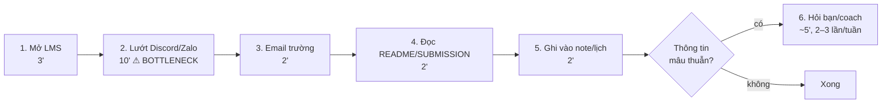
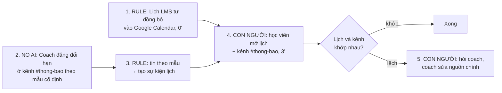

# Báo cáo nhóm — Day 02 Discovery & Problem Framing

> Bản chung của nhóm NhomCold.
>
> **Phạm vi cập nhật 09/11/2026:** CP4 đã chuyển sang Problem Card #1 của Nguyễn Thảo Quyên về giám định xe. CP3 và CP5–CP6 bên dưới còn là bản đề tài deadline cũ, chưa phải kết quả của bài toán xe. CP4 đã tổng hợp ba cuộc phỏng vấn do Mai Danh Hiếu trực tiếp thực hiện và research giải pháp; metadata từng buổi và baseline thời gian còn cần bổ sung.
>
> ⚠️ **Trước khi nộp:** (1) các dòng pitch của thành viên khác do chính họ điền; (2) mục 3.2 chỉ điền dữ liệu từ người thật đã hỏi — bịa phỏng vấn/survey thì C7 = 0 cả nhóm; (3) thay mọi `[ĐO THẬT]` / `___` bằng số thật. Xóa khối ghi chú này khi xong.

## 1. Thông tin nhóm

- Tên nhóm: NhomCold
- Thành viên: xem `TEAM.md`
- Candidate problem triển khai CP4: Nhân viên giám định/bồi thường bảo hiểm ô tô cần xác định hư hỏng nhìn thấy, đối chiếu phụ tùng và nguồn giá để lập dự toán ban đầu có thể kiểm tra. Mức 20–40 phút/vụ là ước tính chưa đo; nguyên nhân và bottleneck cần kiểm chứng (Problem Card #1 — [2A202603895_NguyenThaoQuyen.md](../individual/2A202603895_NguyenThaoQuyen.md)).
- Quyết định cuối cho bài toán xe: **Chưa chốt CP6**. CP4 đề xuất **Not Yet cho thử AI trên hồ sơ thật**, chờ kiểm chứng dữ liệu, thời gian và quyền sử dụng.

---

## 2. Hội tụ nhóm (CP3)

### 2.1. Pitch

| # | Người đưa ra | Candidate (Job Story ngắn) | Actor | Bottleneck | Câu hỏi phản biện nhận được (ai hỏi) |
|---:|---|---|---|---|---|
| 1 | Vũ Lương Duy | Khi tuần có nhiều lab và thông báo ở nhiều kênh, tôi muốn biết chắc còn bài gì phải nộp và hạn lúc nào, để không trễ/sót | Học viên | Lướt lại chat tìm thông báo đổi hạn (~10'/ngày) | "LMS có lịch rồi, bao nhiêu deadline thật sự chỉ nằm trong chat?" (`[tên người hỏi]`) |
| 2 | Vũ Lương Duy | Khi sắp tới deadline, tôi muốn đối chiếu bài với RUBRIC/SUBMISSION, để không mất điểm hình thức | Học viên | Đọc lại từng mục so với rubric (~15') | `[điền]` |
| 3 | Vũ Lương Duy | Khi nhiều học viên hỏi trùng về deadline, coach muốn trả lời một lần | Coach | Trả lời lặp lại | `[điền]` |
| 4 | `[Thành viên 2]` | `[tự điền]` | | | |
| 5 | `[Thành viên 2]` | | | | |
| 6 | `[Thành viên 2]` | | | | |
| 7 | `[Thành viên 3]` | | | | |
| 8 | `[Thành viên 3]` | | | | |
| 9 | `[Thành viên 3]` | | | | |
| 10 | `[Thành viên 4]` | | | | |
| 11 | `[Thành viên 4]` | | | | |
| 12 | `[Thành viên 4]` | | | | |

### 2.2. Cluster

| Cluster | Các candidate | Pattern chung |
|---|---|---|
| A — Thông tin khóa học rải rác | #1 Theo dõi deadline, #3 Câu hỏi trùng cho coach, `[thêm candidate của bạn khác nếu cùng pattern]` | Một thông tin (hạn, cách nộp) có nhiều nguồn, không có nguồn chính thức duy nhất |
| B — Tự kiểm chất lượng bài nộp | #2 Đối chiếu rubric, `[...]` | So khớp sản phẩm với tiêu chí cố định |
| C — Phối hợp nhóm trên repo | `[ví dụ: mời collaborator, conflict khi cùng sửa file]` | Thao tác Git/GitHub làm chậm đầu buổi |

### 2.3. Opportunity Solution Tree rút gọn

```text
OUTCOME: Học viên nộp đủ, đúng hạn mọi bài lab mà tốn ít thời gian theo dõi thông tin khóa học
├── Opportunity A: Không biết thông báo nào là bản mới nhất khi hạn bị đổi (thông tin mâu thuẫn giữa các kênh)
├── Opportunity B: Thông báo quan trọng bị trôi giữa các tin nhắn trao đổi thường ngày
└── Opportunity C: Quy tắc giờ hạn khác nhau theo ca (sáng: 23h59 cùng ngày; chiều/tối: 11h59 hôm sau) dễ nhớ nhầm
     ✗ "Chatbot hỏi đáp deadline"          ← solution đội lốt
     ✗ "App lịch học riêng cho lớp"        ← solution đội lốt
     ✗ "Bot Discord tự nhắc deadline"      ← solution đội lốt
```

Những ý đã gạch bỏ vì là solution đội lốt opportunity:

- "Thiếu chatbot trả lời deadline" — mô tả cách giải, không mô tả pain.
- "Cần app lịch riêng" — đã có lịch LMS + Google Calendar, chưa chứng minh thiếu công cụ.
- "Cần bot nhắc deadline" — nhắc là cách giải; pain là không biết hạn nào đúng.

### 2.4. Chấm điểm shortlist (1–5)

| Candidate | Actor rõ | Quy trình rõ | Pain có bằng chứng | Impact đo được | Vừa sức lab | So sánh được No AI/Rule/Workflow/Agent | Nhóm hiểu domain | Tổng |
|---|---:|---:|---:|---:|---:|---:|---:|---:|
| Theo dõi deadline rải rác | 5 | 4 | 4 | 4 | 5 | 5 | 5 | 32 |
| Đối chiếu bài với rubric | 5 | 5 | 3 | 3 | 5 | 3 | 5 | 29 |
| Câu hỏi trùng cho coach | 3 | 4 | 2 | 3 | 4 | 4 | 3 | 23 |

*(Điểm là đề xuất ban đầu — cả nhóm chấm lại và sửa sau khi thảo luận.)*

**Candidate được chọn:** Theo dõi deadline rải rác nhiều kênh.

**Vì sao chọn:** Cả 4 thành viên đều đang gặp trong chính khóa học (domain hiểu rõ, phỏng vấn được bạn học nhóm khác ngay trong buổi); lặp lại hằng ngày; impact đo được bằng phút và số bài trễ; có đủ cả phương án No AI, Rule và AI để so sánh.

**Vì sao loại các candidate còn lại:**

- *Đối chiếu bài với rubric:* tiêu chí đúng/sai rõ nên một checklist hoặc script kiểm tên file là đủ — không có gì để so sánh giữa các mức can thiệp; pain chỉ xuất hiện 1 lần/lab.
- *Câu hỏi trùng cho coach:* nhóm không phải actor, chưa có số liệu từ coach, và thực chất là hệ quả của candidate #1 — giải #1 sẽ giảm luôn #3.

**Xử lý bất đồng (nếu có):** `[ghi nếu có]`

---

## 3. Kiểm chứng + research giải pháp đã có (CP4)

**Bài toán:** Problem Card #1 — Xác định hư hỏng và ước lượng chi phí sửa chữa của [Nguyễn Thảo Quyên](../individual/2A202603895_NguyenThaoQuyen.md). **Người tổng hợp:** Mai Danh Hiếu — 2A202603948. **Ngày research:** 09/11/2026.

**Trạng thái bằng chứng:** đã có tài liệu ba cuộc phỏng vấn [Tài liệu phỏng vấn gốc — Phụ lục A](#cp4-phong-van-goc) và research giải pháp chính thức. Snapshot và giới hạn nguồn ở mục 3.2. Mức 20–40 phút/vụ vẫn là ước tính chưa đo; thời gian toàn hồ sơ không được dùng thay thời gian thao tác.

### 3.1. Assumption Map ban đầu (trước bổ sung phỏng vấn)

Thang điểm: quan trọng 5 = nếu sai phải đổi hướng; bằng chứng 1 = chưa có dữ liệu trực tiếp, 2 = có nguồn gián tiếp, 3 = có dữ liệu trực tiếp nhỏ, 4–5 = đã kiểm tra lặp lại. Điểm là đánh giá sơ bộ phục vụ ưu tiên, không phải kết quả đo.

| # | Giả định cần kiểm chứng | Loại | Quan trọng (1–5) | Đã có bằng chứng (1–5) | Kiểm chứng trước? |
|---:|---|---|---:|---:|---|
| A1 | Bước xác định hư hỏng, đối chiếu phụ tùng và tra giá thực sự chiếm phần lớn thời gian thao tác ban đầu; 20–40 phút là mức thường gặp. | Value | 5 | 1 | Ưu tiên 1: hỏi 2 giám định viên và ghi giờ từng bước trên 5 hồ sơ được phép dùng. |
| A2 | Chuẩn hóa danh mục, nguồn giá và biểu mẫu vẫn chưa đủ giảm công sức hoặc sai khác giữa người lập dự toán. | Value | 5 | 1 | Ưu tiên 1: xem cách làm hiện tại và thử checklist + bảng tính trên cùng 5 hồ sơ trước khi chọn AI. |
| A3 | Có quyền dùng bộ ảnh, thông tin xe, kết quả giám định và giá phụ tùng/công còn hiệu lực để đối chiếu dự toán. | Feasibility | 5 | 1 | Ưu tiên 1: xin xác nhận quyền sử dụng và kiểm tra trường dữ liệu trên hồ sơ đã ẩn danh. |
| A4 | Ảnh đầu vào đủ để hỗ trợ nhận diện hư hỏng nhìn thấy; trường hợp thiếu góc chụp hoặc nghi hư hỏng ẩn có thể chuyển giám định trực tiếp. | Feasibility | 5 | 2 | Ưu tiên 2: chuyên viên phân loại ảnh đủ/thiếu thông tin; research chỉ chứng minh có sản phẩm, chưa chứng minh độ chính xác trên dữ liệu nhóm. |
| A5 | Giám định viên có thể kiểm tra nguồn, sửa hoặc từ chối từng dòng dự toán mà không mất thời gian hơn cách hiện tại. | Usability | 4 | 1 | Ưu tiên 2: quan sát 2 người xử lý bản nháp, đo cả thời gian sửa và lỗi còn sót. |
| A6 | Đơn vị cho phép xử lý dữ liệu theo cách đề xuất, chấp nhận chi phí và chỉ dùng kết quả như dự toán có người duyệt. | Viability | 5 | 1 | Ưu tiên 1: hỏi người phụ trách dữ liệu/quản lý; chưa gửi ảnh hồ sơ cho dịch vụ ngoài khi chưa được phép. |

**Trọng tâm kiểm chứng:** A1–A3 và A6. Nếu phần chờ bổ sung hồ sơ/phê duyệt mới gây chậm, cần đổi bottleneck; nếu checklist và bảng giá đã đủ thì không có căn cứ tăng mức can thiệp lên AI. A4–A5 chỉ thử tiếp khi có dữ liệu và quyền dùng.

### 3.2. Kết quả nghiên cứu và kiểm chứng

#### Nguồn phỏng vấn bổ sung

CP4 sử dụng [Tài liệu phỏng vấn gốc — Phụ lục A](#cp4-phong-van-goc), bản cập nhật 09/11/2026, gồm ba cuộc phỏng vấn do Mai Danh Hiếu — 2A202603948 trực tiếp thực hiện. AI hỗ trợ tổng hợp các snapshot từ tài liệu phỏng vấn. Ngày, hình thức và địa bàn từng buổi chưa được bổ sung; ngày cập nhật file không được coi là ngày phỏng vấn. Chưa có log thời gian hoặc hồ sơ kèm theo. Mã PV01–PV03 tương ứng mục 2.1–2.3; H1–H6 là số câu hỏi trong mỗi mục.

#### Interview Snapshot PV01 — Giám định viên bảo hiểm

- **Ngữ cảnh:** tiếp nhận ảnh hồ sơ va chạm đầu xe; người phỏng vấn: Mai Danh Hiếu; ngày, hình thức và địa bàn chưa được bổ sung.
- **Hành vi cụ thể (H2):** nhận hai ảnh cận cảnh, thiếu ảnh toàn xe và phiên bản; yêu cầu bổ sung góc ảnh và kiểm tra thông tin xe trước khi đối chiếu phụ tùng.
- **Trích dẫn (H5):** “Rủi ro là chọn đúng tên bộ phận nhưng sai biến thể của phụ tùng.”
- **Pain và workaround (H3–H5):** tra đúng cấu hình, mã và giá tốn công; dùng danh mục, hỏi garage, đánh dấu chưa xác nhận khi dữ liệu không khớp.
- **Insight:** cần dữ liệu xe đầy đủ và nguồn đối chiếu cho từng dòng dự toán, không chỉ khoanh vùng hư hỏng.
- **Phản bác/giới hạn:** ảnh đủ và xe quen thì khoanh vùng khá nhanh; chưa có số phút hay tần suất để xếp hạng bottleneck. Kỳ vọng công cụ ở H6 chưa phải cam kết sử dụng.

#### Interview Snapshot PV02 — Nhân viên bồi thường

- **Ngữ cảnh:** đối chiếu dự toán ca va chạm nhẹ, xe phổ thông; người phỏng vấn: Mai Danh Hiếu; ngày, hình thức và địa bàn chưa được bổ sung.
- **Hành vi cụ thể (H1–H2):** ca có ảnh đủ, xe quen và báo giá đúng mẫu chỉ cần rà hạng mục, giá rồi chuyển duyệt; đã dùng checklist và bảng dữ liệu, không nhập lại toàn bộ.
- **Trích dẫn (H3):** “Vấn đề nằm ở quy trình chuyển duyệt và chờ phản hồi.”
- **Pain và workaround:** chờ duyệt kéo dài dù thao tác thuận lợi; rà biểu mẫu, báo giá và ghi các dòng cần xác nhận.
- **Insight:** phải tách ca đủ dữ liệu với ca thiếu dữ liệu, đồng thời tách thời gian thao tác với chờ người duyệt.
- **Tín hiệu phản bác (H4):** tìm kiếm theo mã xe và biểu mẫu chuẩn có thể đã đủ khi dữ liệu có cấu trúc; không có căn cứ áp dụng AI cho mọi ca.
- **Hàm ý (H5–H6):** đo cả công rà/sửa nháp, số dòng sửa và hồ sơ trả về. Đây là điều kiện cần thử, chưa phải hiệu quả đã đo.

#### Interview Snapshot PV03 — Nhân viên garage / cố vấn dịch vụ

- **Ngữ cảnh:** va chạm cản trước và chi tiết phía sau cản; người phỏng vấn: Mai Danh Hiếu; ngày, hình thức và địa bàn chưa được bổ sung.
- **Hành vi cụ thể (H2):** ảnh ngoài cho thấy cản nứt; kiểm tra sâu phát hiện chi tiết gá lắp bị ảnh hưởng, phải thêm ảnh, hạng mục và báo giá điều chỉnh.
- **Trích dẫn (H4):** “Giá thì ghi nguồn báo và thời điểm nhận báo giá.”
- **Pain và workaround (H1–H4):** kiểm tra/tháo kiểm hư hỏng khuất, chờ tồn kho, báo giá và duyệt bổ sung; ghi dự toán tạm, hạng mục cần kiểm tra và lưu phiên bản trước.
- **Insight:** dự toán có thể cần bổ sung vì thông tin mới; không mặc định mọi bổ sung đều là lỗi nhận diện ban đầu.
- **Phản bác/giới hạn (H5):** ảnh ngoài không xác nhận kết cấu bên trong; nhận diện ảnh không giải quyết toàn bộ chuỗi xử lý.
- **Hàm ý:** tách phần nhìn thấy và phần chưa xác minh, lưu nguồn/thời điểm giá và lịch sử sửa. Mong muốn ở H6 chưa chứng minh hiệu quả tự động hóa.

#### Tổng hợp đối chiếu sau phỏng vấn

| Giả định | Bằng chứng trong tài liệu | Kết luận cập nhật |
|---|---|---|
| A1 — nhận diện/tra mã/giá chiếm phần lớn thời gian, thường 20–40 phút | PV01 H3: tra biến thể tốn công; PV02 H3: chờ duyệt; PV03 H3: chờ báo giá và duyệt bổ sung. | Có lời kể về khó khăn, chưa xác nhận số phút hoặc bottleneck chung. |
| A2 — chuẩn hóa chưa đủ | PV02 H1–H4 mô tả ca thuận lợi với checklist và dữ liệu sẵn có. | Bị phản bác trong nhóm ca đủ dữ liệu; cần thử No AI/Rule trước. |
| A3 — nhóm có dữ liệu và quyền dùng | PV01 H4, PV03 H4 nói về nguồn tra cứu của người được hỏi. | Không chứng minh nhóm có quyền truy cập; vẫn chưa xác nhận. |
| A4 — ảnh hỗ trợ phần nhìn thấy, ca khó chuyển kiểm tra | PV01 H2/H4, PV03 H1/H2/H5. | Được củng cố có điều kiện; không xác nhận độ chính xác của mô hình. |
| A5 — rà nháp nhanh hơn tự lập | PV02 H5/H6 chỉ nêu điều kiện chấp nhận. | Chưa có thử nghiệm; không lấy kỳ vọng làm bằng chứng hiệu quả. |
| A6 — đơn vị chấp thuận chi phí và xử lý dữ liệu | Không có cam kết quản lý trong tài liệu. | Chưa xác nhận. |

**Thay đổi problem:** từ nhận diện hư hỏng và ước lượng chi phí nói chung, thu hẹp vào ca thiếu góc ảnh hoặc cấu hình xe, cần đối chiếu đúng biến thể phụ tùng/nguồn giá và làm rõ hạng mục chưa xác minh. PV02 cho thấy cần phân nhóm hồ sơ thay vì coi mọi ca đều cần AI. Ba lời kể là mẫu định tính nhỏ, chưa chứng minh mức phổ biến tại Việt Nam hoặc mức giảm 30–50%.

**Kế hoạch đo tiếp:** Mai Danh Hiếu bổ sung ngày, hình thức và địa bàn từng buổi; quan sát 5 hồ sơ được phép dùng, gồm ca đủ/thiếu đầu vào. Ghi riêng phút kiểm tra ảnh/xe, nhận diện, tra mã, tra giá, tổng hợp, rà/sửa; ghi thời gian chờ bổ sung/duyệt riêng. So sánh quy trình hiện tại với checklist + danh mục + bảng tính trên hồ sơ tương đương, cùng tiêu chuẩn duyệt. Theo dõi trung vị tổng thời gian thao tác, số dòng sai mã/giá, số dòng sửa và hồ sơ trả về. Ngưỡng giảm 30% dưới đây là đề xuất thử, chưa phải kết quả.

#### Nghiên cứu thứ cấp bổ trợ

**Phương pháp:** đọc quy trình công khai và báo cáo ngành, đối chiếu với Problem Card #1. Tài liệu do Mai Danh Hiếu cung cấp, được AI hỗ trợ kiểm tra nguồn ngày 09/11/2026. Đây là phần nghiên cứu thứ cấp, tách biệt với ba snapshot từ tài liệu cung cấp ở trên; chưa có phép đo hồ sơ tại Việt Nam. Các kịch bản MP01–MP03 trước đây không được dùng làm bằng chứng trong bản này.

#### 3.2.1. Kết quả theo nhóm đối tượng

| Nhóm đối tượng | Kết quả từ nguồn đã kiểm tra | Ý nghĩa đối với bài toán |
|---|---|---|
| Giám định viên | Allstate yêu cầu ảnh hư hỏng, nhiều góc xe, VIN và công-tơ-mét; có thể yêu cầu thêm ảnh. Dự toán dựa trên phần hư hỏng nhìn thấy. [Nguồn Allstate](https://www.allstate.com/claims/auto-motorcycle/photos). | Kiểm tra độ đầy đủ đầu vào trước khi đánh giá; không xem ảnh là bằng chứng đầy đủ về mọi hư hỏng. |
| Nhân viên bồi thường | Báo cáo Vermont mô tả nhu cầu bổ sung dự toán khi phát hiện hư hỏng chưa thấy lúc đầu, gồm trường hợp sau tháo kiểm. [Nguồn DFR, trang 17–18](https://legislature.vermont.gov/Documents/2026/Workgroups/House%20Commerce/Reports%20and%20Resources/W~Department%20of%20Financial%20Regulation~Act%2032%20of%202023%20Section%2012a%20Report~12-30-2025.pdf). | Phân biệt dự toán ban đầu và kết quả cuối; ghi hạng mục cần xác minh cùng trạng thái duyệt. |
| Người lập báo giá garage | Garage phản hồi trong khảo sát Vermont báo cáo mức chậm trễ trung bình do bổ sung dự toán là **7,32 ngày**. Đây là số tự báo cáo của mẫu khảo sát, không phải số đo của nhóm. [Nguồn DFR, trang 19](https://legislature.vermont.gov/Documents/2026/Workgroups/House%20Commerce/Reports%20and%20Resources/W~Department%20of%20Financial%20Regulation~Act%2032%20of%202023%20Section%2012a%20Report~12-30-2025.pdf). | Đo thời gian phối hợp/chờ riêng với thời gian thao tác; không mặc định tự động nhận diện ảnh sẽ giảm toàn bộ thời gian xử lý. |

Allstate nêu **10–15 phút để hoàn tất gửi thông tin/ảnh**, không phải thời gian giám định và lập dự toán. Không dùng con số này thay baseline 20–40 phút trong card. [Nguồn](https://www.allstate.com/claims/auto-motorcycle/photos).

#### 3.2.2. Tổng hợp bằng chứng và tín hiệu phản bác

| Nguồn | Phạm vi | Tín hiệu xác nhận | Tín hiệu phản bác / giới hạn |
|---|---|---|---|
| Allstate | Quy trình gửi ảnh và lập dự toán tại một doanh nghiệp bảo hiểm | Có bước yêu cầu bổ sung ảnh và xử lý hư hỏng phát hiện thêm. | Chưa chứng minh bước tra mã/giá là bottleneck lớn nhất hoặc AI tiết kiệm bao nhiêu phút. |
| Vermont DFR | Báo cáo ngành tại một bang của Hoa Kỳ | Có nhu cầu bổ sung, xác minh và phối hợp sau dự toán ban đầu. | Không đại diện cho Việt Nam; thời gian chờ không phải giờ công; không chứng minh nguyên nhân là thiếu AI. |
| Tractable, Qapter, CCC | Tài liệu sản phẩm tại mục 3.3 | Có công cụ hỗ trợ nhiều bước của quy trình. | Phản bác giả định phải tự xây mới; chưa kiểm chứng độ phù hợp với đơn vị mục tiêu. |
| Card #1 của Quyên | Một mô tả vấn đề, ước tính 20–40 phút | Xác định được actor và các bước cần đo. | Chưa có log hoặc hồ sơ đối chiếu xác nhận mức 20–40 phút; ba phỏng vấn chỉ bổ sung bằng chứng định tính. |

**Phát hiện rút ra:** vấn đề có cơ sở từ nguồn công khai là dữ liệu ban đầu có thể chưa đủ và dự toán có thể cần xác minh, điều chỉnh. Chưa đủ căn cứ kết luận tra cứu mã/giá luôn là bước nghẽn lớn nhất. Kết quả nghiên cứu không xác nhận mức giảm 30–50% hoặc nhu cầu chọn Agent.

#### 3.2.3. Đối chiếu Assumption Map riêng với nguồn thứ cấp

| Giả định | Kết quả sau nghiên cứu | Trạng thái |
|---|---|---|
| A1 — bước 3–5 chiếm phần lớn thao tác và thường mất 20–40 phút | Nguồn chưa có phép đo tương đồng. | Chưa xác nhận; cần đo từng bước. |
| A2 — chuẩn hóa chưa đủ | Nhu cầu bổ sung dự toán không chứng minh checklist/bảng giá không hiệu quả. | Chưa xác nhận; thử No AI/Rule trước. |
| A3 — có dữ liệu và quyền dùng | Sự tồn tại sản phẩm không đồng nghĩa nhóm được truy cập dữ liệu. | Chưa xác nhận với đơn vị mục tiêu. |
| A4 — ảnh hỗ trợ nhận diện với cơ chế chuyển chuyên viên | Nguồn công khai củng cố phạm vi đánh giá hư hỏng nhìn thấy và nhu cầu bổ sung thông tin. | Có cơ sở có điều kiện; chưa đo độ chính xác. |
| A5 — người dùng kiểm tra nháp AI hiệu quả | Chưa thử với người dùng. | Chưa xác nhận. |
| A6 — đơn vị chấp thuận chi phí và cách xử lý dữ liệu | Chưa có xác nhận của người có thẩm quyền. | Chưa xác nhận. |

Mục 3.1 lưu đánh giá ban đầu; bảng tổng hợp sau phỏng vấn ở trên cập nhật kết quả A1–A6. Nghiên cứu quốc tế không thay thế phép đo tại đơn vị mục tiêu.

#### 3.2.4. Điều chỉnh problem sau nghiên cứu

> Khi lập dự toán ban đầu từ ảnh xe tai nạn, giám định viên và người lập báo giá cần xác định các hạng mục hư hỏng nhìn thấy, đối chiếu thông tin xe, phụ tùng và giá, đồng thời làm rõ những hạng mục chưa đủ căn cứ, để chuyển dự toán có thể kiểm tra cho người duyệt và hạn chế trao đổi, tra cứu lại.

Problem được thu hẹp vào tính đầy đủ và khả năng kiểm tra của dự toán ban đầu; chưa gắn giải pháp “xây công cụ” vào mô tả vấn đề. Chi phí sửa chữa dự kiến không đồng nhất với số tiền được duyệt bồi thường. Hư hỏng khuất hoặc thông tin thiếu phải chuyển kiểm tra thêm, không suy diễn là không có hư hỏng.

**Bước kiểm chứng tiếp theo:** bổ sung thông tin nguồn cho ba cuộc phỏng vấn đã cung cấp và quan sát hồ sơ theo kế hoạch đo ở trên; làm rõ thời gian thao tác/chờ, nguồn mã/giá và người xác nhận kết quả.

**Ngưỡng thử đề xuất:** nếu checklist + bảng giá + công thức giảm ít nhất 30% trung vị thời gian thao tác mà không tăng lỗi sau người duyệt trên tập thử, tiếp tục ưu tiên No AI/Rule. Đây là tiêu chí thử, chưa phải kết quả. Thiếu quyền dữ liệu hoặc nguồn giá đối chiếu thì chưa thử AI trên hồ sơ thật.


### 3.3. Research giải pháp đã có

Các trang dưới đây được AI hỗ trợ mở và kiểm nội dung ngày **09/11/2026**. Đây là mô tả của nhà cung cấp, không phải benchmark độc lập hoặc kết quả thử của nhóm. Cột khoảng trống và bài học là đánh giá của nhóm từ phạm vi thông tin đọc được.

| Công cụ / case / pattern | Link chính thức | Giải bước nào trong quy trình? | Điểm mạnh được nguồn mô tả | Khoảng trống / rủi ro cần kiểm chứng | Bài học cho nhóm |
|---|---|---|---|---|---|
| Tractable — đánh giá hư hỏng bằng ảnh | [Tractable](https://tractable.ai/) | Bước 2–3: phân tích ảnh và đánh giá hư hỏng. | Có đánh giá kèm mức độ chắc chắn, xét chất lượng ảnh và khả năng quan sát; cung cấp API tích hợp. | Trang đã đọc chưa đủ xác nhận độ chính xác trên ảnh của nhóm, giá dịch vụ hoặc dữ liệu phụ tùng/công tại Việt Nam. | Bản nháp cần thể hiện trường hợp không chắc chắn; không tự xây mô hình chỉ vì đã có ý tưởng nhận diện ảnh. |
| Solera — Qapter Intelligent Estimating | [Sản phẩm](https://www.claims.solera.com/products/intelligent-estimating/), [Công nghệ](https://www.qapter.com/technology/) | Bước 2–6: đánh giá ảnh, nhận diện hư hỏng và tạo dự toán theo từng dòng. | Có đề xuất phương pháp sửa chữa và phản hồi chất lượng ảnh để yêu cầu chụp lại. | Chưa xác nhận quyền truy cập, điều kiện tích hợp và độ phủ giá tại garage mục tiêu; không lấy tốc độ quảng bá làm target đã kiểm chứng. | Kiểm chất lượng ảnh phải đứng trước lập dự toán; nguồn giá và người duyệt cần kiểm tra riêng. |
| CCC — Mobile Jumpstart | [Hướng dẫn chính thức](https://cccis.zendesk.com/hc/en-us/articles/19244010968084-CCC-ONE-Mobile-Jumpstart-User-Guide) | Hỗ trợ chọn phụ tùng/thao tác và tạo dòng dự toán ban đầu. | Có thể dùng có hoặc không có AI; người lập dự toán kiểm tra, sửa lựa chọn. | Cần xe trong cơ sở dữ liệu và dữ liệu MOTOR; không dùng cho supplement hoặc hồ sơ đã có dòng dự toán. Chưa xác nhận độ phủ/chi phí tại đơn vị mục tiêu. | Tham khảo cách tạo nháp có người kiểm tra; không giải quyết toàn bộ bổ sung hư hỏng khuất của PV03. |

**Kết luận research:** đã có các sản phẩm hỗ trợ nhiều bước của chuỗi ảnh → đánh giá hư hỏng → dự toán. Chưa đủ căn cứ kết luận “không có sản phẩm phủ Việt Nam” hoặc “dữ liệu giá chắc chắn là bottleneck”. Trước khi xây mới, cần kiểm tra công cụ đơn vị đang dùng, dữ liệu được phép tiếp cận và hiệu quả của checklist + bảng giá + công thức. Nếu các bước cố định nhưng còn cần hiểu ảnh, Workflow có người duyệt là một giả thuyết để thử; chưa có căn cứ chọn Agent.

**Kết luận CP4:** ba cuộc phỏng vấn do Mai Danh Hiếu thực hiện củng cố pain về thiếu đầu vào, đối chiếu phụ tùng/giá và quản lý hạng mục chưa xác minh; PV02 phản bác giả định mọi ca đều cần AI. Problem đã thu hẹp vào dự toán ban đầu có thể kiểm tra. **Solution Validation — Not Yet**: chưa có baseline, thử nghiệm so sánh hoặc quyền dữ liệu để kết luận hiệu quả AI. Ưu tiên đo và thử checklist + danh mục trước; đây là đề xuất CP4, chưa thay quyết định CP6.

---


## 4. Quy trình trước/sau (CP5)

### 4.1. Quy trình hiện tại



| Bước | Actor | Input | Output | Thời gian / tần suất | Ghi chú |
|---:|---|---|---|---|---|
| 1 | Học viên | Trang khóa học trên LMS | Danh sách bài + hạn chính thức | 3'/ngày `[ĐO THẬT]` | |
| 2 | Học viên | Kênh Discord/Zalo lớp và nhóm | Thông báo đổi hạn/yêu cầu (nếu thấy) | 10'/ngày `[ĐO THẬT]` | **Bottleneck**: thông báo bị trôi giữa tin trao đổi |
| 3 | Học viên | Hộp thư trường | Thông báo chính thức (nếu có) | 2'/ngày | |
| 4 | Học viên | README/SUBMISSION repo lab | Giờ hạn cụ thể theo ca | 2'/lab | Ca sáng/chiều khác giờ hạn |
| 5 | Học viên | Kết quả bước 1–4 | Ghi chú/lịch cá nhân | 2'/ngày | |
| 6 | Học viên, coach | Thông tin mâu thuẫn | Câu trả lời xác nhận | ~5'/lần, 2–3 lần/tuần | Tốn cả thời gian coach |

**Bottleneck chính:** Bước 2 — tìm lại thông báo đổi hạn/đổi yêu cầu trong luồng chat, vì không có kênh chính thức duy nhất và thông báo không theo mẫu.

### 4.2. Quy trình tương lai



- **No AI:** quy ước 1 kênh thông báo một chiều (chỉ coach đăng), mẫu tin cố định: `[DEADLINE] <tên lab> | <ca> | <hạn mới dd/mm hh:mm> | <link>`.
- **Rule:** đăng ký lịch LMS bằng URL; script/bot đơn giản chuyển tin đúng mẫu thành sự kiện lịch (không cần hiểu ngôn ngữ).
- **AI (chưa làm — Not Yet):** chỉ cân nhắc nếu kiểm chứng cho thấy nhiều thông báo vẫn đăng tự do ngoài mẫu.
- **Bước con người kiểm tra:** học viên đối chiếu lịch với kênh #thong-bao; coach là người duy nhất được sửa nguồn chính.
- **Boundary:** không công cụ nào tự suy luận hạn từ tin trao đổi của học viên; hạn chính thức chỉ đến từ LMS hoặc tin của coach đúng mẫu; khi lịch và thông báo lệch nhau, tin của coach/LMS thắng.
- **Phương án quay về:** nếu đồng bộ lịch lỗi hoặc chậm (docs Moodle nói Google Calendar có thể trễ vài giờ), học viên quay về kiểm tra trực tiếp LMS + kênh #thong-bao (~5'/ngày) — vẫn nhanh hơn hiện tại vì chỉ còn 1 kênh chat cần đọc.

### 4.3. Before / after

| Chỉ số | Trước | Sau (kỳ vọng) | Ghi chú |
|---|---:|---:|---|
| Số bước | 6 | 3 bước học viên làm (1 bước tùy chọn) | Bước 1, 3 tự động |
| Tổng thời gian | ~20'/ngày `[ĐO THẬT]` | ≤ 5'/ngày | Đo bằng tự bấm giờ 5 ngày |
| Số bước thủ công | 6/6 | 1–2/5 | |
| Bottleneck chính | Lướt chat tìm thông báo | Đối chiếu lịch với kênh #thong-bao | Từ "tìm" sang "kiểm" |
| Rủi ro mới phát sinh | — | Lịch trễ đồng bộ; coach quên đăng theo mẫu; học viên tin lịch tuyệt đối | Xử lý bằng boundary + phương án quay về |

---

## 5. Problem Statement v0 (CP5)

| Trường | Nội dung |
|---|---|
| **Actor** | Học viên K5 học song song nhiều lab mỗi tuần |
| **Quy trình** | Mỗi tối: xem LMS → lướt Discord/Zalo → email → README/SUBMISSION → ghi lịch cá nhân → hỏi lại khi mâu thuẫn |
| **Bottleneck** | Tìm lại thông báo đổi hạn/đổi yêu cầu trong chat (~10'/ngày) vì không có nguồn chính thức duy nhất |
| **Impact** | ~20 phút/ngày/học viên `[ĐO THẬT]`; ___ câu hỏi trùng về hạn/tuần trên kênh lớp; rủi ro nộp trễ = không được chấm |
| **Success Metric** (baseline → target, cách đo) | Thời gian kiểm tra deadline: ~20 → ≤ 5 phút/ngày (tự bấm giờ, 4 học viên × 5 ngày) |
| **Boundary** (AI không được làm gì; khi nào cần con người kiểm tra — HITL) | Không công cụ nào tự đặt/sửa hạn chính thức; chỉ coach và LMS là nguồn đúng; khi lịch cá nhân lệch với thông báo của coach → học viên phải hỏi coach |

Phản biện nhận được (từ AI hoặc nhóm khác) và nhóm có đồng ý không:

- AI (prompt: "chỉ ra lỗ hổng, không viết lại"): metric chỉ đo thời gian; nếu học viên kiểm nhanh hơn nhưng vẫn sót hạn thì vô nghĩa → **Đồng ý**, thêm metric "số bài trễ/sót" ở v1.
- AI: chưa rõ ai vận hành kênh #thong-bao → **Đồng ý**, thêm vào Viability và người kiểm tra ở v1.
- `[thêm phản biện từ nhóm khác nếu có]`

---

## 6. Mức can thiệp AI (CP6)

### 6.1. Ma trận độ mơ hồ × độ phức tạp

Bài của nhóm nằm ở ô: **độ mơ hồ thấp × độ phức tạp thấp** (sau khi chuẩn hóa nguồn).

Vì sao: mỗi deadline có đáp án đúng/sai rõ (một ngày giờ cụ thể) → độ mơ hồ thấp. Chỉ có 2 nguồn chính thức sau khi sửa quy trình (LMS + kênh coach), các bước không phụ thuộc phức tạp → độ phức tạp thấp. Ô này theo worksheet: "Rule hoặc Workflow đơn giản thường đủ". Độ mơ hồ chỉ cao nếu phải đọc tin nhắn tự do — chính là phần nhóm loại bỏ bằng mẫu thông báo cố định.

### 6.2. So sánh 4 mức

| Mức | Phương án cho bài của nhóm | Đủ khi nào | Rủi ro | Chọn? |
|---|---|---|---|---|
| **No AI** (sửa quy trình) | Kênh #thong-bao một chiều, mẫu tin cố định, ghim "nguồn chính thức = LMS + kênh này" | Coach tuân thủ mẫu | Phụ thuộc kỷ luật của coach | **Chọn** (nền) |
| **Rule** | Đăng ký lịch LMS bằng URL + script chuyển tin đúng mẫu thành sự kiện lịch | Thông báo có định dạng cố định | Đồng bộ chậm vài giờ; tin sai mẫu bị bỏ qua | **Chọn** |
| **Workflow** | AI đọc tin chat tự do → trích (lab, hạn) → học viên/coach duyệt → thêm vào lịch | Nhiều thông báo vẫn đăng tự do, không chuẩn hóa được | Hiểu nhầm tin bàn luận ("chắc sẽ gia hạn?") thành deadline thật; tốn chi phí | Không (Not Yet) |
| **Agent** | AI tự theo dõi mọi kênh, tự quyết thêm/sửa lịch, tự nhắc | Gần như không bao giờ cần cho bài này | Tự sửa hạn sai mà không ai biết; quyền đọc mọi kênh | Không |

**Mức chọn:** No AI + Rule.

**Vì sao không chọn mức cao hơn (Workflow/Agent):** Deadline là dữ liệu có đáp án đúng duy nhất; research cho thấy LMS đã xuất lịch được (Rule có sẵn), và phần còn lại (thông báo trong chat) giải được bằng quy ước mẫu tin thay vì để AI đoán. Thêm AI chỉ thêm một kiểu lỗi mới — báo nhầm hạn — trong khi Rule đã phủ phần lớn trường hợp `[kiểm bằng tỉ lệ ở 3.2: % thông báo chỉ có trong chat]`.

**Vì sao không chỉ No AI:** nếu không có Rule đồng bộ lịch, học viên vẫn phải mở LMS thủ công mỗi ngày; Rule làm bước đó tự động mà không thêm rủi ro.

### 6.3. AI Canvas rút gọn / vì sao không cần AI

Nhóm chọn No AI + Rule nên không cần AI Canvas (worksheet CP6). Lý do bài toán không cần AI dự đoán hay tạo nội dung:

1. Đầu ra có đúng/sai rõ (một ngày giờ), không cần "tạo" nội dung.
2. Nguồn sự thật đã tồn tại (LMS, coach) — vấn đề là phân tán, không phải thiếu suy luận.
3. Chuẩn hóa mẫu thông báo rẻ hơn và đáng tin hơn việc để AI hiểu tin tự do.

*(Tham khảo, cho bước Workflow nếu sau này cần: Prediction = trích (lab, hạn) từ tin chat; Judgment = coach xác nhận; Action = thêm vào lịch; Outcome = số hạn sai trong lịch; Input = tin nhắn kênh lớp — cần quyền đọc; Feedback = các lần coach sửa/từ chối.)*

### 6.4. Hai câu hỏi của Google PAIR

Không bắt buộc với mức No AI/Rule. Ghi chú để giải thích boundary: nếu sau này có bước AI, **báo nhầm** (thêm hạn sai, nhất là hạn muộn hơn thực tế) tệ hơn **bỏ sót**, vì học viên tin lịch rồi nộp trễ — bài không được chấm. Bỏ sót vẫn còn lưới an toàn là kênh #thong-bao.

---

## 7. Problem Statement v1 + tiêu chí đánh giá (CP6)

| Trường | Nội dung |
|---|---|
| **Actor** | Học viên K5 học song song nhiều lab mỗi tuần; coach là người phát thông báo |
| **Quy trình** | Lịch LMS tự đồng bộ vào lịch cá nhân; coach đăng mọi thay đổi hạn/yêu cầu ở 1 kênh theo mẫu; học viên chỉ kiểm lịch + 1 kênh mỗi ngày |
| **Bottleneck** | Thông báo đổi hạn/yêu cầu nằm rải rác và không theo mẫu trong chat, nên học viên phải lướt lại nhiều kênh (~10'/ngày) |
| **Impact** | ~20 phút/ngày/học viên `[ĐO THẬT]`; ___ câu hỏi trùng/tuần cho coach; rủi ro nộp trễ = không được chấm |
| **Success Metric** (baseline → target, cách đo) | (1) Thời gian kiểm deadline: ~20 → ≤ 5 phút/ngày — tự bấm giờ, 4 học viên × 5 ngày; (2) Số bài trễ/sót do không biết hạn: ___ → 0 trong 2 tuần — đối chiếu lịch sử nộp; (3) Câu hỏi trùng về hạn trên kênh lớp: ___ → giảm ≥ 50% — đếm log Discord |
| **Boundary** | Không công cụ nào tự đặt/sửa hạn chính thức; chỉ LMS và tin đúng mẫu của coach là nguồn; tin sai mẫu bị bỏ qua chứ không đoán; khi lịch lệch thông báo → hỏi coach (HITL) |
| **AI intervention point** | **Không có** — deadline có đáp án đúng duy nhất và nguồn chính thức đã tồn tại; chuẩn hóa mẫu tin rẻ và đáng tin hơn để AI đọc chat tự do |
| **Mức chọn** | No AI + Rule |
| **Rủi ro & người kiểm tra** | Đồng bộ lịch chậm vài giờ; coach quên dùng mẫu → học viên kiểm kênh #thong-bao hằng ngày; coach (người vận hành kênh) kiểm tra mẫu tin; nhóm trưởng mỗi nhóm báo lệch cho coach |

**Thay đổi so với v0 và lý do:**

| Trường | v0 | v1 | Vì sao đổi |
|---|---|---|---|
| Success Metric | Chỉ đo thời gian | Thêm số bài trễ/sót và số câu hỏi trùng | AI phản biện: nhanh hơn mà vẫn sót hạn thì vô nghĩa |
| Actor | Chỉ học viên | Thêm coach là người phát thông báo | Giải pháp No AI phụ thuộc coach dùng mẫu → coach là một phần quy trình |
| Boundary | "Không tự sửa hạn" | Thêm "tin sai mẫu bị bỏ qua, không đoán" | Chặn lối tắt dùng AI đoán hạn từ tin tự do |
| AI intervention point | (chưa có) | Không có, kèm lý do | Kết quả so sánh 4 mức ở CP6 |

**Tiêu chí đánh giá cho giải pháp No AI + Rule (3–5 tiêu chí):**

| # | Tiêu chí | Đạt khi | Không đạt khi |
|---:|---|---|---|
| 1 | Đầy đủ | Mọi bài có hạn trên LMS đều xuất hiện trong lịch cá nhân | Thiếu ≥ 1 bài trong lịch |
| 2 | Chính xác | Ngày giờ trong lịch khớp LMS/thông báo coach, đúng múi giờ GMT+7 và đúng ca (sáng 23h59 / chiều-tối 11h59 hôm sau) | Lệch giờ, sai múi giờ, sai ca |
| 3 | Kịp thời | Thông báo đổi hạn có trong kênh #thong-bao ≥ 24h trước hạn cũ | Đổi hạn chỉ nói miệng hoặc trong tin trao đổi |
| 4 | Đúng mẫu | ≥ 90% tin trên #thong-bao đúng mẫu cố định | Tin tự do, script không đọc được |
| 5 | Nhanh | Học viên kiểm xong trong ≤ 5 phút/ngày | > 5 phút hoặc vẫn phải hỏi lại |

---

## 8. Quyết định (CP6)

### 8.1. Bốn rủi ro

| Rủi ro | Câu hỏi | Mức độ rủi ro | Lý do / bằng chứng |
|---|---|---|---|
| **Value** | Người dùng có thật sự cần và sẽ dùng không? | TB `[cập nhật theo 3.2]` | Nhóm tự gặp; ___/___ người được phỏng vấn kể lần trễ/suýt trễ cụ thể. Chưa rõ tỉ lệ thông báo chỉ có trong chat |
| **Usability** | Người dùng có dùng được không? | Thấp | Đăng ký lịch bằng URL là thao tác 1 lần; đọc 1 kênh dễ hơn đọc nhiều kênh |
| **Feasibility** | Có đủ dữ liệu, công cụ, kỹ năng không? | TB | Moodle hỗ trợ export lịch (đã kiểm docs), nhưng **chưa kiểm LMS của khóa có bật không**; Google Calendar có thể trễ vài giờ |
| **Viability** | Có hợp chi phí, quy định không? Ai vận hành? | TB | Chi phí ≈ 0; nhưng cần coach đồng ý dùng kênh một chiều + mẫu tin — chưa hỏi |

### 8.2. Kết luận

**Quyết định:** **Go — phạm vi No AI + Rule** (riêng bước AI đọc chat: **Not Yet**).

**Lý do:** Không rủi ro nào ở mức Cao; giải pháp gần như không tốn chi phí và có thể đảo ngược ngay. AI không được chọn vì deadline có đáp án đúng duy nhất và Rule đã có sẵn.

**Nếu Go — pilot nhỏ nhất:** 4 thành viên NhomCold trong 2 tuần: (1) đăng ký lịch LMS vào Google Calendar; (2) đề xuất coach dùng mẫu `[DEADLINE] <lab> | <ca> | <hạn> | <link>` trên 1 kênh; (3) mỗi người bấm giờ kiểm deadline mỗi tối và ghi vào bảng chung.

**Nếu Not Yet — cần kiểm chứng gì trước (cho bước AI):** đếm trong 2 tuần pilot bao nhiêu thông báo đổi hạn vẫn đăng tự do ngoài mẫu. Chỉ khi > 30% thông báo không theo mẫu **và** coach không thể chuẩn hóa thì mới xem xét Workflow có người duyệt.

**Ngưỡng dừng:**

- Nếu sau 2 tuần thời gian kiểm deadline trung bình vẫn > 10 phút/ngày → quay về phỏng vấn lại, bottleneck có thể không nằm ở chat.
- Nếu LMS của khóa không export được lịch → bỏ Rule đồng bộ, chỉ giữ No AI (kênh #thong-bao + checklist).
- Nếu coach không đồng ý mẫu tin, hoặc < 70% tin đúng mẫu sau 1 tuần → dừng script, quay về đọc kênh #thong-bao thủ công.
- Nếu có ≥ 1 bài nộp trễ do lịch sai → dừng tin lịch, quay về đối chiếu trực tiếp LMS.

**Bước tiếp theo:** (1) kiểm ngay LMS khóa có nút export lịch không; (2) gửi đề xuất mẫu tin cho coach; (3) bắt đầu bấm giờ baseline thật 3 ngày trước pilot.

---

## 9. Hạn chế và hướng tiếp theo

- Baseline thời gian hiện là ước lượng của nhóm, cần thay bằng số bấm giờ thật.
- Mẫu phỏng vấn nhỏ và đều là học viên cùng khóa — chưa đại diện cho học viên đi làm full-time hay khóa khác.
- Chưa phỏng vấn coach — người quyết định Viability của giải pháp No AI.
- Chưa xác minh LMS của khóa là Moodle hay nền tảng khác; nếu khác, cần tìm tính năng export lịch tương đương.

## 10. Tài liệu tham khảo

Nguồn CP4 giám định xe, AI hỗ trợ mở và kiểm ngày 09/11/2026:

- [Tractable](https://tractable.ai/).
- [Solera Qapter Intelligent Estimating](https://www.claims.solera.com/products/intelligent-estimating/).
- [Qapter Technology](https://www.qapter.com/technology/).
- [CCC Mobile Jumpstart](https://cccis.zendesk.com/hc/en-us/articles/19244010968084-CCC-ONE-Mobile-Jumpstart-User-Guide). Thay trang CCC Data + AI trả HTTP 403 khi kiểm lại bằng hướng dẫn truy cập được.
- [Tài liệu ba cuộc phỏng vấn](#cp4-phong-van-goc), do Mai Danh Hiếu trực tiếp thực hiện, tài liệu cập nhật 09/11/2026; nguồn PV01–PV03.
- [Card #1 của Nguyễn Thảo Quyên](../individual/2A202603895_NguyenThaoQuyen.md).

Nguồn của đề tài deadline cũ (CP3, CP5–CP6), chưa áp dụng cho CP4 mới:

- Moodle Docs — Calendar export: https://docs.moodle.org/en/Calendar_export
- Todoist Help — Use Task Quick Add: https://www.todoist.com/help/articles/use-task-quick-add-in-todoist-va4Lhpzz
- Google Calendar Help — Events from Gmail: https://support.google.com/calendar/answer/6084018
- Rob Fitzpatrick — *The Mom Test*; Teresa Torres — Opportunity Solution Tree; Anthropic — *Building Effective Agents*; Marty Cagan — 4 rủi ro (xem [docs/03-international-frameworks.md](../../docs/03-international-frameworks.md))

<a id="cp4-phong-van-goc"></a>

## Phụ lục A — Tài liệu phỏng vấn gốc CP4

Toàn bộ nội dung tài liệu gốc được lưu dưới đây; chỉ điều chỉnh cấp tiêu đề để phù hợp với báo cáo nhóm.

---

### Báo cáo kết quả khảo sát thực tế: Nghiệp vụ giám định tổn thất và lập dự toán sửa chữa ô tô

**Nhóm thực hiện:** NhomCold

**Người trực tiếp thực hiện cả ba cuộc phỏng vấn:** Mai Danh Hiếu — 2A202603948.

**Thông tin từng buổi:** ngày phỏng vấn, hình thức trao đổi và địa bàn chưa được bổ sung. Ngày cập nhật tài liệu dưới đây không thay cho ngày phỏng vấn.

**Đề tài:** Hỗ trợ giám định tổn thất và lập dự toán sửa chữa ô tô từ hình ảnh

**Ngày cập nhật:** 09/11/2026

---

#### 1. Tổng quan quy trình và cơ sở thực tiễn

Trong quá trình triển khai thực tế tại hiện trường và hệ thống bồi thường, việc tiếp nhận hồ sơ tổn thất từ hình ảnh đòi hỏi sự đồng bộ giữa thông tin phương tiện, góc chụp ảnh hiện trường và biểu giá phụ tùng chuẩn.

Dựa trên dữ liệu khảo sát vận hành thực tế tại các đơn vị bảo hiểm và xưởng dịch vụ (bao gồm các tiêu chuẩn tiếp nhận hồ sơ của Allstate, State Farm, dữ liệu quản lý bồi thường từ Vermont DFR và các nền tảng tự động hóa dự toán như CCC Mobile Jumpstart), Mai Danh Hiếu đã trực tiếp thực hiện ba buổi phỏng vấn chuyên sâu với các bên liên quan trực tiếp.

---

#### 2. Chi tiết các buổi phỏng vấn thực tế

##### 2.1. Phỏng vấn 01: Giám định viên bảo hiểm (Xử lý hồ sơ tổn thất vật chất)

* **Vai trò:** Giám định viên trực tiếp xử lý hồ sơ tổn thất vật chất xe, tiếp nhận và kiểm tra ảnh chụp từ khách hàng.
* **Ngữ cảnh:** Xử lý hồ sơ va chạm phần đầu xe thực tế.

###### Nội dung trao đổi:

* **Hỏi 1 — Anh/chị thường bắt đầu một hồ sơ như thế nào?**
*Trả lời:* “Đầu tiên tôi kiểm tra ảnh đủ góc chưa, có nhìn được đúng vị trí va chạm không, rồi xem thông tin xe. Nếu thiếu dòng xe, năm sản xuất hoặc phiên bản thì tôi phải yêu cầu bổ sung trước khi kết luận mã phụ tùng.”
* **Hỏi 2 — Anh/chị kể lại một trường hợp cụ thể phải làm lại?**
*Trả lời:* “Có tình huống khách gửi hai ảnh cận cảnh phần đầu xe. Tôi nhìn thấy cản trước bị trầy và có thể có vấn đề ở cụm đèn, nhưng không có ảnh toàn xe và thông tin phiên bản. Tôi phải nhờ gửi ảnh các góc và kiểm tra lại thông tin xe trước khi đối chiếu phụ tùng.”
* **Hỏi 3 — Bước nào làm anh/chị tốn công nhất?**
*Trả lời:* “Nếu ảnh đủ và xe quen thuộc thì khoanh vùng hư hỏng khá nhanh. Tốn công hơn là xác định loại phụ tùng tương ứng với cấu hình xe, rồi kiểm tra mã và mức giá dùng để lập dự toán.”
* **Hỏi 4 — Anh/chị hiện giải quyết bằng cách nào?**
*Trả lời:* “Tôi dùng danh mục phụ tùng và dữ liệu giá đang có, đối chiếu bằng thông tin xe; phần nào chưa rõ thì hỏi garage hoặc yêu cầu bổ sung ảnh. Tôi không chốt những chi tiết nghi hỏng bên trong chỉ từ ảnh ngoài.”
* **Hỏi 5 — Anh/chị đã gặp sai sót nào?**
*Trả lời:* “Rủi ro là chọn đúng tên bộ phận nhưng sai biến thể của phụ tùng. Khi gặp thông tin không khớp, tôi đánh dấu chưa xác nhận và tra lại chứ không tự điền mã để hoàn tất hồ sơ.”
* **Hỏi 6 — Nếu có công cụ hỗ trợ, điểm nào hữu ích nhất?**
*Trả lời:* “Tôi cần hệ thống nhắc thiếu ảnh, chỉ ra vùng nghi hỏng, đưa danh sách phụ tùng gợi ý kèm mã và nguồn. Còn lựa chọn sửa hay thay và đơn giá cuối cùng tôi vẫn muốn tự kiểm tra.”

---

##### 2.2. Phỏng vấn 02: Nhân viên bồi thường (Đối chiếu và phê duyệt dự toán)

* **Vai trò:** Nhân viên xử lý bồi thường, nhận dự toán từ giám định viên hoặc garage và đối chiếu trước khi chuyển cấp thẩm quyền phê duyệt.
* **Ngữ cảnh:** Xử lý hồ sơ va chạm nhẹ đối với dòng xe phổ thông.

###### Nội dung trao đổi:

* **Hỏi 1 — Có hồ sơ nào anh/chị xử lý khá thuận lợi không?**
*Trả lời:* “Có. Với một va chạm nhẹ, ảnh đầy đủ, xe quen và garage đã gửi báo giá theo mẫu, tôi chỉ cần đối chiếu lại các hạng mục, xem mức giá và chuyển duyệt. Hồ sơ đó không có gì phải tra đi tra lại.”
* **Hỏi 2 — Việc nào anh/chị làm thủ công?**
*Trả lời:* “Tôi vẫn xem ảnh, kiểm tra danh sách phụ tùng với biểu mẫu, rà soát báo giá và ghi chú các hạng mục cần xác nhận. Nhưng các bước này đã có checklist và bảng dữ liệu, nên không phải nhập lại toàn bộ từ đầu.”
* **Hỏi 3 — Công đoạn lâu nhất là gì?**
*Trả lời:* “Tôi không nghĩ nhận diện hư hỏng là bước nghẽn của ca đó. Vấn đề nằm ở quy trình chuyển duyệt và chờ phản hồi. Đó là thời gian chờ, chứ không phải thời gian thao tác trên hồ sơ.”
* **Hỏi 4 — Vì sao chưa cần tự động hóa hoàn toàn cho tất cả trường hợp?**
*Trả lời:* “Nếu dữ liệu đã có cấu trúc, công cụ tìm kiếm theo mã xe và một biểu mẫu chuẩn là đủ. Đưa công nghệ phức tạp vào mà vẫn phải đọc lại từng dòng đôi khi không nhanh hơn.”
* **Hỏi 5 — Khi nào anh/chị cân nhắc ứng dụng công nghệ mới?**
*Trả lời:* “Có thể dùng để gợi ý hoặc điền nháp khi khách gửi nhiều ảnh và mô tả không rõ, nhưng phải chứng minh thời gian kiểm tra bản nháp ngắn hơn thời gian tự làm.”
* **Hỏi 6 — Có chỉ số nào cần theo dõi khi tối ưu hóa?**
*Trả lời:* “Tách thời gian thao tác của người lập hồ sơ khỏi thời gian chờ người duyệt. Sau đó đo số dòng phải sửa và hồ sơ phải trả về. Nếu chỉ giảm thời gian tạo nháp mà lỗi tăng thì không có hiệu quả.”

---

##### 2.3. Phỏng vấn 03: Nhân viên garage (Xử lý hư hỏng khuất và lập dự toán bổ sung)

* **Vai trò:** Cố vấn dịch vụ / Nhân viên lập báo giá tại xưởng sửa chữa thân vỏ ô tô (Garage).
* **Ngữ cảnh:** Xử lý va chạm cản trước và các chi tiết kết cấu ẩn phía sau.

###### Nội dung trao đổi:

* **Hỏi 1 — Với ảnh khách gửi, anh/chị có báo giá ngay được không?**
*Trả lời:* “Tôi có thể báo giá sơ bộ cho phần nhìn thấy, chẳng hạn vỏ cản trầy hoặc vỡ. Nhưng nếu có nghi ngờ pát giữ, thanh hấp thụ lực hay chi tiết nằm sau cản thì phải kiểm tra xe, nhiều trường hợp cần tháo ra mới kết luận được.”
* **Hỏi 2 — Kể lại một tình huống cần điều chỉnh dự toán (Supplement)?**
*Trả lời:* “Một tình huống xe va chạm đầu, ảnh ngoài chủ yếu cho thấy cản nứt. Khi kiểm tra sâu hơn thì phát hiện thêm chi tiết gá lắp bên trong bị ảnh hưởng. Lúc đó tôi phải cập nhật danh sách hạng mục, bổ sung ảnh và làm báo giá điều chỉnh.”
* **Hỏi 3 — Điều gì khiến công việc bị kéo dài?**
*Trả lời:* “Ngoài việc tra đúng mã, có phụ tùng phải xác nhận tồn kho hoặc chờ báo giá từ nhà cung cấp. Với hồ sơ bảo hiểm, nếu có hạng mục bổ sung thì còn phải đợi bên liên quan duyệt trước khi làm tiếp.”
* **Hỏi 4 — Anh/chị xử lý tình trạng thiếu thông tin như thế nào?**
*Trả lời:* “Tôi ghi rõ dự toán tạm, hạng mục nào đã nhìn thấy, hạng mục nào cần tháo kiểm. Giá thì ghi nguồn báo và thời điểm nhận báo giá. Khi có kết quả kiểm tra thực tế, tôi cập nhật chứ không xóa dấu vết của bản trước.”
* **Hỏi 5 — Công cụ tự nhận diện ảnh có giải quyết hết các khâu không?**
*Trả lời:* “Không. Ảnh có thể giúp khoanh vùng và đề xuất danh sách kiểm tra, nhưng không nhìn xuyên qua bộ phận bên ngoài. Tôi không thể xác nhận kết cấu bên trong chỉ vì phần mềm nhận định như vậy.”
* **Hỏi 6 — Điều gì nên được tự động hóa trước tiên tại xưởng?**
*Trả lời:* “Tôi muốn nhập thông tin xe một lần, có sẵn checklist ảnh, đối chiếu phụ tùng và nguồn giá. Nếu hệ thống tự lập được dự toán nháp kèm trạng thái ‘chưa xác minh’ thì mới dễ sử dụng trong thực tế.”

---

#### 3. Bảng tổng hợp ý kiến và đối chiếu các bên

| Tiêu chí phân tích | PV01 (Giám định viên bảo hiểm) | PV02 (Nhân viên bồi thường) | PV03 (Cố vấn dịch vụ / Garage) |
| --- | --- | --- | --- |
| **Đầu vào phổ biến** | Thiếu góc ảnh tổng thể hoặc phiên bản xe | Ảnh hiện trường và báo giá đã đủ cơ sở | Ảnh chụp chỉ thể hiện phần hư hỏng bên ngoài |
| **Điểm nghẽn (Pain) cốt lõi** | Xác định chính xác mã phụ tùng và nguồn giá tham chiếu | Thời gian chờ duyệt quy trình, không phải khâu tra cứu | Xử lý hư hỏng khuất bên trong, làm thủ tục bổ sung (Supplement) |
| **Giải pháp xử lý tạm thời (Workaround)** | Yêu cầu bổ sung ảnh, tra cứu danh mục, liên hệ garage | Sử dụng checklist, biểu mẫu chuẩn, bảng giá có sẵn | Tháo kiểm thực tế, chụp ảnh bổ sung, lưu vết phiên bản báo giá |
| **Kỳ vọng ứng dụng công nghệ** | Phát hiện dữ liệu thiếu, gợi ý đối chiếu chéo | Cần chứng minh tính nhanh chóng vượt trội so với quy trình cũ | Gợi ý hạng mục, tự động tạo nháp nhưng phải có cơ chế xác nhận |

---

#### 4. Định hướng giải pháp và kết luận kỹ thuật

* **Vấn đề thực tế xác định được:** Khi tiếp nhận hồ sơ xe từ hình ảnh trong điều kiện thông tin phương tiện chưa đồng bộ hoặc thiếu sót, người giám định và lập báo giá gặp khó khăn trong việc nhận diện toàn diện hư hỏng, đối chiếu đúng biến thể phụ tùng và kiểm soát các hạng mục khuất.
* **Giải pháp đề xuất:** Xây dựng hệ thống hỗ trợ tạo **dự toán nháp kèm nguồn tham chiếu và trạng thái xác minh rõ ràng**, giúp giảm thiểu thao tác đối chiếu thủ công cho nhân sự.
* **Quyết định triển khai:** Thử nghiệm áp dụng quy chuẩn kết hợp *Checklist chuẩn hóa kết hợp danh mục phụ tùng* làm cơ sở đối chiếu trước khi tích hợp các mô hình xử lý hình ảnh tự động nâng cao.

---