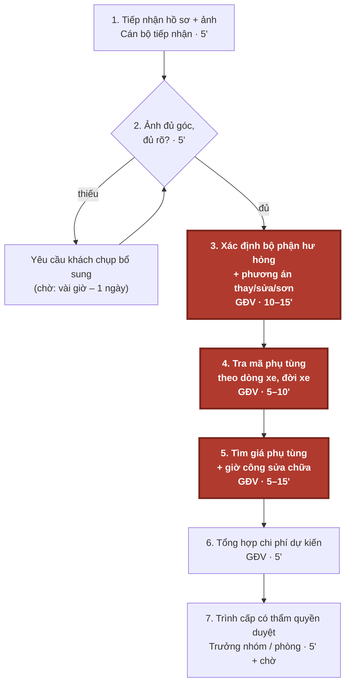
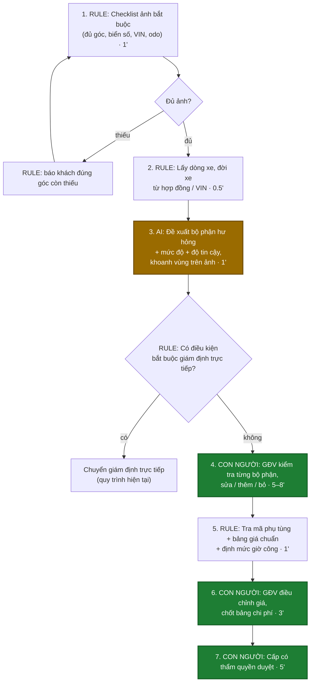

# Báo cáo nhóm — Day 02 Discovery & Problem Framing

> Bản chung của nhóm NhomCold, viết trên repo do nhóm trưởng fork.
>
> ⚠️ **Trước khi nộp:** thay mọi `[ĐO THẬT]` / `___` bằng số thật lấy từ phỏng vấn giám định viên hoặc từ hồ sơ đã xử lý (CP4). Số phút trong mục 4 hiện là ước tính ban đầu của nhóm. Xóa khối ghi chú này khi xong.

## 1. Thông tin nhóm

- Tên nhóm: NhomCold
- Thành viên: xem `TEAM.md`
- Candidate problem được chọn (1 câu): Khi tiếp nhận hồ sơ bồi thường bảo hiểm ô tô kèm ảnh xe tai nạn, giám định viên mất 20–40 phút/vụ để xác định bộ phận hư hỏng, tra phụ tùng và giá sửa chữa, và kết quả ước lượng chưa nhất quán giữa các nhân viên.
- Quyết định cuối: Go / Not Yet / No-Go

---

## 2. Hội tụ nhóm (CP3)

Nhóm 4 người, 12 candidate. Hội tụ theo trình tự: pitch top 3 → gom cluster → cây OST → chấm điểm shortlist và chọn một candidate.

### 2.1. Candidate và câu hỏi chuẩn bị pitch

Các câu hỏi dưới đây phục vụ buổi pitch; câu hỏi thực tế và người hỏi được ghi vào nhật ký phản biện của từng thành viên.

| # | Người có card | Candidate | Actor | Bottleneck | Câu hỏi chuẩn bị phản biện |
|---:|---|---|---|---|---|
| 1 | Vũ Lương Duy | Chép đơn từ inbox | Chủ shop | Chép trường thông tin sang bảng quản lý | Khách tự điền mẫu xác nhận đơn có giảm được thao tác chép lại không? |
| 2 | Vũ Lương Duy | Tồn kho lệch giữa các kênh | Chủ shop | Cập nhật kho thủ công | Kho lệch do cập nhật chậm hay do số tồn ban đầu sai? |
| 3 | Vũ Lương Duy | Đăng sản phẩm nhiều kênh | Chủ shop | Viết và điều chỉnh mô tả | Bước mất thời gian nhất là viết mô tả hay nhập thuộc tính từng kênh? |
| 4 | Nguyễn Thảo Quyên | Xác định hư hỏng xe | Giám định viên | Đối chiếu hư hỏng, phụ tùng và giá | Bước nghẽn chính là xác định hư hỏng, tra phụ tùng hay tra giá? Ảnh có đủ căn cứ để lập dự toán không? |
| 5 | Nguyễn Thảo Quyên | Tìm đúng phụ tùng | Nhân viên phụ tùng | Đối chiếu mã và tính tương thích | Đã có mã phụ tùng và thông tin dòng xe thì bộ lọc danh mục có đủ không? |
| 6 | Nguyễn Thảo Quyên | Kiểm tra bài tập | Giảng viên | Đọc bài và đối chiếu rubric | Rubric và đáp án có đủ rõ để hai người chấm nhất quán không? |
| 7 | Hồ Nguyễn Minh Sang | Tổng hợp ghi chú họp | Thành viên nhóm | Gom ghi chú theo chủ đề | Nếu ghi trực tiếp theo mẫu ngay trong họp, bước gom ghi chú còn tốn thời gian không? |
| 8 | Hồ Nguyễn Minh Sang | Chốt sổ thu chi nhà trọ hằng tháng | Chủ nhà trọ, người quản lý | Đối chiếu thanh toán và công nợ theo phòng/kỳ | Công thức bảng tính đã xử lý được bao nhiêu phần việc? Chênh lệch chủ yếu ở chỉ số hay thanh toán? |
| 9 | Hồ Nguyễn Minh Sang | Hiểu khái niệm khó khi research | Người học, dev | Tra thuật ngữ và tìm cách giải thích phù hợp kiến thức nền | Sau khi đọc lời giải thích, làm thế nào kiểm tra người học hiểu đúng và áp dụng được? |
| 10 | Mai Danh Hiếu | Tổng hợp tiến độ nhóm | Người điều phối | Đọc cập nhật và hỏi lại | Nhóm thiếu cập nhật hay có cập nhật nhưng cách diễn đạt khó tổng hợp? |
| 11 | Mai Danh Hiếu | Phân công phù hợp khả năng | Nhóm trưởng | Cân đối tải và chuyển đầu việc | Chênh lệch tải do số việc, độ khó hay thời gian rảnh của từng người? |
| 12 | Mai Danh Hiếu | Bàn giao việc phụ thuộc | Người nhận bàn giao | Đợi và yêu cầu bổ sung đầu vào | Phần việc bị chặn vì giao trễ hay vì đầu ra bàn giao thiếu thông tin? |

### 2.2. Cluster

| Cluster | Candidate | Pattern chung |
|---|---|---|
| A — Tổng hợp và diễn giải thông tin | #1, #7, #9, #10 | Chuyển thông tin rời rạc hoặc khó hiểu thành nội dung có cấu trúc để sử dụng |
| B — Đối chiếu số liệu và giao dịch | #2, #8 | Đối chiếu lượng tồn, khoản thanh toán hoặc công nợ để xác định trạng thái đúng |
| C — Đánh giá và đối chiếu chuyên môn | #4, #5, #6 | Xác định bộ phận, mã tương thích hoặc mức độ đáp ứng tiêu chí dựa trên căn cứ chuyên môn |
| D — Phối hợp và xuất bản | #3, #11, #12 | Phụ thuộc đầu vào, tải công việc hoặc nhiều nơi nhận |

### 2.3. Opportunity Solution Tree rút gọn

Gốc là **1 outcome**. Nhánh là **opportunity** (nhu cầu, pain), không phải tính năng hay công cụ.

```text
OUTCOME: Rút ngắn thời gian lập dự toán sửa chữa ban đầu trên mỗi hồ sơ bồi thường ô tô,
         đồng thời không tăng số hạng mục bỏ sót và sai lệch chi phí so với giám định
├── Opportunity: Khó xác định đầy đủ bộ phận hư hỏng từ ảnh và thông tin xe
├── Opportunity: Tốn công đối chiếu phụ tùng tương thích và phương án sửa/thay
├── Opportunity: Phải tra cứu giá phụ tùng và công sửa chữa từ nhiều nguồn
└── Opportunity: Khó đối chiếu căn cứ của từng hạng mục trong dự toán
     ✗ "Nhận diện hư hỏng bằng Computer Vision"       ← đây là SOLUTION, gạch bỏ khỏi tầng này
     ✗ "Hệ thống tự tra phụ tùng và đề xuất chi phí"  ← đây là SOLUTION, gạch bỏ khỏi tầng này
     ✗ "Agent tự xử lý hồ sơ"                        ← đây là SOLUTION, gạch bỏ khỏi tầng này
```

### 2.4. Chấm điểm shortlist (1–5)

Bảng điểm đề xuất trên thang 1–5, dùng để đối chiếu ba candidate theo cùng tiêu chí. Điểm bằng chứng phản ánh mức độ dữ liệu hiện có; điểm tổng không thay thế việc xem xét phạm vi và khả năng kiểm chứng.

| Candidate | Actor rõ | Quy trình rõ | Pain có bằng chứng | Impact đo được | Vừa sức lab | So sánh được 4 mức | Nhóm hiểu domain | Tổng |
|---|---:|---:|---:|---:|---:|---:|---:|---:|
| Xác định hư hỏng và ước lượng chi phí sửa chữa | 5 | 5 | 2 | 5 | 3 | 5 | 3 | **28** |
| Tra cứu và xác định phụ tùng ô tô | 5 | 5 | 2 | 4 | 4 | 4 | 3 | 27 |
| Chốt sổ thu chi nhà trọ hằng tháng | 5 | 5 | 1 | 5 | 5 | 2 | 3 | 26 |

**Chọn:** Xác định hư hỏng và ước lượng chi phí sửa chữa — Problem Card #1 của Nguyễn Thảo Quyên, tương ứng candidate #4 trong bảng tổng hợp.

**Job Story:** Khi tiếp nhận yêu cầu bồi thường kèm hình ảnh xe bị tai nạn, tôi muốn xác định các bộ phận bị hư hỏng và ước lượng chi phí sửa chữa, để có cơ sở đánh giá mức bồi thường và tư vấn cho khách hàng.

**Vì sao chọn:** Quy trình rõ, đo được thời gian lập dự toán, hạng mục bỏ sót và sai lệch chi phí; có cơ sở so sánh checklist, Rule, Workflow và Agent. Phạm vi lab chỉ gồm dự toán ban đầu để người giám định kiểm tra. Điểm bằng chứng thấp vì số phút trong card là ước lượng; điểm vừa sức lab thấp hơn hai bài còn lại do cần hồ sơ và dữ liệu giá.

**Vì sao loại hai candidate kia:** Tra cứu phụ tùng hẹp hơn và đã là một bước trong bài toán được chọn, nên giữ làm phần phân tích sâu. Sổ nhà trọ có quy trình rõ và vẫn là candidate hợp lệ dù chỉ cần bảng tính hoặc Rule. Vòng này nhóm tập trung vào chuỗi xác định hư hỏng, tra phụ tùng và lập dự toán; bài toán nhà trọ được giữ cho vòng phân tích khác. Cả ba chỉ đạt 3 điểm hiểu domain vì cần người trực tiếp làm nghiệp vụ đối chiếu.

**Nguyên tắc xử lý bất đồng:** Đối chiếu actor, dữ liệu tiếp cận được và cách đo tác động; nếu hai candidate có điểm gần nhau, ưu tiên phạm vi kiểm chứng được trong buổi lab. Giữ các candidate còn lại cho vòng phân tích tiếp theo.


## 3. Kiểm chứng + research giải pháp đã có (CP4)

### 3.1. Assumption Map

| # | Giả định | Loại (Value / Usability / Feasibility / Viability) | Quan trọng (1–5) | Đã có bằng chứng (1–5) | Kiểm chứng trước? |
|---:|---|---|---:|---:|---|
| 1 | | | | | |
| 2 | | | | | |
| 3 | | | | | |
| 4 | | | | | |

Giả định nhóm kiểm chứng trong buổi này:

### 3.2. Kiểm chứng

Cách đã dùng: Phỏng vấn / Survey / Log, ticket, review

Interview snapshot:

| Trường | Nội dung |
|---|---|
| Người được hỏi (vai trò, không ghi tên thật) | |
| Câu nói đáng nhớ nhất (nguyên văn) | |
| Lần gần nhất gặp vấn đề này: chuyện gì đã xảy ra? | |
| Hiện đang xử lý bằng cách nào (workaround)? | |
| Mất bao lâu, bao lần? | |
| Insight / opportunity rút ra | |

Tổng hợp:

| Nguồn | Số người / số mẫu | Tín hiệu xác nhận | Tín hiệu phản bác |
|---|---:|---|---|
| | | | |

**Nhóm đã sửa problem thế nào sau kiểm chứng:**

### 3.3. Research giải pháp đã có

| Công cụ / case / pattern | Link | Giải bước nào trong quy trình? | Điểm mạnh | Khoảng trống / rủi ro | Bài học cho nhóm |
|---|---|---|---|---|---|
| | | | | | |
| | | | | | |

---

## 4. Quy trình trước/sau (CP5)

Phạm vi: **đánh giá sơ bộ từ ảnh** cho một hồ sơ bồi thường vật chất xe ô tô, tính từ lúc nhận ảnh đến lúc trình duyệt phương án sửa chữa và chi phí dự kiến. Không gồm bước xác minh phạm vi bảo hiểm, giám định trực tiếp tại garage khi tháo dỡ, và thanh toán.

### 4.1. Quy trình hiện tại



*Ô đỏ đậm, viền dày = bottleneck (bước 3–5).*

| Bước | Actor | Input | Output | Thời gian / tần suất | Ghi chú |
|---:|---|---|---|---|---|
| 1 | Cán bộ tiếp nhận | Thông báo tổn thất, ảnh khách gửi, số hợp đồng | Hồ sơ vụ mới | 5'/vụ | 15 vụ/ngày/GĐV |
| 2 | Giám định viên (GĐV) | Bộ ảnh hiện trường/xe | Ảnh đạt yêu cầu, hoặc yêu cầu chụp bổ sung | 5'/vụ; 20% vụ phải chụp lại `[ĐO THẬT]` | Thiếu ảnh làm cả hồ sơ phải chờ |
| 3 | GĐV | Ảnh đạt yêu cầu, thông tin xe | Danh sách bộ phận hư hỏng + phương án thay/sửa/sơn | 10–15'/vụ | **Bottleneck**: phụ thuộc kinh nghiệm, mỗi GĐV đánh giá một kiểu |
| 4 | GĐV | Danh sách bộ phận, dòng xe/đời xe | Mã phụ tùng | 5–10'/vụ | Tra catalogue theo từng hãng |
| 5 | GĐV | Mã phụ tùng, phương án sửa | Đơn giá phụ tùng + giờ công | 5–15'/vụ | Hỏi báo giá garage, đối chiếu bảng giá hãng |
| 6 | GĐV | Kết quả bước 3–5 | Bảng chi phí dự kiến (Excel/biểu mẫu) | 5'/vụ | |
| 7 | Trưởng nhóm / phòng | Bảng chi phí + ảnh | Duyệt / yêu cầu chỉnh sửa | 5'/vụ + thời gian chờ | Ngưỡng phân cấp duyệt theo số tiền |

**Tổng thời gian thao tác:** khoảng 40–60 phút/vụ, trong đó bước 3–5 chiếm 20–40 phút. Chưa tính thời gian chờ khách chụp bổ sung và chờ duyệt.

**Bottleneck chính:** Bước 3–5. GĐV phải tự nhìn ảnh để xác định bộ phận hư hỏng và chọn thay hay sửa, rồi tra mã và giá thủ công qua nhiều nguồn. Ba bước này vừa tốn 20–40 phút vừa cho kết quả khác nhau giữa các GĐV với cùng một bộ ảnh.

### 4.2. Quy trình tương lai



*Vàng đậm = bước AI · Xanh lá đậm = bước con người kiểm tra / quyết định · còn lại là Rule.*

| Bước | Ai làm | Việc | Thời gian |
|---:|---|---|---|
| 1 | **Rule** | Biểu mẫu nhận ảnh bắt buộc đủ góc (4 góc chéo, cận cảnh vùng hư hỏng, biển số, VIN, đồng hồ odo); thiếu góc nào báo đúng góc đó | 1' |
| 2 | **Rule** | Lấy hãng, dòng xe, đời xe từ hợp đồng bảo hiểm / VIN | 0.5' |
| 3 | **AI** | Đề xuất danh sách bộ phận hư hỏng, mức độ (trầy / móp / vỡ), gợi ý thay hay sửa, kèm độ tin cậy và vùng khoanh trên ảnh | ~1' |
| 3b | **Rule** | Kiểm điều kiện bắt buộc giám định trực tiếp (xem Boundary) | tức thì |
| 4 | **Con người** | GĐV kiểm tra từng bộ phận AI đề xuất: xác nhận, sửa, thêm bộ phận bị sót, bỏ bộ phận sai | 5–8' |
| 5 | **Rule** | Tra mã phụ tùng và đơn giá từ bảng giá chuẩn của công ty + định mức giờ công | 1' |
| 6 | **Con người** | GĐV điều chỉnh theo báo giá garage thực tế, chốt bảng chi phí sơ bộ | 3' |
| 7 | **Con người** | Cấp có thẩm quyền duyệt theo phân cấp số tiền | 5' |

**Boundary — AI không được:**

- Quyết định mức bồi thường, chấp nhận hay từ chối bồi thường.
- Kết luận về phạm vi bảo hiểm, nguyên nhân tai nạn hay nghi vấn gian lận.
- Tự gửi kết quả hoặc báo giá cho khách hàng hay garage.
- Tự đặt giá. Giá chỉ lấy từ bảng giá chuẩn (Rule), GĐV điều chỉnh.

**Khi nào bắt buộc con người (HITL):**

- **Mọi hồ sơ:** GĐV phải xác nhận từng bộ phận ở bước 4 trước khi tính giá. Không có đường nào đi thẳng từ AI sang bảng chi phí.
- **Bắt buộc chuyển giám định trực tiếp, không dùng đề xuất AI:**
  - Có dấu hiệu hư hỏng kết cấu: khung, sườn, túi khí bung.
  - Xe bị ngập nước hoặc cháy.
  - AI báo độ tin cậy thấp (dưới ngưỡng 60%, nhóm chốt ở CP6).
  - Chi phí sơ bộ vượt 2 triệu đồng.
  - Ảnh không đạt chuẩn sau 2 lần chụp lại.
- **Mọi kết quả từ ảnh chỉ là ước lượng sơ bộ.** Hư hỏng bên trong chỉ thấy được khi tháo dỡ tại garage, lúc đó GĐV giám định bổ sung như hiện nay.

**Phương án quay về khi AI sai:**

- **AI sai ở một vụ:** GĐV bỏ toàn bộ đề xuất của AI và làm bước 3 thủ công như hiện tại. Bảng giá chuẩn (bước 5) vẫn dùng được vì không phụ thuộc AI.
- **AI sai lặp lại, hoặc hệ thống lỗi:** tắt bước 3, quy trình quay về hiện tại nhưng vẫn giữ checklist ảnh (bước 1) và bảng giá chuẩn (bước 5). Hai bước Rule này đã có giá trị riêng.
- **Mỗi lần GĐV sửa đề xuất AI đều được ghi lại.** Dữ liệu này dùng để đo tỉ lệ sai và quyết định có tiếp tục dùng AI không.

### 4.3. Before / after

| Chỉ số | Trước | Sau (kỳ vọng) | Ghi chú |
|---|---:|---:|---|
| Số bước | 7 | 7 (3 Rule, 1 AI, 3 con người) | Không bớt bước kiểm tra nào; thay đổi nằm ở ai làm |
| Tổng thời gian thao tác / vụ | 40–60' | ~17–20' | Bước 3–5 từ 20–40' còn ~8–11' (AI 1' + GĐV kiểm 5–8' + Rule tra giá 1') |
| Số bước thủ công | 7/7 | 3/7 | Bước 4, 6, 7 vẫn là con người |
| Số vụ phải chụp ảnh lại | 20% | Giảm (kỳ vọng) | Nhờ checklist ảnh ở bước 1 (Rule, không cần AI) |
| Độ nhất quán giữa các GĐV | Thấp (chưa đo) | Cao hơn | Cùng xuất phát từ một đề xuất + một bảng giá chuẩn |
| Bottleneck chính | Bước 3–5: tự xác định và tra giá | Bước 4: GĐV kiểm tra đề xuất AI | Từ "tự làm" sang "kiểm tra" |
| Rủi ro mới phát sinh | — | AI bỏ sót bộ phận hư hỏng; GĐV tin AI quá mức nên kiểm qua loa; ảnh bị chỉnh sửa; bảng giá chuẩn lỗi thời | Xử lý bằng HITL bắt buộc, điều kiện chuyển giám định trực tiếp, cập nhật bảng giá định kỳ |

---

## 5. Problem Statement v0 (CP5)

| Trường | Nội dung |
|---|---|
| **Actor** | Giám định viên tổn thất xe ô tô tại công ty bảo hiểm phi nhân thọ, xử lý 20 hồ sơ/ngày . Người duyệt: trưởng nhóm / trưởng phòng bồi thường. |
| **Quy trình** | Tiếp nhận ảnh xe tai nạn → kiểm tra đủ ảnh → xác định bộ phận hư hỏng và phương án thay/sửa/sơn → tra mã phụ tùng → tìm giá phụ tùng và giờ công → tổng hợp chi phí dự kiến → trình duyệt |
| **Bottleneck** | Bước 3–5: GĐV tự nhìn ảnh để xác định hư hỏng, rồi tra mã và giá thủ công qua nhiều nguồn. Mất 20–40 phút/vụ, kết quả phụ thuộc kinh nghiệm từng người. |
| **Impact** | 20–40 phút/vụ × 15 vụ/ngày/GĐV = 6 giờ/ngày . Khách chờ lâu mới có phương án sửa chữa. Cùng một bộ ảnh nhưng các GĐV cho ra danh sách hư hỏng và chi phí khác nhau, dẫn tới khiếu nại và phải duyệt lại. |
| **Success Metric** (baseline → target, cách đo) | **(1) Thời gian bước 3–5:** 20–40' → ≤ 12'/vụ. *Cách đo:* bấm giờ trên ≥ 30 hồ sơ trước và trong pilot.<br>**(2) Độ khớp danh sách bộ phận hư hỏng** so với biên bản giám định cuối cùng (sau tháo dỡ): baseline 25% → không thấp hơn baseline. *Cách đo:* đối chiếu trên tập hồ sơ đã đóng.<br>**(3) Sai lệch chi phí sơ bộ** so với chi phí được duyệt cuối: baseline ±25% → ≤ ±15%. *Cách đo:* cùng tập hồ sơ đã đóng. |
| **Boundary** (AI không được làm gì; khi nào cần con người kiểm tra — HITL) | **AI không được:** quyết định mức bồi thường; chấp nhận hay từ chối bồi thường; kết luận về phạm vi bảo hiểm hay gian lận; tự gửi kết quả cho khách hoặc garage; tự đặt giá.<br>**HITL:** GĐV xác nhận từng bộ phận trước khi tính giá, ở mọi hồ sơ.<br>**Bắt buộc giám định trực tiếp khi:** hư hỏng kết cấu hoặc túi khí bung; xe ngập nước hoặc cháy; AI có độ tin cậy thấp; chi phí sơ bộ vượt ngưỡng; ảnh không đạt chuẩn. |

**Phản biện Problem Statement v0 từ AI** (prompt: "chỉ ra lỗ hổng trong Problem Statement này, đừng viết lại"). Nhóm tự ghi quyết định ở cột cuối:

| # | Lỗ hổng AI chỉ ra | Nhóm có đồng ý không? Sửa gì ở v1? |
|---:|---|---|
| 1 | Baseline 20–40 phút chỉ là ước tính, chưa có số đo thật. Khoảng rộng gấp đôi cho thấy có thể đang gộp nhiều loại vụ khác nhau (va quẹt nhẹ và tai nạn nặng). Nên tách metric theo mức độ vụ. | |
| 2 | Metric (2) và (3) cần **tập hồ sơ đã đóng** kèm ảnh ban đầu và kết quả giám định cuối. Nhóm chưa chứng minh có tiếp cận được dữ liệu này. Nếu không có, cả hai metric không đo được. | |
| 3 | Metric chưa tách hai kiểu lỗi: **bỏ sót** bộ phận hư hỏng (làm khách thiệt, dễ khiếu nại) và **báo thừa** (làm công ty trả thừa). Hai kiểu lỗi có hậu quả khác nhau, nên đo riêng. | |
| 4 | Ảnh chỉ thấy hư hỏng bên ngoài. Nếu phần lớn chi phí nằm ở hư hỏng ẩn (phát hiện khi tháo dỡ), thì cải thiện bước đánh giá từ ảnh có thể không giảm được tổng thời gian xử lý hồ sơ. | |
| 5 | Phương án No AI (checklist ảnh + bảng giá chuẩn) có thể đã giải quyết bước 4–5 và một phần bước 2. Cần đo riêng phần thời gian mà chỉ AI mới giảm được (bước 3) trước khi kết luận cần AI. | |
| 6 | Problem Card ghi cảm nhận là "Agent", nhưng quy trình tương lai là Workflow: các bước cố định, AI chỉ làm bước 3. Cần thống nhất ở CP6. | |

---

## 6. Mức can thiệp AI (CP6)

### 6.1. Ma trận độ mơ hồ × độ phức tạp

Bài của nhóm nằm ở ô: **độ mơ hồ cao × độ phức tạp cao** ở bước 3 *xác định bộ phận hư hỏng từ ảnh* (quy trình 4.1); các bước còn lại (kiểm ảnh, tra mã phụ tùng, tra giá, tổng hợp chi phí, trình duyệt) ở ô **độ mơ hồ thấp**.

Vì sao:

- **Độ mơ hồ cao ở bước xác định hư hỏng:** cùng một bộ ảnh, hai giám định viên có thể đưa ra danh sách bộ phận khác nhau. Hư hỏng ẩn (khung, gầm, bộ phận phía sau) không thấy trên ảnh, quyết định "sửa hay thay" cần kinh nghiệm, và chất lượng/góc chụp ảnh của khách không đồng đều.
- **Độ phức tạp cao:** hồ sơ đi qua nhiều bước nối tiếp (ảnh → bộ phận → mã phụ tùng → giá phụ tùng + công → tổng chi phí → phê duyệt), dùng nhiều nguồn dữ liệu (ảnh, thông tin xe, danh mục phụ tùng, bảng giá), và bước sau phụ thuộc bước trước: xác định sai bộ phận thì tra mã, tra giá đều sai theo.
- **Các bước còn lại có đúng/sai rõ:** mã phụ tùng theo hãng/dòng/năm xe, đơn giá theo bảng giá, phép cộng tổng chi phí, hạn mức thẩm quyền phê duyệt, nên độ mơ hồ thấp.
- Ô cao × cao theo worksheet là "Agent có thể phù hợp". Nhưng thứ tự các bước của bài này **đã định sẵn** và không rẽ nhánh theo từng hồ sơ, nên nhóm không mặc định chọn Agent (xem 6.2).

### 6.2. So sánh 4 mức

| Mức | Phương án cho bài của nhóm | Đủ khi nào | Rủi ro | Chọn? |
|---|---|---|---|---|
| **No AI** (sửa quy trình) | Checklist giám định theo từng vùng xe; bảng giá phụ tùng + công chuẩn hóa theo dòng xe; biểu mẫu tính chi phí thống nhất | Bước tra phụ tùng/tra giá/tổng hợp là phần tốn thời gian nhất | Bước xác định hư hỏng từ ảnh vẫn hoàn toàn thủ công; bảng giá cũ nếu không có người cập nhật | **Dùng làm nền** |
| **Rule** | Checklist ảnh bắt buộc (đủ góc, biển số, VIN, odo), thiếu góc nào báo đúng góc đó; lấy hãng/dòng/đời xe từ hợp đồng hoặc VIN; tra mã phụ tùng và đơn giá từ bảng giá chuẩn + định mức giờ công; tự cộng tổng chi phí; kiểm điều kiện bắt buộc giám định trực tiếp; chuyển cấp duyệt theo phân cấp số tiền | Danh sách bộ phận hư hỏng đã được người xác định xong | Không đọc được ảnh; tên bộ phận ghi không thống nhất thì tra mã trượt | **Dùng cho bước 1, 2, 5 và điều kiện chuyển giám định trực tiếp (quy trình 4.2)** |
| **Workflow** | Các bước cố định theo quy trình 4.2: Rule checklist ảnh → Rule lấy dòng/đời xe → **AI đề xuất bộ phận hư hỏng, mức độ, gợi ý thay/sửa, độ tin cậy, khoanh vùng trên ảnh** → Rule kiểm điều kiện bắt buộc giám định trực tiếp → GĐV kiểm tra từng bộ phận → Rule tra mã + giá → GĐV chốt bảng chi phí → cấp có thẩm quyền duyệt. Bước AI ưu tiên **dùng công cụ có sẵn** (mục 3.3: Tractable, Solera Qapter, CCC đã hỗ trợ đánh giá hư hỏng từ ảnh), không tự xây mô hình | Bước 3 chiếm phần đáng kể thời gian sau khi Rule đã xử lý bước 4–5; có hồ sơ cũ được phép dùng để đánh giá; đơn vị được phép dùng công cụ | Bỏ sót hư hỏng ẩn; GĐV tin AI quá mức nên kiểm qua loa; cần ảnh và dữ liệu có nhãn; công cụ có sẵn chưa chứng minh độ phủ giá và dòng xe tại Việt Nam (mục 3.3) | **Chọn** (AI chỉ ở bước 3) |
| **Agent** | AI tự quyết cần thêm ảnh hay không, tự chọn nguồn giá, tự lặp, tự lập và gửi hồ sơ phê duyệt | Khi bước tiếp theo của mỗi hồ sơ không đoán trước được | Tự chọn nguồn giá sai, tự gửi hồ sơ không ai kiểm; AI tự quyết số tiền bồi thường gây rủi ro pháp lý; cần quyền truy cập rộng | Không chọn |

**Mức chọn:** Workflow (AI chỉ ở bước 3 xác định bộ phận hư hỏng; Rule cho checklist ảnh, lấy dòng/đời xe, tra mã + giá, tổng hợp, điều kiện chuyển giám định trực tiếp; con người kiểm tra ở bước 4, 6, 7).

**Vì sao không chọn mức đơn giản hơn:** Bottleneck ở mục 4.1 là bước 3–5 (20–40'/vụ). No AI và Rule giải được bước 4–5: với bảng giá chuẩn và định mức giờ công, tra mã + giá từ 10–25' còn khoảng 1' (mục 4.2). Nhưng bước 3, nhìn ảnh để xác định bộ phận hư hỏng và chọn thay/sửa, vẫn mất 10–15'/vụ và kết quả khác nhau giữa các GĐV. Không có Rule nào đọc được ảnh, nên chỉ AI mới rút ngắn được bước này: AI đề xuất khoảng 1', GĐV kiểm 5–8'. Lưu ý: theo ước tính ở mục 4.1, bước 3 chỉ chiếm khoảng 17–37% tổng thời gian thao tác (10–15' trên 40–60'). Nếu số đo thật cho thấy bước 3 chiếm phần nhỏ, kết luận đổi thành **Rule là đủ**.

Kết quả CP4 làm lập luận này **chưa được chứng minh**: chưa phỏng vấn ai (0 người, 0 hồ sơ), nên giả định A1 (bước 3–5 chiếm phần lớn thời gian) và A2 (checklist + bảng giá chưa đủ) đều mới có bằng chứng 1/5 (mục 3.1). Vì vậy Workflow là **giả thuyết để thử**, không phải kết luận. Theo mục 3.2, nhóm thử checklist + bảng giá + công thức trên 5 hồ sơ **trước**. Chỉ khi cách đó không đạt ngưỡng ở mục 8.2 mới cân nhắc thêm bước AI. Research (mục 3.3) cũng cho thấy nếu cần AI thì nên dùng công cụ có sẵn thay vì tự xây.

Nhóm không chọn Agent vì các bước đã cố định và giống nhau giữa các hồ sơ, AI chỉ cần làm **một** bước. Không có chỗ nào cần AI tự quyết bước tiếp theo, trong khi Agent thêm rủi ro tự chọn nguồn giá và tự gửi hồ sơ.

### 6.3. AI Canvas rút gọn

| Thành phần | Nội dung |
|---|---|
| **Prediction** — AI dự đoán / tạo ra gì? | Danh sách bộ phận có khả năng bị hư hỏng, mức độ (trầy / móp / vỡ), gợi ý thay hay sửa, kèm độ tin cậy cho từng bộ phận và vùng khoanh trên ảnh; nếu ảnh mờ hoặc thiếu góc thì báo "không đủ ảnh" thay vì đoán |
| **Judgment** — con người cân nhắc, quyết định gì? | Giám định viên xác nhận, xóa hoặc thêm từng bộ phận; đánh giá hư hỏng ẩn không thấy trên ảnh; nhận diện dấu hiệu bất thường của hồ sơ; xác định phạm vi được bảo hiểm theo hợp đồng |
| **Action** — hành động cuối cùng là gì, ai làm? | Giám định viên chốt danh sách bộ phận → Rule tra mã + đơn giá và tính tổng → giám định viên chuyển hồ sơ cho người có thẩm quyền theo hạn mức để phê duyệt |
| **Outcome** — đo kết quả bằng gì? | Thời gian xử lý bước xác định hư hỏng → tra giá mỗi hồ sơ; tỉ lệ bộ phận AI đề xuất được giám định viên giữ nguyên; sai lệch giữa ước tính ban đầu và chi phí được duyệt cuối cùng |
| **Input** — AI cần dữ liệu đầu vào gì mỗi lần chạy? Có sẵn không? | Mỗi lần chạy: bộ ảnh đã qua checklist ở bước 1 (4 góc chéo, cận cảnh vùng hư hỏng, biển số, VIN, đồng hồ odo); hãng, dòng xe, đời xe lấy từ hợp đồng / VIN ở bước 2. Cho bước Rule phía sau: danh mục phụ tùng có mã theo dòng xe; bảng giá phụ tùng + công theo garage/khu vực. Để đánh giá trước pilot: tập hồ sơ cũ đã có kết quả giám định cuối (đã che biển số và thông tin khách). **Có sẵn không:** **Chưa.** CP4 chưa có quyền dùng ảnh, kết quả giám định hay bảng giá còn hiệu lực (giả định A3, bằng chứng 1/5); 0 hồ sơ đã thu thập. Chưa xác nhận đơn vị có quyền truy cập công cụ ở mục 3.3. Theo worksheet, khi chưa điền được ô Input thì bài toán chưa sẵn sàng cho AI → nhất quán với quyết định Not Yet ở mục 8 |
| **Feedback** — lấy phản hồi ở đâu để cải thiện? | Mỗi lần giám định viên sửa danh sách AI đề xuất (bộ phận bị xóa, bộ phận được thêm); chi phí được duyệt cuối cùng và hóa đơn sửa chữa thực tế từ garage |

### 6.4. Hai câu hỏi của Google PAIR

- Người dùng muốn **được hỗ trợ (augment)** hay **giao hẳn việc (automate)**? Bằng chứng: **chưa có bằng chứng từ người dùng** (CP4: 0 người được phỏng vấn; giả định A5 về việc GĐV kiểm và sửa được từng dòng có bằng chứng 1/5). Bằng chứng gián tiếp từ research (mục 3.3): các sản phẩm đều tạo **bản dự toán để chuyên viên kiểm và sửa** (CCC điền trước dòng dự toán trong quy trình làm việc; Tractable đánh giá kèm mức độ chắc chắn), không giao hẳn việc. Thiết kế hiện tại theo hướng **augment**: giám định viên giữ quyết định cuối và chịu trách nhiệm về số tiền bồi thường, AI chỉ đề xuất danh sách bộ phận. Cần xác nhận bằng phỏng vấn theo [cp4-interview-guide.md](../assets/cp4-interview-guide.md).
- AI sai kiểu nào tệ hơn, **báo nhầm** hay **bỏ sót**? Vì sao, và thiết kế đã xử lý thế nào: Ở bước xác định hư hỏng, **bỏ sót tệ hơn báo nhầm**. Bộ phận báo nhầm hiện ngay trong danh sách nên giám định viên nhìn thấy và gạch đi được. Bộ phận bị bỏ sót thì không hiện ở đâu cả, người kiểm dễ tin danh sách đã đủ, dẫn tới ước tính thiếu, khách khiếu nại và phải giám định lại. Vì vậy tiêu chí đánh giá ưu tiên "không bỏ sót" (tiêu chí 1), và giám định viên phải xác nhận từng bộ phận cũng như kiểm hư hỏng ẩn. Ngược lại, ở **tổng chi phí**, ước tính quá cao gây thiệt hại tiền cho công ty bảo hiểm, nên boundary quy định AI không đưa ra số tiền: mọi đơn giá chỉ lấy từ bảng giá qua Rule (tiêu chí 4).

---

## 7. Problem Statement v1 + tiêu chí đánh giá (CP6)

| Trường | Nội dung |
|---|---|
| **Actor** | Giám định viên tổn thất xe ô tô tại công ty bảo hiểm phi nhân thọ. Người duyệt: trưởng nhóm / trưởng phòng bồi thường |
| **Quy trình** | Checklist ảnh (Rule) → lấy dòng/đời xe từ hợp đồng / VIN (Rule) → AI đề xuất bộ phận hư hỏng → kiểm điều kiện bắt buộc giám định trực tiếp (Rule) → GĐV kiểm tra từng bộ phận → tra mã + giá từ bảng giá chuẩn (Rule) → GĐV chốt bảng chi phí → cấp có thẩm quyền duyệt |
| **Bottleneck** | Bước 3: GĐV tự nhìn ảnh để xác định bộ phận hư hỏng và chọn thay/sửa, 10–15'/vụ, kết quả khác nhau giữa các GĐV. Bước 4–5 (tra mã, tra giá) được Rule + bảng giá chuẩn xử lý nên không còn là bottleneck |
| **Impact** | 20–40'/vụ ở bước 3–5 × 15 vụ/ngày/GĐV (mục 4.1) = 5–10 giờ/ngày. Khách chờ lâu mới có phương án sửa chữa; cùng một bộ ảnh nhưng các GĐV cho danh sách hư hỏng và chi phí khác nhau, dẫn tới khiếu nại và phải duyệt lại. *Số liệu là ước tính ở CP5; CP4 chưa đo được (0 người, 0 hồ sơ). Thay bằng log 5 hồ sơ theo kế hoạch A1 ở mục 3.1* |
| **Success Metric** (baseline → target, cách đo) | **(1) Thời gian bước 3–5:** 20–40' → ≤ 12'/vụ. *Cách đo:* bấm giờ trên ≥ 30 hồ sơ trước và trong pilot, **tách theo mức độ vụ** (va quẹt nhẹ / hư hỏng nặng).<br>**(2a) Tỉ lệ bỏ sót:** % bộ phận có trong biên bản giám định cuối nhưng không có trong danh sách AI đề xuất: ≤ 15% (mục tiêu ≤ 10%).<br>**(2b) Tỉ lệ báo thừa:** số bộ phận AI đề xuất nhưng GĐV bỏ đi: ≤ 2 bộ phận/hồ sơ. *Cách đo (2a, 2b):* đối chiếu trên tập hồ sơ đã đóng (ảnh ban đầu + biên bản cuối).<br>**(3) Sai lệch chi phí sơ bộ** so với chi phí được duyệt cuối: baseline ±25% → ≤ ±15%. *Cách đo:* cùng tập hồ sơ đã đóng.<br>*Baseline là ước tính ở CP5, CP4 chưa đo được. Thay bằng số đo thật trên 5 hồ sơ theo mục 3.1–3.2 trước khi tính mức cải thiện*. |
| **Boundary** | **Phạm vi:** chỉ dự toán ban đầu cho hư hỏng **nhìn thấy** trên ảnh; chi phí sửa chữa dự kiến **không** đồng nhất với số tiền được duyệt bồi thường.<br>**AI không được:** quyết định mức bồi thường; chấp nhận hay từ chối bồi thường; kết luận về phạm vi bảo hiểm hay gian lận; tự gửi kết quả cho khách hoặc garage; tự đặt giá (giá chỉ lấy từ bảng giá chuẩn qua Rule); suy luận "không hư hỏng" từ ảnh không đủ; tự quyết sửa/thay khi thiếu cơ sở.<br>**Dữ liệu:** không gửi ảnh hồ sơ cho dịch vụ bên ngoài khi đơn vị chưa cho phép (giả định A6).<br>**HITL:** GĐV xác nhận từng bộ phận trước khi tính giá, ở mọi hồ sơ.<br>**Bắt buộc giám định trực tiếp khi:** hư hỏng kết cấu hoặc túi khí bung; xe ngập nước hoặc cháy; AI có độ tin cậy dưới 60%; chi phí sơ bộ vượt 2 triệu đồng; ảnh không đạt chuẩn sau 2 lần chụp lại (ngưỡng 60% và 2 triệu theo mục 4.2, là ước tính chờ đo thật) |
| **AI intervention point** | Chỉ ở bước 3: sau khi ảnh đã qua checklist và đã có dòng/đời xe, trước bước Rule kiểm điều kiện giám định trực tiếp và trước khi GĐV kiểm tra. Ưu tiên dùng công cụ có sẵn mà đơn vị được phép dùng (mục 3.3), chỉ thử sau khi checklist + bảng giá đã được thử trước |
| **Mức chọn** | Workflow |
| **Rủi ro & người kiểm tra** | AI bỏ sót hư hỏng hoặc nhận diện sai bộ phận → GĐV kiểm từng bộ phận ở bước 4; GĐV tin AI quá mức nên kiểm qua loa → ghi lại mọi lần GĐV sửa đề xuất, trưởng nhóm xem tỉ lệ sửa hằng tuần; ảnh bị chỉnh sửa → điều kiện chuyển giám định trực tiếp; bảng giá chuẩn lỗi thời → người quản lý bảng giá cập nhật định kỳ; ảnh khách chứa biển số và thông tin cá nhân → chỉ dùng hồ sơ đã ẩn danh trong giai đoạn đánh giá |

**Thay đổi so với v0 và lý do:**

| Trường | v0 | v1 | Vì sao đổi |
|---|---|---|---|
| Mức chọn | Cảm nhận ban đầu ở Problem Card (CP2): Agent | Workflow | Lỗ hổng #6 ở mục 5: quy trình tương lai có các bước cố định, AI chỉ làm bước 3. Agent thêm rủi ro tự chọn nguồn giá và tự gửi hồ sơ mà không giải được thêm bước nào |
| Bottleneck | Bước 3–5: xác định hư hỏng + tra mã + tra giá, 20–40'/vụ | Bước 3: xác định bộ phận hư hỏng từ ảnh, 10–15'/vụ | Lỗ hổng #5 ở mục 5: bước 4–5 đã giải được bằng Rule + bảng giá chuẩn, không cần AI. Chỉ bước 3 mới cần AI |
| Success Metric | (2) Độ khớp danh sách bộ phận gộp chung một chỉ số; (1) thời gian đo chung mọi loại vụ | (2a) Tỉ lệ bỏ sót và (2b) tỉ lệ báo thừa đo riêng; (1) thời gian tách theo mức độ vụ | Lỗ hổng #3: bỏ sót (khách thiệt, dễ khiếu nại) và báo thừa (công ty trả thừa) có hậu quả khác nhau. Lỗ hổng #1: khoảng 20–40' có thể đang gộp va quẹt nhẹ với tai nạn nặng |
| Boundary | AI không quyết bồi thường, không kết luận phạm vi/gian lận, không tự gửi, không tự đặt giá | Thêm: phạm vi chỉ hư hỏng nhìn thấy; không suy luận "không hư hỏng" từ ảnh thiếu; chi phí sửa chữa dự kiến ≠ số tiền bồi thường; không gửi ảnh cho dịch vụ ngoài khi chưa được phép | Điều chỉnh problem sau research CP4 (mục 3.2) và giả định A4, A6: ảnh chỉ cho thấy hư hỏng bên ngoài; công cụ có sẵn là dịch vụ bên ngoài nên cần quyền dữ liệu |

**Tiêu chí đánh giá đầu ra của AI (3–5 tiêu chí):**

| # | Tiêu chí | Đạt khi | Không đạt khi |
|---:|---|---|---|
| 1 | Không bỏ sót | ≥ 85% bộ phận trong kết quả giám định cuối có trong danh sách AI đề xuất (mục tiêu 90%) | Bỏ sót bộ phận chính có trong kết quả giám định cuối |
| 2 | Ít báo nhầm | ≤ 2 bộ phận báo nhầm mỗi hồ sơ | Danh sách nhiều bộ phận sai đến mức giám định viên phải xem lại từ đầu |
| 3 | Đúng bộ phận theo dòng xe | Tên bộ phận đề xuất có trong danh mục phụ tùng của đúng hãng/dòng/năm xe | Đề xuất bộ phận không tồn tại hoặc thuộc dòng xe khác |
| 4 | Không đưa ra giá | Đầu ra của AI chỉ có danh sách bộ phận, mức độ, gợi ý sửa/thay và độ tin cậy; mọi đơn giá do Rule lấy từ bảng giá | Đầu ra có đơn giá hoặc tổng tiền do AI tự suy ra |
| 5 | Biết dừng | Ảnh mờ hoặc thiếu góc → báo "không đủ ảnh, cần chụp thêm"; bộ phận có độ tin cậy dưới 60% được đánh dấu để chuyển giám định trực tiếp | Vẫn đưa danh sách đầy đủ, không đánh dấu, từ ảnh không đủ thông tin |

---

## 8. Quyết định (CP6)

### 8.1. Bốn rủi ro

| Rủi ro | Câu hỏi | Mức độ rủi ro (Thấp = an toàn / TB / Cao = nguy hiểm) | Lý do / bằng chứng |
|---|---|---|---|
| **Value** | Người dùng có thật sự cần và sẽ dùng không? | Cao | CP4 chưa phỏng vấn ai (0 người, 0 hồ sơ). A1 (bước 3–5 là phần tốn thời gian nhất) và A2 (checklist + bảng giá chưa đủ) đều quan trọng 5/5 nhưng bằng chứng 1/5 (mục 3.1). 20–40'/vụ là ước tính của Problem Card, chưa phải baseline đo được |
| **Usability** | Người dùng có dùng được, có hiểu và sửa được đầu ra của AI không? | TB | Đầu ra là danh sách bộ phận để giám định viên tick xác nhận, quen thuộc với cách làm hiện tại. Nhưng có nguy cơ giám định viên tin danh sách mà bỏ qua hư hỏng ẩn → giảm bằng cách hiển thị độ tin cậy và bắt buộc xác nhận từng bộ phận |
| **Feasibility** | Có đủ dữ liệu, công cụ, kỹ năng để làm không? | Cao | **Công cụ:** đã có sản phẩm hỗ trợ đánh giá hư hỏng và lập dự toán từ ảnh (Tractable, Solera Qapter, CCC, mục 3.3), nên không cần tự xây mô hình. **Dữ liệu:** chưa có quyền dùng ảnh, kết quả giám định, giá phụ tùng/công còn hiệu lực (A3, bằng chứng 1/5); chưa xác nhận ảnh đầu vào đủ để nhận diện (A4, 2/5); chưa xác nhận quyền truy cập, điều kiện tích hợp và độ phủ giá tại Việt Nam của các công cụ trên |
| **Viability** | Có hợp chi phí, pháp lý, quy định tổ chức không? Ai vận hành? | Cao | Số tiền bồi thường gắn với trách nhiệm pháp lý của công ty bảo hiểm; ảnh khách gửi chứa biển số và thông tin cá nhân; công cụ có sẵn là dịch vụ bên ngoài nên cần đơn vị cho phép xử lý dữ liệu và chấp nhận chi phí (A6, bằng chứng 1/5); cần người cập nhật bảng giá lâu dài |

### 8.2. Kết luận

**Quyết định:** **Not Yet**

**Lý do:** Ba rủi ro Value, Feasibility, Viability đều ở mức Cao, nên chưa đủ điều kiện Go (worksheet: Go khi không có rủi ro Cao). Cả ba có thể kiểm chứng nhanh: phỏng vấn 2–3 người, ghi giờ 5 hồ sơ, xin xác nhận quyền dữ liệu. Chưa có căn cứ No-Go vì research cho thấy công cụ đã tồn tại và pain chưa bị bác bỏ. Kết luận này nhất quán với đề xuất của CP4: Not Yet cho thử AI trên hồ sơ thật (mục 3.3).

**Nếu Go — pilot nhỏ nhất:** Chưa áp dụng. Khi đủ điều kiện ở mục "Nếu Not Yet", pilot đầu tiên **không dùng AI**: thử checklist ảnh + bảng giá chuẩn + công thức tính trên 5 hồ sơ đã ẩn danh, GĐV ghi giờ từng bước. Chỉ khi cách này không đạt ngưỡng dừng mới thử bước AI bằng công cụ có sẵn trên hồ sơ cũ.

**Nếu Not Yet — cần kiểm chứng gì trước:** (1) **A1:** phỏng vấn 2 giám định viên/nhân viên bồi thường và 1 người lập báo giá garage theo [cp4-interview-guide.md](../assets/cp4-interview-guide.md); ghi giờ từng bước trên 5 hồ sơ được phép dùng, tách thời gian thao tác khỏi thời gian chờ; (2) **A2:** thử checklist + bảng giá + công thức trên cùng 5 hồ sơ; (3) **A3, A6:** xin người phụ trách dữ liệu/quản lý xác nhận quyền dùng hồ sơ đã ẩn danh và quyền gửi dữ liệu cho dịch vụ ngoài; (4) kiểm tra đơn vị đang dùng công cụ nào trong số ở mục 3.3 (hoặc tương đương) trước khi nghĩ tới việc xây mới.

**Nếu No-Go — nên làm gì thay AI:** Giữ No AI + Rule: checklist giám định theo vùng xe, bảng giá phụ tùng + công chuẩn hóa, biểu mẫu tính chi phí và chuyển duyệt theo hạn mức.

**Ngưỡng dừng** (nếu sau … mà … thì quay về …):

- Nếu chạy thử trên 30 hồ sơ cũ mà tỉ lệ bỏ sót trên 15% → quay về GĐV tự xác định ở bước 3 như hiện tại, vẫn giữ checklist ảnh và bảng giá chuẩn.
- Nếu checklist + bảng giá + công thức giảm ít nhất 30% trung vị thời gian thao tác trên 5 hồ sơ mà không tăng lỗi sau người duyệt → dừng ở No AI + Rule, không thêm bước AI (ngưỡng thử nghiệm của CP4, mục 3.2).
- Nếu phần lớn chậm trễ nằm ở chờ hồ sơ, chờ garage hoặc phê duyệt chứ không ở bước 3–5 → dừng, đổi bottleneck và viết lại Problem Statement.
- Nếu không được phép dùng hồ sơ, hoặc không đối chiếu được mã phụ tùng / nguồn giá / ngày hiệu lực → dừng thử AI trên hồ sơ thật, No-Go cho bước AI, giữ No AI + Rule.

---

## 9. Hạn chế và hướng tiếp theo

- Baseline thời gian (20–40'/vụ, 15 vụ/ngày) và các ngưỡng (60%, 2 triệu, ±25%) là ước tính ở Problem Card và CP5, chưa đo trên hồ sơ thực tế.
- Chưa phỏng vấn giám định viên (0 người) — người quyết định Value và câu hỏi augment/automate.
- Chưa có quyền tiếp cận ảnh, danh mục phụ tùng, bảng giá hay hồ sơ cũ (0 hồ sơ), nên chưa đánh giá được Feasibility của bước AI.
- Research ở mục 3.3 chỉ dựa trên mô tả của nhà cung cấp, không phải benchmark độc lập; chưa biết độ phủ giá và dòng xe tại Việt Nam.
- Hư hỏng ẩn (khung, gầm, động cơ) nằm ngoài phạm vi AI đọc ảnh, vẫn cần giám định trực tiếp.

## 10. Tài liệu tham khảo

- Anthropic — *Building Effective Agents*; Google PAIR — *People + AI Guidebook*; Agrawal, Gans, Goldfarb — *Prediction Machines* (AI Canvas); Marty Cagan — 4 rủi ro (xem [docs/03-international-frameworks.md](../../docs/03-international-frameworks.md))

Nguồn CP4 giám định xe, AI hỗ trợ mở và kiểm ngày 09/11/2026:

- [Tractable](https://tractable.ai/).
- [Solera Qapter Intelligent Estimating](https://www.claims.solera.com/products/intelligent-estimating/).
- [Qapter Technology](https://www.qapter.com/technology/).
- [CCC Data + AI](https://www.cccis.com/our-technology/ai).
- [Card #1 của Nguyễn Thảo Quyên](../individual/2A202603895_NguyenThaoQuyen.md) và [kế hoạch phỏng vấn CP4](../assets/cp4-interview-guide.md).
