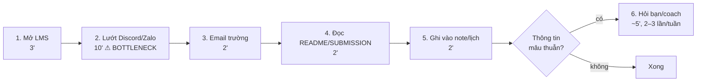
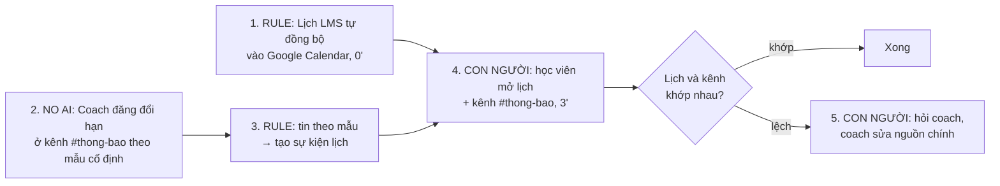

# Báo cáo nhóm — Day 02 Discovery & Problem Framing

> Bản chung của nhóm NhomCold.
>
> ⚠️ **Trước khi nộp:** (1) các dòng pitch của thành viên khác do chính họ điền; (2) mục 3.2 chỉ điền dữ liệu từ người thật đã hỏi — bịa phỏng vấn/survey thì C7 = 0 cả nhóm; (3) thay mọi `[ĐO THẬT]` / `___` bằng số thật. Xóa khối ghi chú này khi xong.

## 1. Thông tin nhóm

- Tên nhóm: NhomCold
- Thành viên: xem `TEAM.md`
- Candidate problem được chọn (1 câu): Học viên K5 mất ~20 phút mỗi ngày lướt LMS, Discord/Zalo, email và README để biết chắc còn bài nào phải nộp và hạn lúc nào, vì thông báo đổi hạn/đổi yêu cầu nằm rải rác và trôi trong chat.
- Quyết định cuối: **Go — phạm vi No AI + Rule** (bước AI đọc chat: Not Yet)

---

## 2. Hội tụ nhóm (CP3)

Nhóm 4 người, 12 candidate. Hội tụ theo trình tự: pitch top 3 → gom cluster → cây OST → chấm điểm shortlist và chọn một candidate.

### 2.1. Candidate và câu hỏi chuẩn bị pitch

Các câu hỏi dưới đây phục vụ buổi pitch; câu hỏi thực tế và người hỏi được ghi vào nhật ký phản biện của từng thành viên.

| # | Người có card | Candidate | Actor | Bottleneck | Câu hỏi chuẩn bị phản biện |
|---:|---|---|---|---|---|
| 1 | Vũ Lương Duy | Chép đơn từ inbox | Chủ shop | Chép trường thông tin sang bảng quản lý | Khách tự điền mẫu xác nhận đơn có giảm được thao tác chép lại không? |
| 2 | Vũ Lương Duy | Tồn kho lệch giữa các kênh | Chủ shop | Cập nhật kho thủ công | Kho lệch do cập nhật chậm hay do số tồn ban đầu sai? |
| 3 | Vũ Lương Duy | Đăng sản phẩm nhiều kênh | Chủ shop | Viết và điều chỉnh mô tả | Bước mất thời gian nhất là viết mô tả hay nhập thuộc tính từng kênh? |
| 4 | Nguyễn Thảo Quyên | Xác định hư hỏng xe | Giám định viên | Đối chiếu hư hỏng, phụ tùng và giá | Bước nghẽn chính là xác định hư hỏng, tra phụ tùng hay tra giá? Ảnh có đủ căn cứ để lập dự toán không? |
| 5 | Nguyễn Thảo Quyên | Tìm đúng phụ tùng | Nhân viên phụ tùng | Đối chiếu mã và tính tương thích | Đã có mã phụ tùng và thông tin dòng xe thì bộ lọc danh mục có đủ không? |
| 6 | Nguyễn Thảo Quyên | Kiểm tra bài tập | Giảng viên | Đọc bài và đối chiếu rubric | Rubric và đáp án có đủ rõ để hai người chấm nhất quán không? |
| 7 | Hồ Nguyễn Minh Sang | Tổng hợp ghi chú họp | Thành viên nhóm | Gom ghi chú theo chủ đề | Nếu ghi trực tiếp theo mẫu ngay trong họp, bước gom ghi chú còn tốn thời gian không? |
| 8 | Hồ Nguyễn Minh Sang | Chốt sổ thu chi nhà trọ hằng tháng | Chủ nhà trọ, người quản lý | Đối chiếu thanh toán và công nợ theo phòng/kỳ | Công thức bảng tính đã xử lý được bao nhiêu phần việc? Chênh lệch chủ yếu ở chỉ số hay thanh toán? |
| 9 | Hồ Nguyễn Minh Sang | Hiểu khái niệm khó khi research | Người học, dev | Tra thuật ngữ và tìm cách giải thích phù hợp kiến thức nền | Sau khi đọc lời giải thích, làm thế nào kiểm tra người học hiểu đúng và áp dụng được? |
| 10 | Mai Danh Hiếu | Tổng hợp tiến độ nhóm | Người điều phối | Đọc cập nhật và hỏi lại | Nhóm thiếu cập nhật hay có cập nhật nhưng cách diễn đạt khó tổng hợp? |
| 11 | Mai Danh Hiếu | Phân công phù hợp khả năng | Nhóm trưởng | Cân đối tải và chuyển đầu việc | Chênh lệch tải do số việc, độ khó hay thời gian rảnh của từng người? |
| 12 | Mai Danh Hiếu | Bàn giao việc phụ thuộc | Người nhận bàn giao | Đợi và yêu cầu bổ sung đầu vào | Phần việc bị chặn vì giao trễ hay vì đầu ra bàn giao thiếu thông tin? |

### 2.2. Cluster

| Cluster | Candidate | Pattern chung |
|---|---|---|
| A — Tổng hợp và diễn giải thông tin | #1, #7, #9, #10 | Chuyển thông tin rời rạc hoặc khó hiểu thành nội dung có cấu trúc để sử dụng |
| B — Đối chiếu số liệu và giao dịch | #2, #8 | Đối chiếu lượng tồn, khoản thanh toán hoặc công nợ để xác định trạng thái đúng |
| C — Đánh giá và đối chiếu chuyên môn | #4, #5, #6 | Xác định bộ phận, mã tương thích hoặc mức độ đáp ứng tiêu chí dựa trên căn cứ chuyên môn |
| D — Phối hợp và xuất bản | #3, #11, #12 | Phụ thuộc đầu vào, tải công việc hoặc nhiều nơi nhận |

### 2.3. Opportunity Solution Tree rút gọn

```text
OUTCOME: Rút ngắn thời gian lập dự toán sửa chữa ban đầu trên mỗi hồ sơ bồi thường ô tô,
         đồng thời không tăng số hạng mục bỏ sót và sai lệch chi phí so với giám định
├── Opportunity: Khó xác định đầy đủ bộ phận hư hỏng từ ảnh và thông tin xe
├── Opportunity: Tốn công đối chiếu phụ tùng tương thích và phương án sửa/thay
├── Opportunity: Phải tra cứu giá phụ tùng và công sửa chữa từ nhiều nguồn
└── Opportunity: Khó đối chiếu căn cứ của từng hạng mục trong dự toán
     ✗ "Nhận diện hư hỏng bằng Computer Vision"       ← đây là SOLUTION, gạch bỏ khỏi tầng này
     ✗ "Hệ thống tự tra phụ tùng và đề xuất chi phí"  ← đây là SOLUTION, gạch bỏ khỏi tầng này
     ✗ "Agent tự xử lý hồ sơ"                        ← đây là SOLUTION, gạch bỏ khỏi tầng này
```

### 2.4. Chấm điểm shortlist (1–5)

Bảng điểm đề xuất trên thang 1–5, dùng để đối chiếu ba candidate theo cùng tiêu chí. Điểm bằng chứng phản ánh mức độ dữ liệu hiện có; điểm tổng không thay thế việc xem xét phạm vi và khả năng kiểm chứng.

| Candidate | Actor rõ | Quy trình rõ | Pain có bằng chứng | Impact đo được | Vừa sức lab | So sánh được 4 mức | Nhóm hiểu domain | Tổng |
|---|---:|---:|---:|---:|---:|---:|---:|---:|
| Xác định hư hỏng và ước lượng chi phí sửa chữa | 5 | 5 | 2 | 5 | 3 | 5 | 3 | **28** |
| Tra cứu và xác định phụ tùng ô tô | 5 | 5 | 2 | 4 | 4 | 4 | 3 | 27 |
| Chốt sổ thu chi nhà trọ hằng tháng | 5 | 5 | 1 | 5 | 5 | 2 | 3 | 26 |

**Chọn:** Xác định hư hỏng và ước lượng chi phí sửa chữa — Problem Card #1 của Nguyễn Thảo Quyên, tương ứng candidate #4 trong bảng tổng hợp.

**Job Story:** Khi tiếp nhận yêu cầu bồi thường kèm hình ảnh xe bị tai nạn, tôi muốn xác định các bộ phận bị hư hỏng và ước lượng chi phí sửa chữa, để có cơ sở đánh giá mức bồi thường và tư vấn cho khách hàng.

**Vì sao chọn:** Quy trình rõ, đo được thời gian lập dự toán, hạng mục bỏ sót và sai lệch chi phí; có cơ sở so sánh checklist, Rule, Workflow và Agent. Phạm vi lab chỉ gồm dự toán ban đầu để người giám định kiểm tra. Điểm bằng chứng thấp vì số phút trong card là ước lượng; điểm vừa sức lab thấp hơn hai bài còn lại do cần hồ sơ và dữ liệu giá.

**Vì sao loại hai candidate kia:** Tra cứu phụ tùng hẹp hơn và đã là một bước trong bài toán được chọn, nên giữ làm phần phân tích sâu. Sổ nhà trọ có quy trình rõ và vẫn là candidate hợp lệ dù chỉ cần bảng tính hoặc Rule. Vòng này nhóm tập trung vào chuỗi xác định hư hỏng, tra phụ tùng và lập dự toán; bài toán nhà trọ được giữ cho vòng phân tích khác. Cả ba chỉ đạt 3 điểm hiểu domain vì cần người trực tiếp làm nghiệp vụ đối chiếu.

**Nguyên tắc xử lý bất đồng:** Đối chiếu actor, dữ liệu tiếp cận được và cách đo tác động; nếu hai candidate có điểm gần nhau, ưu tiên phạm vi kiểm chứng được trong buổi lab. Giữ các candidate còn lại cho vòng phân tích tiếp theo.


## 3. Kiểm chứng + research giải pháp đã có (CP4)

### 3.1. Assumption Map

| # | Giả định | Loại | Quan trọng (1–5) | Đã có bằng chứng (1–5) | Kiểm chứng trước? |
|---:|---|---|---:|---:|---|
| 1 | Học viên khác cũng mất ≥ 10 phút/ngày để kiểm tra deadline | Value | 5 | 2 | ✅ |
| 2 | Có thông báo đổi hạn/yêu cầu **chỉ** xuất hiện trong chat, không có trên LMS | Value | 5 | 1 | ✅ |
| 3 | Đã từng có học viên nộp trễ/sót vì không biết hạn đúng | Value | 4 | 2 | ✅ |
| 4 | LMS của khóa cho phép export/đăng ký lịch (iCal) | Feasibility | 4 | 2 | ✅ (research) |
| 5 | Coach sẵn sàng đăng thông báo theo mẫu cố định ở 1 kênh | Viability | 4 | 1 | ✅ (hỏi coach) |
| 6 | Học viên chịu mở Google Calendar thay vì hỏi bạn | Usability | 3 | 2 | — |

Giả định nhóm kiểm chứng trong buổi này: #2 (có deadline chỉ nằm trong chat không) — nếu sai, chỉ cần đăng ký lịch LMS là xong, không cần gì thêm.

### 3.2. Kiểm chứng

Cách đã dùng: Phỏng vấn `[2–3 bạn học nhóm khác]` + đếm log Discord lớp `[+ survey nếu có]`. Câu hỏi theo The Mom Test: [cp4-interview-guide.md](../assets/cp4-interview-guide.md).

Interview snapshot #1 (thêm bảng cho mỗi người):

| Trường | Nội dung |
|---|---|
| Người được hỏi (vai trò, không ghi tên thật) | `[ví dụ: học viên L3B, nhóm khác, đi làm full-time]` |
| Câu nói đáng nhớ nhất (nguyên văn) | `[nguyên văn]` |
| Lần gần nhất gặp vấn đề này: chuyện gì đã xảy ra? | |
| Hiện đang xử lý bằng cách nào (workaround)? | |
| Mất bao lâu, bao lần? | |
| Insight / opportunity rút ra | |

Đếm log (bằng chứng hành vi, không phải ý kiến):

| Chỉ số | Cách đếm | Kết quả |
|---|---|---|
| Số thông báo về hạn/cách nộp trong 2 tuần | Tìm trên Discord lớp các từ "deadline", "hạn", "gia hạn", "nộp" | ___ |
| Trong đó, số thông báo **không** có trên LMS | Đối chiếu từng cái với LMS | ___ |
| Số câu hỏi lại của học viên về hạn/cách nộp | Đếm các tin hỏi trùng | ___ |

Tổng hợp:

| Nguồn | Số người / số mẫu | Tín hiệu xác nhận | Tín hiệu phản bác |
|---|---:|---|---|
| Phỏng vấn | ___ | | `[bắt buộc ghi ít nhất 1 tín hiệu phản bác, ví dụ: "mình chỉ xem LMS là đủ"]` |
| Log Discord | ___ tin | | |

**Nhóm đã sửa problem thế nào sau kiểm chứng:** `[điền theo kết quả thật. Ví dụ hướng: nếu đa số deadline đã có trên LMS → thu hẹp problem thành "thông báo ĐỔI hạn/yêu cầu trong chat không được cập nhật vào nguồn chính"]`

### 3.3. Research giải pháp đã có

*(Mọi link dưới đây đã được mở và kiểm nội dung ngày 09/11/2026.)*

| Công cụ / case / pattern | Link | Giải bước nào trong quy trình? | Điểm mạnh | Khoảng trống / rủi ro | Bài học cho nhóm |
|---|---|---|---|---|---|
| Moodle — Calendar export (đăng ký lịch LMS vào Google Calendar/Outlook qua URL) | https://docs.moodle.org/en/Calendar_export | Bước 1 + 5: deadline chính thức tự vào lịch cá nhân | Không cần AI, có sẵn, tự đồng bộ khi đăng ký bằng URL | Docs ghi Google Calendar có thể mất "vài giờ" mới cập nhật; không bắt được thông báo chỉ có trong chat; cần kiểm LMS của khóa có bật tính năng này | **Rule có sẵn đã giải phần lớn deadline chính thức** — không nên tự xây |
| Todoist — Quick Add (nhận diện ngày giờ từ ngôn ngữ tự nhiên) | https://www.todoist.com/help/articles/use-task-quick-add-in-todoist-va4Lhpzz | Bước 5: ghi deadline nhanh bằng câu tự nhiên ("tomorrow at 4 PM") | Giảm thời gian ghi chép thủ công | Người dùng vẫn phải tự đọc chat và tự gõ; không biết tin nào là thông báo | Phần "ghi" không phải bottleneck; bottleneck là "tìm" |
| Google Calendar — sự kiện tự tạo từ Gmail | https://support.google.com/calendar/answer/6084018 | Pattern: trích sự kiện từ văn bản tự do thành lịch | Chứng minh pattern "trích sự kiện từ tin nhắn" đã có ở quy mô lớn | Chỉ hỗ trợ vé, đặt chỗ, xác nhận đăng ký — **không** áp dụng cho thông báo khóa học; mặc định tắt ở một số khu vực | Trích sự kiện tự động chỉ tin được khi định dạng ổn định → gợi ý chuẩn hóa mẫu thông báo trước |

---

## 4. Quy trình trước/sau (CP5)

### 4.1. Quy trình hiện tại



| Bước | Actor | Input | Output | Thời gian / tần suất | Ghi chú |
|---:|---|---|---|---|---|
| 1 | Học viên | Trang khóa học trên LMS | Danh sách bài + hạn chính thức | 3'/ngày `[ĐO THẬT]` | |
| 2 | Học viên | Kênh Discord/Zalo lớp và nhóm | Thông báo đổi hạn/yêu cầu (nếu thấy) | 10'/ngày `[ĐO THẬT]` | **Bottleneck**: thông báo bị trôi giữa tin trao đổi |
| 3 | Học viên | Hộp thư trường | Thông báo chính thức (nếu có) | 2'/ngày | |
| 4 | Học viên | README/SUBMISSION repo lab | Giờ hạn cụ thể theo ca | 2'/lab | Ca sáng/chiều khác giờ hạn |
| 5 | Học viên | Kết quả bước 1–4 | Ghi chú/lịch cá nhân | 2'/ngày | |
| 6 | Học viên, coach | Thông tin mâu thuẫn | Câu trả lời xác nhận | ~5'/lần, 2–3 lần/tuần | Tốn cả thời gian coach |

**Bottleneck chính:** Bước 2 — tìm lại thông báo đổi hạn/đổi yêu cầu trong luồng chat, vì không có kênh chính thức duy nhất và thông báo không theo mẫu.

### 4.2. Quy trình tương lai



- **No AI:** quy ước 1 kênh thông báo một chiều (chỉ coach đăng), mẫu tin cố định: `[DEADLINE] <tên lab> | <ca> | <hạn mới dd/mm hh:mm> | <link>`.
- **Rule:** đăng ký lịch LMS bằng URL; script/bot đơn giản chuyển tin đúng mẫu thành sự kiện lịch (không cần hiểu ngôn ngữ).
- **AI (chưa làm — Not Yet):** chỉ cân nhắc nếu kiểm chứng cho thấy nhiều thông báo vẫn đăng tự do ngoài mẫu.
- **Bước con người kiểm tra:** học viên đối chiếu lịch với kênh #thong-bao; coach là người duy nhất được sửa nguồn chính.
- **Boundary:** không công cụ nào tự suy luận hạn từ tin trao đổi của học viên; hạn chính thức chỉ đến từ LMS hoặc tin của coach đúng mẫu; khi lịch và thông báo lệch nhau, tin của coach/LMS thắng.
- **Phương án quay về:** nếu đồng bộ lịch lỗi hoặc chậm (docs Moodle nói Google Calendar có thể trễ vài giờ), học viên quay về kiểm tra trực tiếp LMS + kênh #thong-bao (~5'/ngày) — vẫn nhanh hơn hiện tại vì chỉ còn 1 kênh chat cần đọc.

### 4.3. Before / after

| Chỉ số | Trước | Sau (kỳ vọng) | Ghi chú |
|---|---:|---:|---|
| Số bước | 6 | 3 bước học viên làm (1 bước tùy chọn) | Bước 1, 3 tự động |
| Tổng thời gian | ~20'/ngày `[ĐO THẬT]` | ≤ 5'/ngày | Đo bằng tự bấm giờ 5 ngày |
| Số bước thủ công | 6/6 | 1–2/5 | |
| Bottleneck chính | Lướt chat tìm thông báo | Đối chiếu lịch với kênh #thong-bao | Từ "tìm" sang "kiểm" |
| Rủi ro mới phát sinh | — | Lịch trễ đồng bộ; coach quên đăng theo mẫu; học viên tin lịch tuyệt đối | Xử lý bằng boundary + phương án quay về |

---

## 5. Problem Statement v0 (CP5)

| Trường | Nội dung |
|---|---|
| **Actor** | Học viên K5 học song song nhiều lab mỗi tuần |
| **Quy trình** | Mỗi tối: xem LMS → lướt Discord/Zalo → email → README/SUBMISSION → ghi lịch cá nhân → hỏi lại khi mâu thuẫn |
| **Bottleneck** | Tìm lại thông báo đổi hạn/đổi yêu cầu trong chat (~10'/ngày) vì không có nguồn chính thức duy nhất |
| **Impact** | ~20 phút/ngày/học viên `[ĐO THẬT]`; ___ câu hỏi trùng về hạn/tuần trên kênh lớp; rủi ro nộp trễ = không được chấm |
| **Success Metric** (baseline → target, cách đo) | Thời gian kiểm tra deadline: ~20 → ≤ 5 phút/ngày (tự bấm giờ, 4 học viên × 5 ngày) |
| **Boundary** (AI không được làm gì; khi nào cần con người kiểm tra — HITL) | Không công cụ nào tự đặt/sửa hạn chính thức; chỉ coach và LMS là nguồn đúng; khi lịch cá nhân lệch với thông báo của coach → học viên phải hỏi coach |

Phản biện nhận được (từ AI hoặc nhóm khác) và nhóm có đồng ý không:

- AI (prompt: "chỉ ra lỗ hổng, không viết lại"): metric chỉ đo thời gian; nếu học viên kiểm nhanh hơn nhưng vẫn sót hạn thì vô nghĩa → **Đồng ý**, thêm metric "số bài trễ/sót" ở v1.
- AI: chưa rõ ai vận hành kênh #thong-bao → **Đồng ý**, thêm vào Viability và người kiểm tra ở v1.
- `[thêm phản biện từ nhóm khác nếu có]`

---

## 6. Mức can thiệp AI (CP6)

### 6.1. Ma trận độ mơ hồ × độ phức tạp

Bài của nhóm nằm ở ô: **độ mơ hồ thấp × độ phức tạp thấp** (sau khi chuẩn hóa nguồn).

Vì sao: mỗi deadline có đáp án đúng/sai rõ (một ngày giờ cụ thể) → độ mơ hồ thấp. Chỉ có 2 nguồn chính thức sau khi sửa quy trình (LMS + kênh coach), các bước không phụ thuộc phức tạp → độ phức tạp thấp. Ô này theo worksheet: "Rule hoặc Workflow đơn giản thường đủ". Độ mơ hồ chỉ cao nếu phải đọc tin nhắn tự do — chính là phần nhóm loại bỏ bằng mẫu thông báo cố định.

### 6.2. So sánh 4 mức

| Mức | Phương án cho bài của nhóm | Đủ khi nào | Rủi ro | Chọn? |
|---|---|---|---|---|
| **No AI** (sửa quy trình) | Kênh #thong-bao một chiều, mẫu tin cố định, ghim "nguồn chính thức = LMS + kênh này" | Coach tuân thủ mẫu | Phụ thuộc kỷ luật của coach | **Chọn** (nền) |
| **Rule** | Đăng ký lịch LMS bằng URL + script chuyển tin đúng mẫu thành sự kiện lịch | Thông báo có định dạng cố định | Đồng bộ chậm vài giờ; tin sai mẫu bị bỏ qua | **Chọn** |
| **Workflow** | AI đọc tin chat tự do → trích (lab, hạn) → học viên/coach duyệt → thêm vào lịch | Nhiều thông báo vẫn đăng tự do, không chuẩn hóa được | Hiểu nhầm tin bàn luận ("chắc sẽ gia hạn?") thành deadline thật; tốn chi phí | Không (Not Yet) |
| **Agent** | AI tự theo dõi mọi kênh, tự quyết thêm/sửa lịch, tự nhắc | Gần như không bao giờ cần cho bài này | Tự sửa hạn sai mà không ai biết; quyền đọc mọi kênh | Không |

**Mức chọn:** No AI + Rule.

**Vì sao không chọn mức cao hơn (Workflow/Agent):** Deadline là dữ liệu có đáp án đúng duy nhất; research cho thấy LMS đã xuất lịch được (Rule có sẵn), và phần còn lại (thông báo trong chat) giải được bằng quy ước mẫu tin thay vì để AI đoán. Thêm AI chỉ thêm một kiểu lỗi mới — báo nhầm hạn — trong khi Rule đã phủ phần lớn trường hợp `[kiểm bằng tỉ lệ ở 3.2: % thông báo chỉ có trong chat]`.

**Vì sao không chỉ No AI:** nếu không có Rule đồng bộ lịch, học viên vẫn phải mở LMS thủ công mỗi ngày; Rule làm bước đó tự động mà không thêm rủi ro.

### 6.3. AI Canvas rút gọn / vì sao không cần AI

Nhóm chọn No AI + Rule nên không cần AI Canvas (worksheet CP6). Lý do bài toán không cần AI dự đoán hay tạo nội dung:

1. Đầu ra có đúng/sai rõ (một ngày giờ), không cần "tạo" nội dung.
2. Nguồn sự thật đã tồn tại (LMS, coach) — vấn đề là phân tán, không phải thiếu suy luận.
3. Chuẩn hóa mẫu thông báo rẻ hơn và đáng tin hơn việc để AI hiểu tin tự do.

*(Tham khảo, cho bước Workflow nếu sau này cần: Prediction = trích (lab, hạn) từ tin chat; Judgment = coach xác nhận; Action = thêm vào lịch; Outcome = số hạn sai trong lịch; Input = tin nhắn kênh lớp — cần quyền đọc; Feedback = các lần coach sửa/từ chối.)*

### 6.4. Hai câu hỏi của Google PAIR

Không bắt buộc với mức No AI/Rule. Ghi chú để giải thích boundary: nếu sau này có bước AI, **báo nhầm** (thêm hạn sai, nhất là hạn muộn hơn thực tế) tệ hơn **bỏ sót**, vì học viên tin lịch rồi nộp trễ — bài không được chấm. Bỏ sót vẫn còn lưới an toàn là kênh #thong-bao.

---

## 7. Problem Statement v1 + tiêu chí đánh giá (CP6)

| Trường | Nội dung |
|---|---|
| **Actor** | Học viên K5 học song song nhiều lab mỗi tuần; coach là người phát thông báo |
| **Quy trình** | Lịch LMS tự đồng bộ vào lịch cá nhân; coach đăng mọi thay đổi hạn/yêu cầu ở 1 kênh theo mẫu; học viên chỉ kiểm lịch + 1 kênh mỗi ngày |
| **Bottleneck** | Thông báo đổi hạn/yêu cầu nằm rải rác và không theo mẫu trong chat, nên học viên phải lướt lại nhiều kênh (~10'/ngày) |
| **Impact** | ~20 phút/ngày/học viên `[ĐO THẬT]`; ___ câu hỏi trùng/tuần cho coach; rủi ro nộp trễ = không được chấm |
| **Success Metric** (baseline → target, cách đo) | (1) Thời gian kiểm deadline: ~20 → ≤ 5 phút/ngày — tự bấm giờ, 4 học viên × 5 ngày; (2) Số bài trễ/sót do không biết hạn: ___ → 0 trong 2 tuần — đối chiếu lịch sử nộp; (3) Câu hỏi trùng về hạn trên kênh lớp: ___ → giảm ≥ 50% — đếm log Discord |
| **Boundary** | Không công cụ nào tự đặt/sửa hạn chính thức; chỉ LMS và tin đúng mẫu của coach là nguồn; tin sai mẫu bị bỏ qua chứ không đoán; khi lịch lệch thông báo → hỏi coach (HITL) |
| **AI intervention point** | **Không có** — deadline có đáp án đúng duy nhất và nguồn chính thức đã tồn tại; chuẩn hóa mẫu tin rẻ và đáng tin hơn để AI đọc chat tự do |
| **Mức chọn** | No AI + Rule |
| **Rủi ro & người kiểm tra** | Đồng bộ lịch chậm vài giờ; coach quên dùng mẫu → học viên kiểm kênh #thong-bao hằng ngày; coach (người vận hành kênh) kiểm tra mẫu tin; nhóm trưởng mỗi nhóm báo lệch cho coach |

**Thay đổi so với v0 và lý do:**

| Trường | v0 | v1 | Vì sao đổi |
|---|---|---|---|
| Success Metric | Chỉ đo thời gian | Thêm số bài trễ/sót và số câu hỏi trùng | AI phản biện: nhanh hơn mà vẫn sót hạn thì vô nghĩa |
| Actor | Chỉ học viên | Thêm coach là người phát thông báo | Giải pháp No AI phụ thuộc coach dùng mẫu → coach là một phần quy trình |
| Boundary | "Không tự sửa hạn" | Thêm "tin sai mẫu bị bỏ qua, không đoán" | Chặn lối tắt dùng AI đoán hạn từ tin tự do |
| AI intervention point | (chưa có) | Không có, kèm lý do | Kết quả so sánh 4 mức ở CP6 |

**Tiêu chí đánh giá cho giải pháp No AI + Rule (3–5 tiêu chí):**

| # | Tiêu chí | Đạt khi | Không đạt khi |
|---:|---|---|---|
| 1 | Đầy đủ | Mọi bài có hạn trên LMS đều xuất hiện trong lịch cá nhân | Thiếu ≥ 1 bài trong lịch |
| 2 | Chính xác | Ngày giờ trong lịch khớp LMS/thông báo coach, đúng múi giờ GMT+7 và đúng ca (sáng 23h59 / chiều-tối 11h59 hôm sau) | Lệch giờ, sai múi giờ, sai ca |
| 3 | Kịp thời | Thông báo đổi hạn có trong kênh #thong-bao ≥ 24h trước hạn cũ | Đổi hạn chỉ nói miệng hoặc trong tin trao đổi |
| 4 | Đúng mẫu | ≥ 90% tin trên #thong-bao đúng mẫu cố định | Tin tự do, script không đọc được |
| 5 | Nhanh | Học viên kiểm xong trong ≤ 5 phút/ngày | > 5 phút hoặc vẫn phải hỏi lại |

---

## 8. Quyết định (CP6)

### 8.1. Bốn rủi ro

| Rủi ro | Câu hỏi | Mức độ rủi ro | Lý do / bằng chứng |
|---|---|---|---|
| **Value** | Người dùng có thật sự cần và sẽ dùng không? | TB `[cập nhật theo 3.2]` | Nhóm tự gặp; ___/___ người được phỏng vấn kể lần trễ/suýt trễ cụ thể. Chưa rõ tỉ lệ thông báo chỉ có trong chat |
| **Usability** | Người dùng có dùng được không? | Thấp | Đăng ký lịch bằng URL là thao tác 1 lần; đọc 1 kênh dễ hơn đọc nhiều kênh |
| **Feasibility** | Có đủ dữ liệu, công cụ, kỹ năng không? | TB | Moodle hỗ trợ export lịch (đã kiểm docs), nhưng **chưa kiểm LMS của khóa có bật không**; Google Calendar có thể trễ vài giờ |
| **Viability** | Có hợp chi phí, quy định không? Ai vận hành? | TB | Chi phí ≈ 0; nhưng cần coach đồng ý dùng kênh một chiều + mẫu tin — chưa hỏi |

### 8.2. Kết luận

**Quyết định:** **Go — phạm vi No AI + Rule** (riêng bước AI đọc chat: **Not Yet**).

**Lý do:** Không rủi ro nào ở mức Cao; giải pháp gần như không tốn chi phí và có thể đảo ngược ngay. AI không được chọn vì deadline có đáp án đúng duy nhất và Rule đã có sẵn.

**Nếu Go — pilot nhỏ nhất:** 4 thành viên NhomCold trong 2 tuần: (1) đăng ký lịch LMS vào Google Calendar; (2) đề xuất coach dùng mẫu `[DEADLINE] <lab> | <ca> | <hạn> | <link>` trên 1 kênh; (3) mỗi người bấm giờ kiểm deadline mỗi tối và ghi vào bảng chung.

**Nếu Not Yet — cần kiểm chứng gì trước (cho bước AI):** đếm trong 2 tuần pilot bao nhiêu thông báo đổi hạn vẫn đăng tự do ngoài mẫu. Chỉ khi > 30% thông báo không theo mẫu **và** coach không thể chuẩn hóa thì mới xem xét Workflow có người duyệt.

**Ngưỡng dừng:**

- Nếu sau 2 tuần thời gian kiểm deadline trung bình vẫn > 10 phút/ngày → quay về phỏng vấn lại, bottleneck có thể không nằm ở chat.
- Nếu LMS của khóa không export được lịch → bỏ Rule đồng bộ, chỉ giữ No AI (kênh #thong-bao + checklist).
- Nếu coach không đồng ý mẫu tin, hoặc < 70% tin đúng mẫu sau 1 tuần → dừng script, quay về đọc kênh #thong-bao thủ công.
- Nếu có ≥ 1 bài nộp trễ do lịch sai → dừng tin lịch, quay về đối chiếu trực tiếp LMS.

**Bước tiếp theo:** (1) kiểm ngay LMS khóa có nút export lịch không; (2) gửi đề xuất mẫu tin cho coach; (3) bắt đầu bấm giờ baseline thật 3 ngày trước pilot.

---

## 9. Hạn chế và hướng tiếp theo

- Baseline thời gian hiện là ước lượng của nhóm, cần thay bằng số bấm giờ thật.
- Mẫu phỏng vấn nhỏ và đều là học viên cùng khóa — chưa đại diện cho học viên đi làm full-time hay khóa khác.
- Chưa phỏng vấn coach — người quyết định Viability của giải pháp No AI.
- Chưa xác minh LMS của khóa là Moodle hay nền tảng khác; nếu khác, cần tìm tính năng export lịch tương đương.

## 10. Tài liệu tham khảo

- Moodle Docs — Calendar export: https://docs.moodle.org/en/Calendar_export
- Todoist Help — Use Task Quick Add: https://www.todoist.com/help/articles/use-task-quick-add-in-todoist-va4Lhpzz
- Google Calendar Help — Events from Gmail: https://support.google.com/calendar/answer/6084018
- Rob Fitzpatrick — *The Mom Test*; Teresa Torres — Opportunity Solution Tree; Anthropic — *Building Effective Agents*; Marty Cagan — 4 rủi ro (xem [docs/03-international-frameworks.md](../../docs/03-international-frameworks.md))
